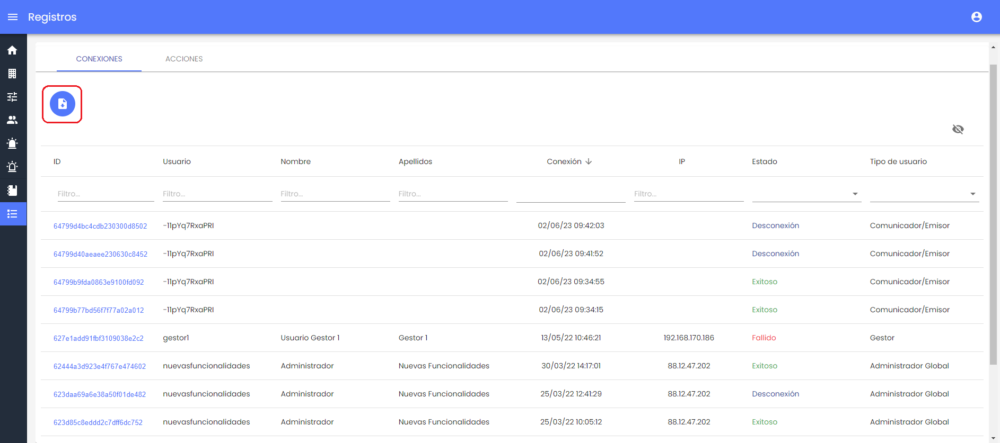

# v3.9 (Junio 2023)

**Funcionalidades y mejoras incluidas:**

- Descarga de **registros de conexiones**:  En esta versión se ha incorporado la posibilidad de exportar en un archivo CSV los logs de conexiones correctos o incorrectos de usuarios del Canal. 

* En el apartado de [Registros > Conexiones](https://help.globalsuite.es/pages/viewpage.action?pageId=28737666) se incluirá un botón de descarga donde generar todos los registros de acceso a la herramienta.
* Este archivo incluirá las columnas que se hayan dejado como visibles en el listado, y en caso de aplicar filtros, los que coincidan con ese filtro aplicado.
* En próximas versiones incluiremos la exportación de logs de acciones del sistema.

 - Ajuste de comportamiento en la **anonimización** de denuncias: A partir de esta versión, aunque se realice la anonimización de una comunicación, el comunicador o denunciante seguirá teniendo acceso para hacer seguimiento del caso, o aportar más información.

* En caso de que el denunciante hubiera informado de sus datos personales, incluyendo su dirección de correo electrónico, dejará de recibir notificaciones por este medio, ya que esos datos quedarán anonimizados.

- Mejoras internas y resolución de errores.
