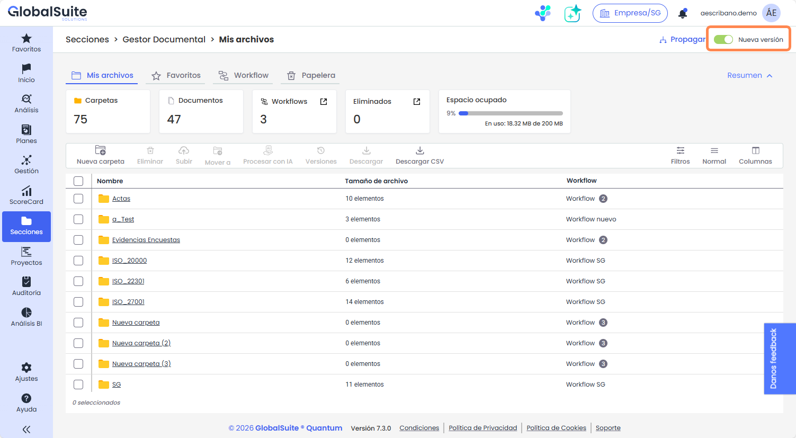
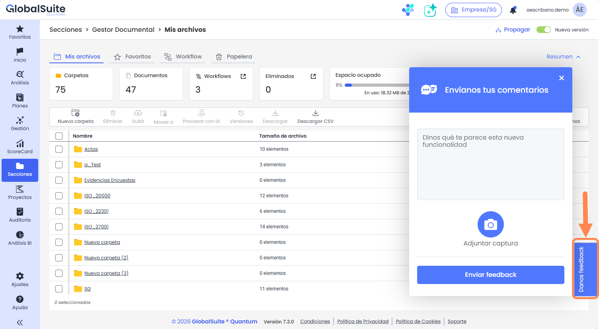

# Quantum 7.3 (Abril 2026)

## Primeras funcionalidades adaptadas en nueva Interfaz: evolución de GlobalSuite Quantum


Como ya avanzamos hace unos meses, desde GlobalSuite Solutions queremos apostar por un avance importante en la evolución de la solución, enmarcado en [\*\*GlobalSuite Quantum\*\*](https://www.globalsuitesolutions.com/es/quantum/).
En esta versión lanzamos el primer paquete de opciones funcionales en las que se han rediseñado e implementado desde el inicio renovando por completo la funcionalidad, tecnología y el diseño visual de forma integral para ofrecer una experiencia más moderna, clara y coherente, además de incorporar diversas mejoras y nuevas capacidades.
Estas opciones son \*\*Gestor Documental, Compliance e Inventario\*\*.


#### Características principales

Dentro de las capacidades concretas incorporadas en cada apartado, hay una serie de mejoras incluidas de manera general, como son:

* **Filtros avanzados**  
  Se han incorporado la posibilidad de realizar filtrados y búsquedas de registros por distintos campos, responsable, rangos de fecha, o coincidencia con varios campos, para facilitar el localizar los resultados deseados.
* **Aprovechamiento del espacio**  
  Se ha reestructurado la interfaz para mejorar la distribución de la información, tener siempre visible la información actual y permitir trabajar de manera cómoda en distintos tamaños de pantalla.
* **Automatización y eficiencia**  
  Se ha mejorado las acciones disponibles y la ubicación de botones, incorporando menús contextuales para facilitar el uso, y se ha incluido la posibilidad de realizar acciones en bloque (asociación, borrado, etc.) sobre múltiples registros a una vez cuando sea viable.
* **Mejoras de rendimiento**  
  Se ha mejorado a nivel tecnológico, ampliando la robustez de la solución, lo que permite trabajar de forma rápida y directa aunque se cuente con volúmenes de información muy elevados.

A continuación, mostramos las características principales de las opciones mejoradas.

### Gestor Documental

En esta opción de [Gestor Documental](https://globalsuitesolutions.atlassian.net/wiki/spaces/GlobalSUITEes/pages/266864205/Gestor+Documental) se han incluido varias mejoras que incluyen:

* **Etiquetado de documentos**, pudiendo aplicar varias etiquetas a archivos y carpetas para clasificarlos
* Nueva funcionalidad de **Favoritos** para tener acceso directo a los documentos y carpetas más utilizados
* Nueva **Papelera** donde permanecen los documentos y carpetas eliminados durante 30 días, pudiendo restaurarse a su ubicación
* **Editor Word** embebido para poder modificar los documentos docx de manera online y manteniendo la trazabilidad.

### Inventario

De manera concreta, en la opción de [Inventario](https://globalsuitesolutions.atlassian.net/wiki/spaces/GlobalSUITEes/pages/266864248/Inventario), se ha incorporado:

* Asociar varios elementos al árbol de dependencias en bloque.
* Adjuntar varios documentos a un elemento (hasta un máximo de 10).
* **Dimensiones multinivel** en la [Metodología de Elementos](https://globalsuitesolutions.atlassian.net/wiki/spaces/GlobalSUITEes/pages/266864054/Metodolog+a+Elementos), permitiendo asignar varias opciones en una dimensión, e incluso utilizándose en la metodología de cálculo de dimensiones automáticas, en cuyo caso toma el mayor nivel asignado.

  * Este nuevo tipo de dimensiones manuales de selección múltiple también están disponibles en el resto de apartados que utilizan esta metodología de elementos, como son Catálogo de Servicios, Procesos, Tratamientos, Proveedores, y las encuestas ERC (elementos, riesgos y controles)
  * También se han tenido en cuenta para la importación masiva a partir de archivos Excel

### Compliance

En el apartado de [Compliance](https://globalsuitesolutions.atlassian.net/wiki/spaces/GlobalSUITEes/pages/266864089/Compliance), se añaden varias capacidades y mejoras:

* Visualizaciones avanzadas, para poder ver al mismo nivel todos los requisitos finales aplicables de la normativa
* Navegación detallada, se simplifica el acceso a los campos personalizados de cada evaluación
* Asignación en bloque de documentos, tickets o controles comunes a varios requisitos a la vez
* Posibilidad de tener **varias evaluaciones activas** de una misma normativa o catálogo
* Nuevo **Asistente de IA para identificar qué requisitos aplican** de una normativa en base al contexto de la compañía

#### Volver a vista anterior

Aunque confiamos que estas opciones de GlobalSuite® que hemos rediseñado y reestructurado, así como los cambios y nuevas funcionalidades que hemos incorporado sean interesantes y permitan mejorar la experiencia de uso, en caso de que sea necesario, cada usuario puede elegir qué versión de la interfaz utiliza, alternando en el selector que está disponible en la parte superior derecha del menú.

Esta posibilidad estará disponible durante varias semanas para facilitar la transición y permitir mantener la operativa de los usuarios.

De igual forma, hemos habilitado un mecanismo para poder **recibir feedback** directamente de los usuarios sobre estas nuevas funcionalidades, y poder tenerlo en cuenta para la mejora y evolución continua del producto.


\*\*\*Nota\*\*: A partir de la versión 7.3, en distribuciones \*\*on‑premise\*\*, GlobalSuite® distribuye únicamente la imagen del producto. El cliente será responsable del aprovisionamiento y mantenimiento del stack tecnológico subyacente requerido para el correcto funcionamiento del mismo.\*


### Vídeos


Compliance.mp4



Inventario.mp4



Gestor Documental.mp4

