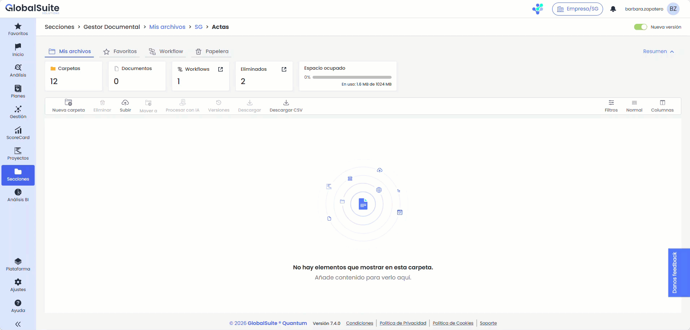
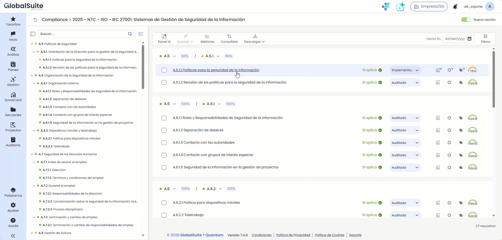

# Quantum 7.4 (Abril 2026)

## Nuevas funcionalidades y mejoras

### Nuevo Asistente IA - Análisis Encuestas ERC


Se ha incluido en el módulo de Encuestas de GlobalSuite® un nuevo asistente que realiza un Análisis Inteligente de la información incorporada en la encuesta, pasando de una revisión manual de respuestas a un análisis más guiado y asistido, permitiendo identificar los elementos, riesgos o controles que requieren mayor atención y reduciendo el tiempo dedicado a revisar grandes volúmenes de valoraciones y documentos.


En esta versión se incorpora un nuevo asistente de Inteligencia Artificial para el módulo de Encuestas de [Elementos, Riesgos y Controles](https://globalsuitesolutions.atlassian.net/wiki/spaces/GlobalSUITEes/pages/266864017/Encuestas+Elementos+Riesgos+y+Controles+Configuraci+n).

Este asistente facilita la revisión y obtención de conclusiones de la encuesta para ayudar en la toma de decisiones a los responsables de verificar y consolidar la información, así como al propio usuario para identificar incoherencias, gaps o puntos faltantes a la hora de completar la encuesta.

#### Características principales

* Generación de **insights** sobre criticidad, cobertura de riesgos y madurez de controles.
* Identificación de riesgos elevados sin controles asociados o con cobertura insuficiente.
* **Detección de controles** débiles, poco efectivos o con alta dependencia manual.
* Revisión asistida de evidencias para comprobar si el documento aportado responde a lo solicitado.
* Señalización de posibles **carencias en las evidencias**, como ausencia de fecha, responsable, trazabilidad o contexto.
* **Generación de recomendaciones** para mejorar controles, documentación o próximas revisiones.  
  Resumen ejecutivo de los principales hallazgos para facilitar el seguimiento.

#### Otras mejoras

En esta versión se ha incluido también la capacidad de que una vez que se **Finaliza la encuesta**, esta queda bloqueada para evitar añadir, eliminar o modificar información sin seguir el flujo establecido.

La encuesta seguirá siendo accesible por los destinatarios hasta que se cierre o caduque en el caso de las encuestas publicadas a través de un link.

### Gestor Documental - Nueva opción para adjuntar documentos: arrastrar y soltar archivos


Se mejora la experiencia de carga de documentos en el Gestor Documental, incorporando una forma más ágil e intuitiva de subir archivos.


Se incorpora la posibilidad de **cargar documentos arrastrándolos directamente sobre el listado de archivos en la pestaña “Mis archivos”**, agilizando la gestión documental y evitando el uso exclusivo del botón “Subir”.

Durante el proceso, el sistema muestra una **zona activa de carga** que se resalta visualmente e indica al usuario cuándo puede soltar los archivos. Además, se ofrece información contextual, como el nombre e icono del archivo en cargas individuales o el número total de archivos en cargas múltiples.

Al soltar los documentos, se ejecuta automáticamente el **flujo habitual de validación y asociación de workflow (si está activado)**, manteniendo el mismo comportamiento que la carga mediante el botón “Subir”.

Esta funcionalidad está disponible únicamente en la pestaña **“Mis archivos”** y se desactiva cuando existen filtros o búsquedas activas, garantizando la coherencia en la gestión de documentos.

### Compliance - Visualización del detalle de requisitos en panel lateral


Se mejora la consulta de información en el módulo de Compliance, permitiendo acceder al detalle de los requisitos sin perder el contexto de la evaluación.


A partir de ahora, al seleccionar un requisito, su información se muestra en un **panel lateral derecho (sidebar)** en lugar de abrirse en pantalla completa. Este panel mantiene un ancho equivalente al del detalle estándar del inventario e incluye un **velo sobre el contenido de fondo** para centrar la interacción.

El panel permite **expandirse a pantalla completa** cuando se requiere una visualización más amplia, ocultando otros elementos como el índice si estuviera visible. Asimismo, se puede **contraer de nuevo al tamaño inicial o cerrar**, recuperando el estado previo de la pantalla.

### Vídeos


AsistenteIA_EncuestasERC.mp4



Gestor Documental.mp4



Compliance.mp4



Inventario.mp4

