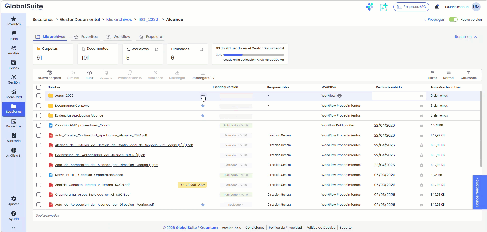
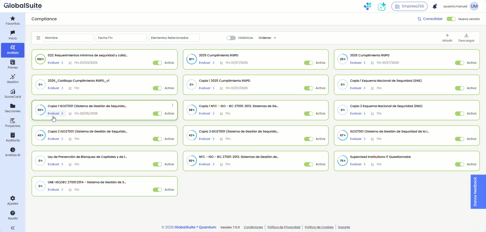
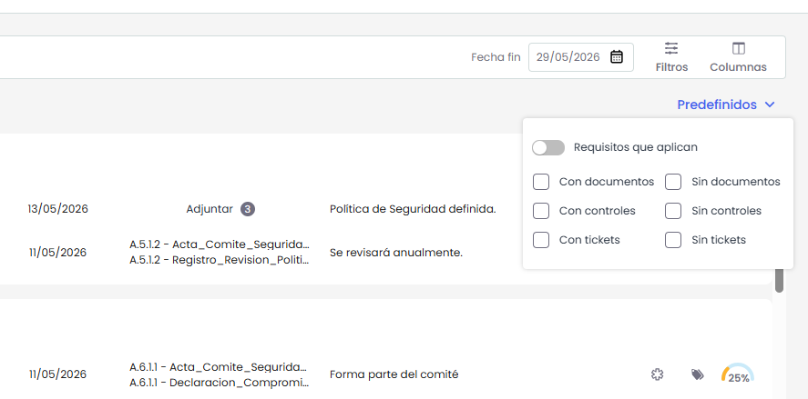
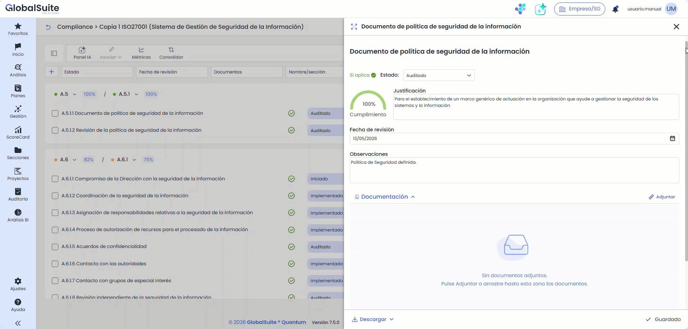

# Quantum 7.5 (Mayo 2026)

## Nueva Pestaña “Actividad” para documentos y carpetas en el Gestor Documental


Se incorpora una vista de actividad en el detalle de documentos y carpetas del Gestor Documental para consultar su historial de acciones desde la propia vista, sin necesidad de abandonar el elemento seleccionado.


La pestaña Actividad del panel de detalle muestra ahora un timeline cronológico con los eventos más recientes en primer lugar, lo que facilita el seguimiento de la operativa realizada sobre documentos y carpetas. Desde esta vista es posible consultar, en formato de solo lectura, acciones relevantes como la creación, cambios de nombre, asociación o eliminación de workflows y etiquetas, movimientos, descargas, aprobaciones, rechazos, nuevas versiones y otras acciones vinculadas al ciclo de vida del contenido.

La pestaña Actividad mostrará los eventos registrados desde la puesta en producción de esta funcionalidad. Las acciones realizadas con anterioridad no estarán disponibles en este historial y deberán consultarse en el apartado de Logs.


Para conocer el detalle de los eventos contemplados en esta vista, puede consultar el manual de [Detalle de una carpeta](https://globalsuitesolutions.atlassian.net/wiki/spaces/GlobalSUITEes/pages/1658683393/Detalle+de+una+carpeta) y [Detalle de un documento](https://globalsuitesolutions.atlassian.net/wiki/spaces/GlobalSUITEes/pages/1658650626/Detalle+de+un+documento)


## Mejoras en la evaluación de catálogos de Compliance


La evaluación de catálogos en Compliance amplía sus capacidades de consulta y edición con nuevos filtros predefinidos, carga más ágil de documentación y una visualización más completa de la información clave en el listado principal.


### Mejoras en el listado principal de evaluación

El listado principal de requisitos amplía la información visible y editable desde la propia tabla, incorporando campos como la fecha de revisión, la documentación asociada y las observaciones.

También se añaden opciones para configurar la visibilidad de determinadas columnas y se habilita el guardado automático de cambios, lo que agiliza la revisión y mantenimiento de la evaluación sin necesidad de acceder al detalle de cada requisito.

### Filtros predefinidos en la evaluación de catálogo

La tabla principal incorpora filtros predefinidos para localizar con mayor rapidez requisitos con o sin documentación, controles o tickets.

Estos filtros pueden combinarse entre sí y utilizarse junto con otros filtros ya disponibles, además de permitir acotar la consulta a los requisitos que aplican, facilitando un análisis más ágil y preciso del catálogo.

### Carga de documentación mediante arrastrar y soltar

El detalle del requisito permite ahora adjuntar documentación arrastrando archivos directamente sobre el área correspondiente. Esta mejora agiliza la carga de evidencias y aporta una experiencia más visual e intuitiva durante el proceso de evaluación.

