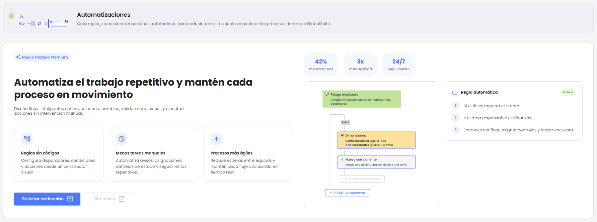
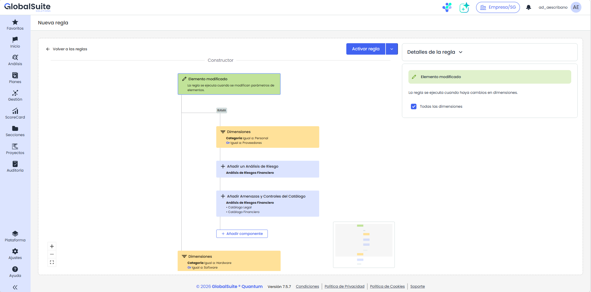
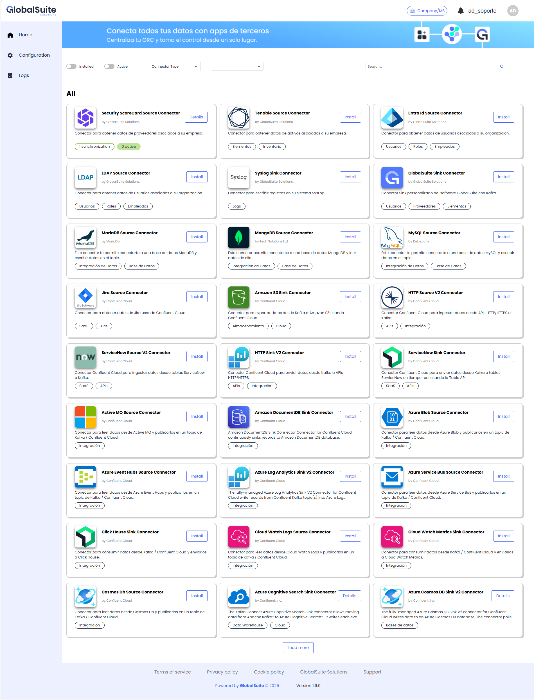

# Quantum 7.6 (Mayo 2026)

## Nuevas funcionalidades y mejoras

### Nuevo módulo de Automatizaciones

|  |
| --- |
| Se incorpora un nuevo módulo transversal de Automatizaciones que permite configurar reglas visuales para que GlobalSuite® ejecute acciones automáticas cuando se produzcan eventos o cambios relevantes dentro de la plataforma. |

Con esta versión, GlobalSuite® avanza hacia una gestión GRC más proactiva, permitiendo convertir cambios de datos en flujos automáticos de trabajo. La funcionalidad permite definir comprobaciones, reglas y condiciones para indicar qué debe ocurrir cuando ocurren ciertos eventos en la solución. Por ejemplo, cuando se crea o modifica un elemento, riesgo, proceso o BIA, reduciendo tareas manuales y mejorando la trazabilidad de cada ejecución.

El objetivo principal es ayudar a los equipos de riesgos, continuidad, compliance, auditoría y seguridad a estandarizar respuestas recurrentes, activar avisos en el momento adecuado y reutilizar información ya existente en la plataforma.

#### Características principales

* Constructor visual de reglas basado en disparadores, condiciones, ramas y acciones a ejecutar de forma encadenada.
* Activación y desactivación de reglas desde la propia interfaz.
* Disparadores iniciales sobre elementos, riesgos, procesos y BIA.
* Condiciones para limitar la ejecución según diversos parámetros, como dimensiones afectadas, niveles valorados, responsables, categorías, o alcances.
* Ramas para definir diferentes caminos de ejecución dentro de una misma regla.
* Registro de actividad por regla para consultar ejecuciones, acciones lanzadas, condiciones evaluadas y errores.

#### Beneficios para el usuario

* Menos tareas repetitivas y menor dependencia de seguimientos manuales.
* Mayor consistencia en la forma de responder ante eventos recurrentes.
* Mejor coordinación entre responsables, áreas, riesgos, encuestas y controles.
* Trazabilidad completa de las ejecuciones y de las acciones lanzadas.
* Mayor aprovechamiento de los datos, catálogos y configuraciones ya existentes en GlobalSuite®.

#### Del dato al workflow automático

|  |
| --- |
| La nueva funcionalidad permite pasar de registrar información a activar acciones sobre esos datos. Por ejemplo, un riesgo que aumenta su criticidad puede lanzar avisos, asociar controles o generar tareas de seguimiento sin intervención manual. |

#### Ejemplos de automatizaciones

* Al crear un nuevo elemento crítico, añadirlo a un análisis de riesgo, asociar controles de catálogo y avisar al responsable.
* Cuando un riesgo pase a criticidad alta, se le asociarán controles, se enviará una notificación o se lanzará una encuesta.
* Cuando se vuelque la información de una encuesta BIA a un BIA individual, se copiará la información al BIA consolidado y notificará al responsable.
* Cuando se modifique un elemento, actualizar una dimensión o lanzar una encuesta de revisión si se cumplen las condiciones definidas.

#### Alcance inicial

En esta primera versión, lanzamos el módulo con un enfoque orientado a casos de uso de alto valor. El catálogo de acciones y condiciones depende del disparador configurado y del contexto funcional disponible en cada caso.

* Se incluyen disparadores priorizados sobre elementos, riesgos, procesos y BIA.
* Se incluyen acciones funcionales orientadas a notificaciones, encuestas, análisis de riesgo, asociación de catálogos y consolidación de información.
* La disponibilidad de acciones puede variar según el disparador seleccionado.

En próximas versiones se incluirán nuevos casos de uso, con disparadores y acciones adicionales para potenciar aún más la automatización de procesos en GlobalSuite®.


Disponible con licenciamiento Enterprise o superior.


### Marketplace de integraciones: incorporación de más de 275 conectores

Se amplía el **Marketplace de integraciones de GlobalSuite** con la incorporación de **más de 275 conectores adicionales**, permitiendo conectar GlobalSuite con un mayor número de herramientas corporativas, plataformas cloud, soluciones de seguridad, sistemas de identidad, bases de datos, aplicaciones SaaS y servicios de analítica. Esta ampliación evoluciona la página de conectores disponibles, que hasta ahora listaba conectores como Tenable, Security Scorecard, Active Directory, LDAP, MariaDB, MySQL, MongoDB, Syslog o GlobalSuite.

Entre los nuevos ámbitos cubiertos se incluyen:

* **Ciberseguridad y riesgo tecnológico**, con conectores como Tenable, SecurityScorecard, Syslog/SIEM o Elasticsearch, orientados a centralizar vulnerabilidades, ratings de seguridad, logs y eventos técnicos.
* **Identidad y gobierno de accesos**, con conectores como Entra ID, Active Directory y LDAP, útiles para sincronizar usuarios, grupos, atributos y estructuras organizativas.
* **Bases de datos y sistemas transaccionales**, con conectores para MySQL, MariaDB, MongoDB, PostgreSQL, SQL Server, Oracle, Cassandra o DynamoDB, facilitando la sincronización de información operativa y evidencias.
* **Cloud, almacenamiento y data lake**, con conectores como Amazon S3, Azure Blob Storage, Google Cloud Storage o Azure Data Lake Storage, pensados para automatizar el intercambio de archivos, evidencias y registros.
* **ITSM, DevOps y aplicaciones SaaS**, con conectores como Jira, ServiceNow, GitHub o Marketo, que permiten relacionar tareas, incidencias, cambios, proyectos o eventos de negocio con los procesos gestionados en GlobalSuite.
* **Monitorización, observabilidad y analítica**, con conectores como Datadog, CloudWatch, Azure Log Analytics, BigQuery, Redshift, Snowflake o Databricks, orientados a explotar datos, métricas y eventos para reporting y seguimiento.
* **Mensajería, eventos e integración empresarial**, con conectores como ActiveMQ, Amazon SQS, Azure Event Hubs o Google Pub/Sub, para habilitar flujos de intercambio de información entre sistemas corporativos.
* **Búsqueda, IA y casos avanzados**, con conectores como Pinecone, Azure AI Search o Elasticsearch, que abren la puerta a escenarios de búsqueda semántica, indexación y explotación avanzada de datos.

Con esta mejora, las compañías pueden **reducir desarrollos a medida**, acelerar la puesta en marcha de integraciones, automatizar la entrada y salida de información, mejorar la trazabilidad de los datos y ampliar los casos de uso de GlobalSuite en ámbitos como TPRM, GRC, auditoría, cumplimiento, ciberseguridad, gestión documental, análisis de riesgos y reporting corporativo.

Puedes consultar más detalle en el apartado de [Conectores disponibles](https://globalsuitesolutions.atlassian.net/wiki/spaces/MIG/pages/1225752585/Conectores+disponibles).

### Vídeos


Automatizaciones_novedades.mp4

