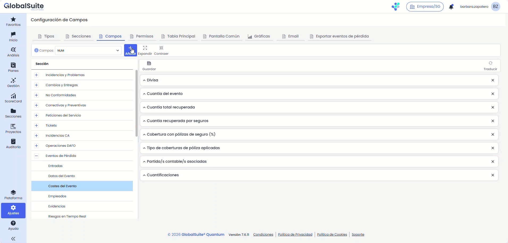
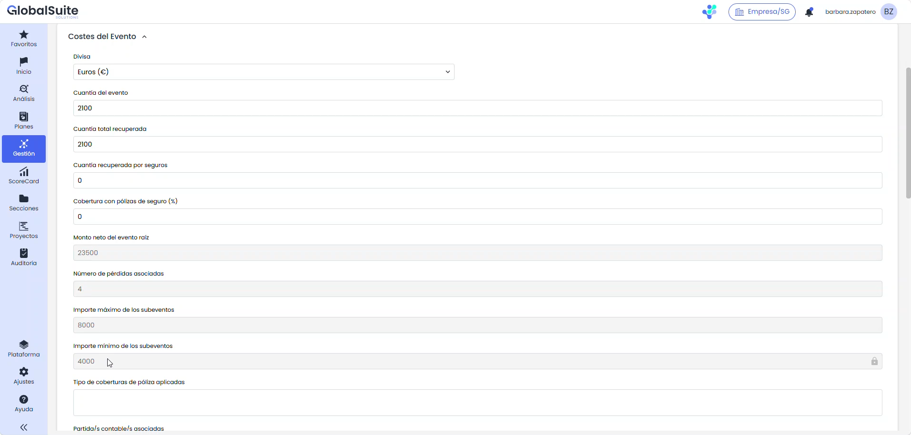
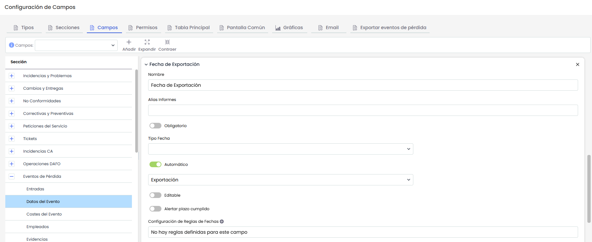
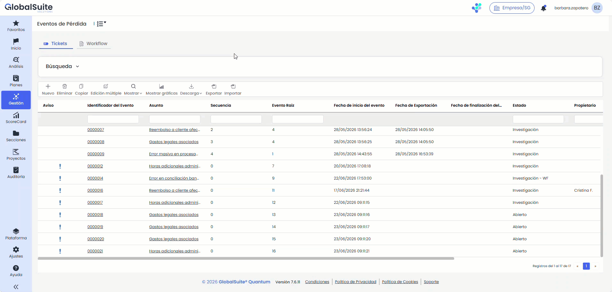
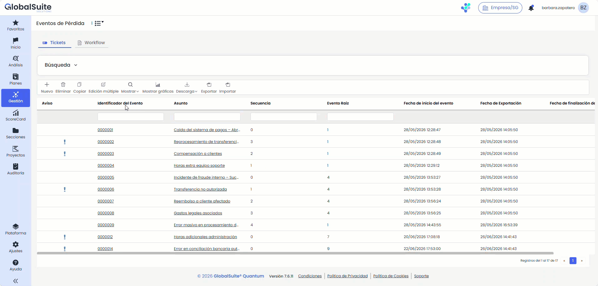
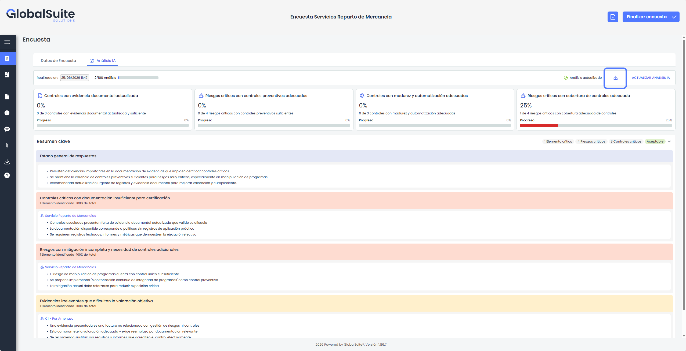
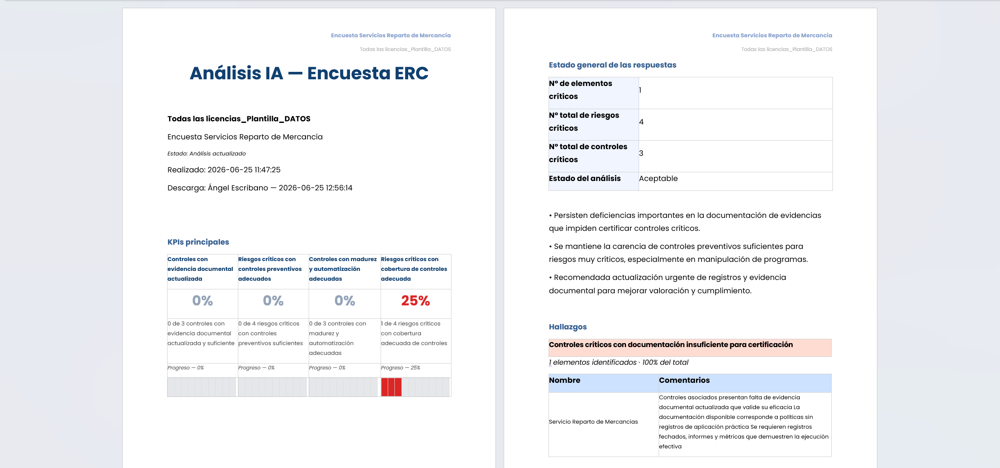
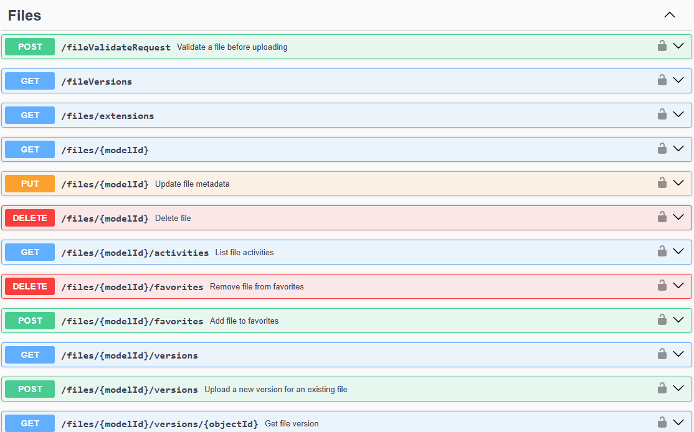

# Quantum 7.7 (Junio 2026)

## Nuevas funcionalidades y mejoras

Esta versión incorpora mejoras en varios ámbitos del producto. En la gestión de **Tickets** se amplían las opciones de configuración y automatización para mejorar el seguimiento de eventos y la operativa sobre los distintos tipos de tickets. Estos cambios responden a necesidades planteadas por varios clientes en torno a la gestión y explotación de la información de **eventos de pérdida**, con el fin de facilitar el cumplimiento de las obligaciones de reporte y de los requerimientos regulatorios definidos por los organismos supervisores y los marcos normativos aplicables.

Además, se amplía el **Asistente IA para el análisis de encuestas ERC**, que ahora permite descargar en formato Word el informe completo generado por la Inteligencia Artificial, y se incorporan nuevas capacidades en la **API de GlobalSuite®** para interactuar con el Gestor Documental, ampliando las posibilidades de integración y automatización con otros sistemas.

### Tickets - Operaciones de cálculo sobre subeventos: sumatorio, contador, mínimo y máximo

| Se amplían las operatorias de cálculo de los campos numéricos de los eventos de pérdida, permitiendo agregar los valores de los subeventos mediante sumatorio, contador, mínimo y máximo. Entre otros usos, el sumatorio de los subeventos permite obtener el monto neto del evento raíz. |
| --- |

Se amplían las capacidades de cálculo de los **campos numéricos (NUM)** de los eventos de pérdida con nuevos atributos y operatorias que permiten obtener el **monto neto agregado a nivel de evento raíz**. De esta forma, la información distribuida entre un evento y sus subeventos se consolida automáticamente, reduciendo el cálculo manual y aportando una cifra fiable para los procesos de reporte. Esta funcionalidad está disponible únicamente para los campos de tipo numérico (NUM) de los eventos de pérdida.

El cálculo se configura desde **Administración > Tickets > Campos > Eventos de pérdida**. Al marcar un campo NUM como **Automático** y definir su fórmula, el constructor incorpora ahora un nuevo grupo, **Campos numéricos de subeventos**, junto a un selector **Cuantificador** que determina cómo se agregan los valores de los subeventos.

##### Características principales

* Cuatro cuantificadores disponibles sobre los campos numéricos de los subeventos: **Sumatorio, Contador, Mínimo y Máximo**.
* El cálculo agrega los valores de los **subeventos (hijos) activos** del evento, sin contar el valor del propio evento raíz; los valores vacíos se consideran 0.
* Cuando el evento no tiene subeventos, el cuantificador se evalúa sobre el propio evento: Sumatorio, Mínimo y Máximo devuelven su valor, y Contador devuelve 1.
* El resultado respeta los signos y los decimales de los valores de origen, y se ajusta a la configuración de decimales del campo destino, igual que el resto de campos NUM automáticos.
* El recálculo se ejecuta **al abrir y al guardar** los tickets de evento de pérdida (anteriormente solo se calculaba al guardar). Si el evento tiene un evento padre, este se recalcula a continuación.
* La opción **Calcular campos** aplica el cálculo sobre los tickets ya existentes.
* Cada ejecución queda registrada con su traza en **Procesos de trabajo**, bajo el proceso "Calcular Campos de Tickets".

##### Beneficios para el usuario

* Menos cálculos manuales para consolidar el importe de un evento y sus subeventos.
* Cifras agregadas coherentes y trazables para los procesos de reporte regulatorio.
* Mayor control sobre la operativa, al recalcularse también el dato al abrir el ticket.

### Tickets - Nuevo tipo de fecha "Exportación"

| Se incorpora un nuevo tipo de fecha automático, "Exportación", que registra la fecha en la que los tickets se exportan en un informe, facilitando la trazabilidad de la actividad de reporte. |
| --- |

Se añade un nuevo tipo de **campo de fecha automático**, denominado **"Exportación"**, que deja constancia de la fecha en la que la información de un ticket se ha exportado a través de un informe. Está orientado a los procesos de reporte y aporta una referencia temporal útil para acreditar el cumplimiento de las obligaciones de información. Aplica a todos los tipos de tickets.

El campo se crea desde **Administración > Tickets > Campos**, marcando un campo de tipo fecha como **Automático** y seleccionando la opción **Exportación**. Es un campo de **solo lectura** por su naturaleza automática —no puede editarse en ningún contexto— y solo puede existir un campo "Exportación" por ticket. Una vez creado, puede mostrarse en la **Tabla Principal**, en el **formulario del ticket** y en la **Pantalla Común**, respetando el orden configurado en cada una, y permite **filtrar por rangos de fecha** cuando se muestra en la Tabla Principal.

La fecha se registra al **descargar un informe generado a partir de una** [**plantilla**](https://globalsuitesolutions.atlassian.net/wiki/spaces/GlobalSUITEes/pages/1117192198/Plantillas+Informes+Ticketing). Cuando el ticket tiene configurado el campo "Exportación", antes de la descarga se muestra un modal —con independencia de que la plantilla incluya o no esa columna— que permite decidir cómo se completa la fecha en los tickets incluidos en el informe, teniendo en cuenta los filtros de la plantilla, no los de la tabla:

* **Borrador** (opción por defecto): se descarga el informe sin completar ninguna fecha de exportación.
* **Exportación**: completa la fecha de hoy en los tickets del informe que aún no la tienen. Este cambio no es reversible.
* **Rectificación**: actualiza la fecha de hoy en todos los tickets del informe, sobrescribiendo las fechas existentes y completando las que falten. Este cambio no es reversible.

Esta funcionalidad está pensada para combinarse con la **configuración de plantillas de informe**. Como en una plantilla se pueden definir filtros y condiciones —por ejemplo, los tickets abiertos durante el último mes—, al exportar desde ella la fecha de exportación se asigna únicamente a los tickets que cumplen esos criterios, lo que permite controlar con precisión a qué registros se aplica. El registro de la fecha de exportación solo se realiza en las descargas hechas desde una plantilla de informe.


Para más información sobre la configuración de plantillas, puede consultar la documentación en el siguiente enlace: [Plantillas Informes Ticketing - Documentación GlobalSuite® - Confluence](https://globalsuitesolutions.atlassian.net/wiki/spaces/GlobalSUITEes/pages/1117192198/Plantillas+Informes+Ticketing)


### Tickets - Actualización masiva de estados

| Se incorpora la modificación masiva de estados, que permite cambiar el estado de múltiples tickets en una sola operación, controlada y trazable, con seguimiento en Procesos de trabajo e informe de resultado descargable. |
| --- |

Se incorpora la posibilidad de **cambiar el estado de múltiples tickets en una sola operación**, de forma centralizada y controlada. La acción se inicia desde la opción **Edición múltiple**, disponible en la barra de herramientas de la tabla principal de cada tipo de ticket que tenga configurado un campo de estado. Aplica a todos los tipos de tickets.

El proceso se realiza desde un modal: se selecciona el **estado actual (origen)** —acompañado de su flujo de trabajo cuando corresponda y del número de tickets que se encuentran en él— y, a continuación, el **nuevo estado (destino)**, que el sistema propone según el flujo de trabajo configurado. También puede decidirse si se envían las **notificaciones de cambio de estado**, activadas por defecto.

Antes de ejecutar, el sistema muestra un mensaje de confirmación con el número de tickets afectados y la transición que se va a aplicar. Al confirmar, la operación se ejecuta en segundo plano —su avance puede seguirse en **Procesos de trabajo**—, de modo que es posible continuar trabajando mientras se completa.

##### Características principales

* Los estados de origen disponibles, sus recuentos de tickets y los registros sobre los que se actúa **respetan la visibilidad y los permisos del usuario**, con la misma lógica que la gestión individual de tickets.
* El cambio se aplica únicamente a los **tickets elegibles en el momento de la ejecución**.
* Las **notificaciones** asociadas al cambio (cambio de estado, cierre, asignación de responsable, etc.) se envían u omiten según la opción seleccionada.
* La operación queda **registrada para auditoría** (usuario, fecha, estado origen y destino e identificador de la operación), lo que permite su trazabilidad posterior.
* Al finalizar se genera un **informe de resultado descargable** (.txt), disponible en las descargas pendientes, tanto si la operación termina con éxito total como parcial o con errores. Incluye un resumen (totales procesados, correctos y con error) y el detalle por ticket, indicando el estado final alcanzado o el motivo del error.

##### Beneficios para el usuario

* Cambio de estado de grandes volúmenes de tickets en una única acción, evitando el trabajo registro a registro.
* Visibilidad clara del impacto antes de ejecutar, gracias al recuento y al mensaje de confirmación.
* Mayor control y trazabilidad, con registro de auditoría e informe de resultado detallado por ticket.

### Ampliación Asistente IA - Análisis Encuestas ERC - Informe Word


Se incorpora una mejora en el Asistente IA para el análisis de encuestas ERC de la versión anterior ([Quantum 7.4](https://globalsuitesolutions.atlassian.net/wiki/spaces/CG/pages/1751744515/Quantum+7.4+Abril+2026)), permitiendo \*\*descargar en formato Word\*\* el informe completo generado por la IA.


En esta versión se amplía el Asistente IA para el análisis de encuestas de Elementos, Riesgos, Controles y Evidencias, permitiendo descargar en formato Word el informe completo generado por Inteligencia Artificial.

Con esta evolución, los resultados del análisis dejan de estar disponibles únicamente dentro de la pantalla de la encuesta y pasan a poder compartirse como un documento formal, facilitando la revisión, presentación y seguimiento por parte de otras áreas de negocio u otros perfiles interesados.

Además, el informe generado queda disponible en el apartado Descargas de la propia encuesta, permitiendo recuperarlo posteriormente sin necesidad de volver a generar o copiar manualmente la información.

#### Principales características

* Se añade un nuevo botón de descarga en la pestaña Análisis IA, visible cuando la encuesta ya dispone de un análisis generado.
* El informe puede descargarse en formato Word, facilitando su uso como documento formal de trabajo, revisión o entrega.
* El documento generado incluye la información principal del análisis IA, como los datos de la encuesta, fecha del análisis, usuario que realiza la descarga, estado del análisis y principales KPIs.
* Se incorporan los KPIs principales con su porcentaje de completitud, permitiendo identificar rápidamente el nivel de cobertura, madurez o suficiencia de los controles y evidencias analizadas.
* El informe incluye el resumen clave y el estado general de respuestas, ofreciendo una visión ejecutiva de los principales puntos de atención detectados.
* Se añade el detalle por elemento evaluado, incluyendo riesgos, controles asociados, evidencias revisadas y recomendaciones generadas por la IA.
* Se amplía el detalle de la información sobre evidencias, ayudando a identificar si la documentación aportada es suficiente, está actualizada, resulta relevante para el control evaluado o presenta carencias que dificulten la valoración objetiva.
* El informe incorpora el estado del análisis, diferenciando si la información está actualizada o desactualizada respecto a la información de la encuesta.
* El archivo descargado queda disponible en el apartado Descargas de la encuesta, centralizando los informes generados junto con el resto de documentación exportada de la encuesta.

### API GlobalSuite - Endpoints Gestor Documental

Con el objetivo de seguir ampliando la posibilidad de **conectar GlobalSuite®** con otros sistemas de información propios o de terceros, delegar la actualización para que esté siempre al día, o automatizar la extracción de datos para su estudio posterior, en esta versión del producto hemos incorporado capacidades para interactuar con el [Gestor Documental](https://globalsuitesolutions.atlassian.net/wiki/spaces/GlobalSUITEes/pages/266864205/Gestor+Documental) de GlobalSuite®, permitiendo automatizar distintas acciones.

#### Principales características

* Está disponible la consulta y obtención de documentos y archivos del sistema de gestión, por ruta, etiqueta, responsable entre otros parámetros.
* Se puede automatizar operaciones como la creación y eliminación de carpetas, la subida de archivos, o la incorporación de nuevas versiones de documentos.
* Es posible etiquetar, clasificar o mover archivos entre las distintas rutas.

Mediante el uso de las APIs, puede integrar GlobalSuite® con el resto de aplicaciones, herramientas o sistemas de su ecosistema corporativo. Por ejemplo:

* Puede automatizar la creación de registros desde otras herramientas.
* Sincronizar información para exportarlos en otra herramienta para su tratamiento.
* Exportar registros para almacenarlos en un repositorio, o lago de datos (EDL).


Puede consultar el API de GlobalSuite® mediante el repositorio de documentación de Endpoints: [API GlobalSuite®](https://demo-eu.globalsuitesolutions.com/docs).


Si quiere comenzar a probar o a utilizar las APIs de GlobalSuite® póngase en contacto con su proveedor.

Para más información sobre las APIs, puede consultarla [aquí](https://globalsuitesolutions.atlassian.net/wiki/spaces/GlobalSUITEes/pages/266731551/GlobalSuite+API).
