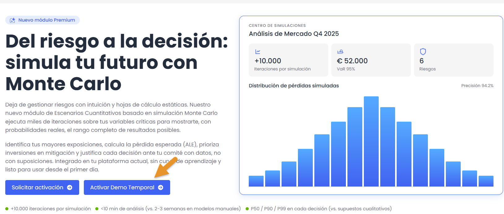
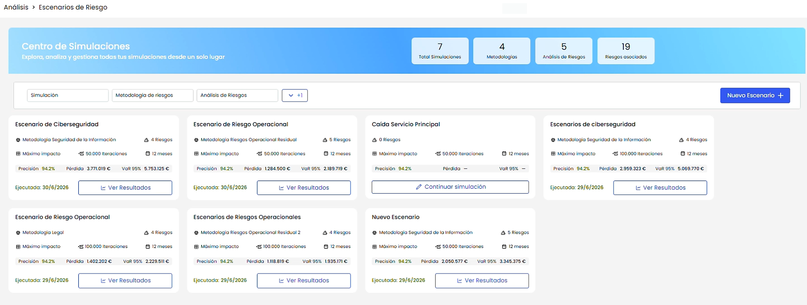
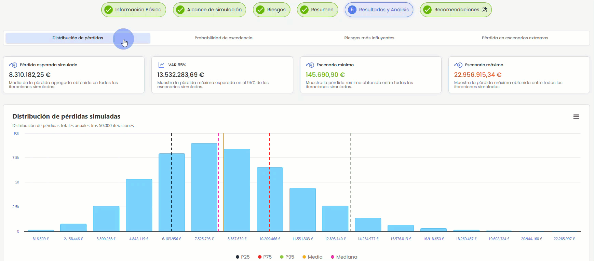
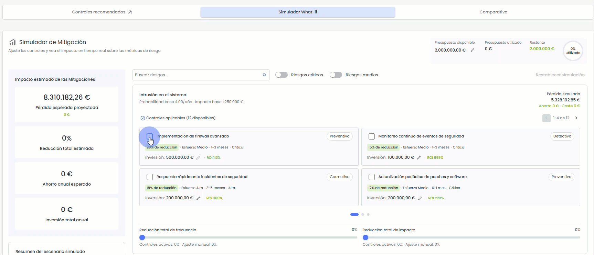
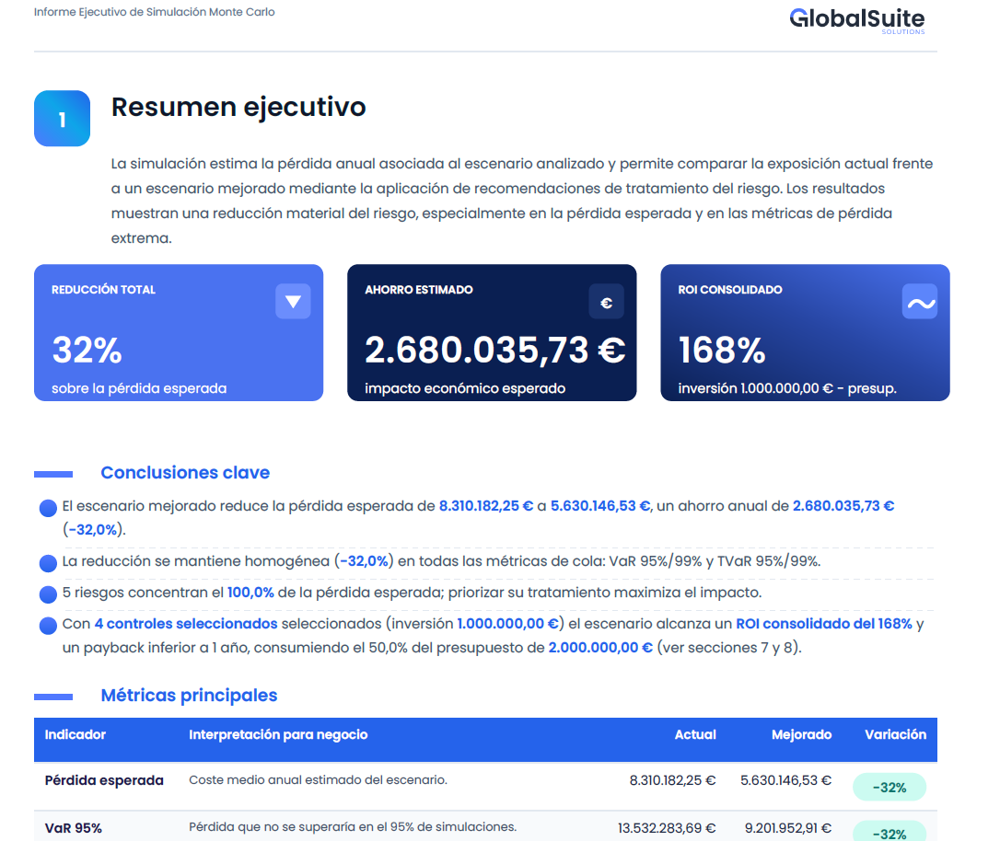

# Quantum 7.8 (Julio 2026)

## Nuevas funcionalidades y mejoras

### Análisis - Nuevo módulo de Escenarios de Riesgo con simulación Monte Carlo

Se incorpora el nuevo módulo de **Escenarios de Riesgos Cuantitativos**, un nuevo bloque de **GlobalSuite GRC** que permite realizar simulaciones cuantitativas de riesgos basadas en **Monte Carlo**.

Esta funcionalidad convierte los análisis de riesgos ya definidos en GlobalSuite, en **escenarios cuantificados, comparables y accionables**, facilitando el análisis de resultados, la estimación de pérdidas y la toma de decisiones sobre medidas de mitigación.

A partir de los riesgos identificados en un análisis existente, el usuario puede crear escenarios de simulación, configurar las variables de frecuencia e impacto, ejecutar miles de iteraciones y obtener una visión cuantitativa de la exposición al riesgo.

## Prueba el módulo por tiempo limitado

Durante el periodo de lanzamiento, se habilita la **activación directa de una demo temporal** del módulo de Escenarios de Riesgos Cuantitativos. Una forma sencilla de descubrir cómo la simulación Monte Carlo ayuda a cuantificar la exposición al riesgo, comparar escenarios y apoyar la toma de decisiones con datos.

Accede a la demo en **Análisis > Escenarios de Riesgo**


Solicita información adicional sobre esta nueva funcionalidad escribiendo a [hello@globalsuitesolutions.com](mailto:hello@globalsuitesolutions.com)


El módulo está disponible desde **Análisis > Escenarios de Riesgo** e incorpora un **Centro de Simulaciones** desde el que se pueden crear, consultar y comparar los escenarios generados.

#### Características principales

* Nuevo Centro de Simulaciones para consultar todos los escenarios de riesgo desde una única pantalla.
* Creación de escenarios mediante un asistente guiado de simulación Monte Carlo.
* Cálculo de la pérdida esperada simulada a partir de las frecuencias e impactos definidos para los riesgos seleccionados.
* Pantalla de resumen previa a la ejecución, donde se consolidan los parámetros configurados, el alcance de la simulación, los riesgos incluidos y la pérdida esperada estimada.
* Ejecución de simulaciones Monte Carlo con miles de escenarios posibles, considerando la materialización o no materialización de los riesgos en cada iteración.

#### Resultados y análisis

Una vez ejecutada la simulación, se incorpora una vista de resultados que permite analizar el escenario desde diferentes perspectivas:

* **Distribución de pérdidas simuladas**, con indicadores como pérdida esperada, VaR 95 %, escenario mínimo y escenario máximo.
* **Probabilidad de excedencia**, que permite definir un umbral de análisis y conocer la probabilidad de que la pérdida simulada lo supere.
* **Riesgos más influyentes**, con un análisis de sensibilidad tipo tornado que muestra la contribución de cada riesgo a la pérdida total esperada.
* **Pérdida en escenarios extremos**, que permite analizar la composición de los peores escenarios, la entrada a cola, la pérdida media en cola y el riesgo dominante en escenarios de mayor impacto.

Estas visualizaciones facilitan el análisis cuantitativo de la exposición al riesgo, identificando tanto la pérdida esperada como los escenarios de mayor severidad.

#### Recomendaciones y simulador What-if

El módulo incorpora la vista **Recomendaciones** orientada a facilitar la toma de decisiones sobre el tratamiento del riesgo.

Desde esta vista se muestran controles recomendados para los riesgos simulados, clasificados por riesgo y con información sobre su tipo, porcentaje de reducción, esfuerzo estimado, plazo de implantación, criticidad, inversión y retorno esperado. Los controles seleccionados pueden añadirse al análisis y asociarse al riesgo y elemento correspondiente.

Además, se incluye un **Simulador What-if** que permite evaluar en tiempo real el impacto de aplicar distintas medidas de mitigación. Será posible seleccionar controles, ajustar presupuestos, modificar reducciones de frecuencia e impacto, y visualizar automáticamente el efecto sobre la pérdida esperada, el ahorro anual, la inversión, el beneficio neto, el ROI y el payback.

#### Comparativa e informe ejecutivo

La funcionalidad permite comparar el **escenario actual** frente a un **escenario mejorado**, considerando las recomendaciones seleccionadas y el impacto esperado de las medidas de mitigación.

La comparativa muestra la variación de métricas como pérdida esperada, VaR 95 % y VaR 99 %, así como el porcentaje de reducción, el ahorro estimado, la inversión total, el plazo máximo de implantación y el ROI consolidado.

También se incorpora la generación de un **Informe Ejecutivo en PDF**, que resume los resultados de la simulación, las recomendaciones seleccionadas, las conclusiones principales y las métricas clave del escenario.

#### Beneficios

* Mayor capacidad de análisis cuantitativo sobre los riesgos identificados.
* Estimación de pérdidas esperadas y escenarios extremos mediante simulaciones Monte Carlo.
* Identificación rápida de los riesgos que más contribuyen a la exposición económica total.
* Priorización de medidas de mitigación en función de su impacto, coste, ahorro esperado, ROI y plazo de implantación.
* Comparación clara entre la situación actual y el escenario mejorado tras aplicar recomendaciones.
* Soporte a la toma de decisiones mediante gráficos, KPIs y un informe ejecutivo descargable.
* Mayor trazabilidad y consistencia en la evaluación de escenarios de riesgo y en la justificación de inversiones de tratamiento.


Para mas información sobre esta funcionalidad, puedes consultar:
\* [¿Cómo crear y analizar escenarios de riesgos con simulación Monte Carlo en GlobalSuite®?](https://globalsuitesolutions.atlassian.net/wiki/spaces/GlobalSUITEes/pages/1943142428/C+mo+crear+y+analizar+escenarios+de+riesgos+con+simulaci+n+Monte+Carlo+en+GlobalSuite)
\* [Escenarios de Riesgos](https://globalsuitesolutions.atlassian.net/wiki/spaces/GlobalSUITEes/pages/1943535622/Escenarios+de+riesgos)

