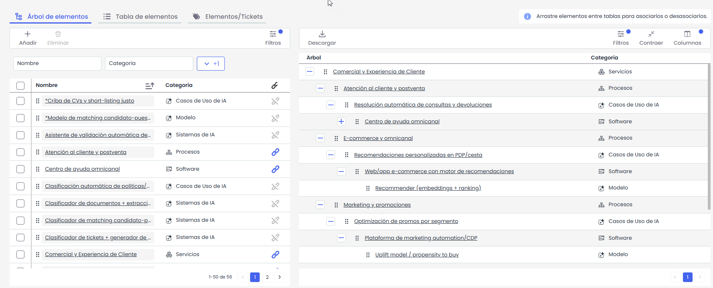

# Quantum 7.9 (Julio 2026)

## Nuevas funcionalidades y mejoras

### AI Governance - Nuevo módulo para el gobierno de los sistemas de IA


Se incorpora el módulo AI Governance, que añade una nueva opción de gestión de Casos de Uso de IA con metodología, dimensiones y catálogos preconfigurados para gobernar los sistemas de IA desde el primer día.


El punto de partida de cualquier marco regulatorio de IA es saber qué IA se está utilizando. AI Governance ofrece un registro formal y único de todas las aplicaciones y procesos donde interviene la IA —propios o de terceros—, con identificación de los sistemas de IA y los datasets asociados, sus responsables y su ciclo de vida. Se pone fin al *Shadow AI*: lo que no se inventaria, no se gobierna.

La gestión se realiza desde una nueva opción disponible en **Análisis > Casos de Uso de IA**, con un comportamiento equivalente al del resto de elementos del inventario. La opción se activa con la licencia **AI Governance** y permite dar de alta, clasificar, evaluar y mantener la trazabilidad de cada activo de IA a lo largo de su vida útil.

#### Metodología y parametrización incluidas por defecto

Al activar la licencia, el sistema deja preparada toda la base de trabajo, sin configuración manual previa:

* **Categorías predefinidas** para los activos de IA: Casos de Uso de IA, Sistemas de IA, DataSets y Modelo.
* **Dimensiones específicas** de gobierno de IA: estado del ciclo de vida, categoría de riesgo según el **EU AI Act**, clasificación técnica, principios éticos aplicables, mecanismo de supervisión humana, base legal, evaluación de impacto (RIA/AIA), frecuencia de revisión, entorno y más.
* **Metodología de Riesgos IA** por defecto, que combina la probabilidad con la severidad legal, ética y técnica para calcular de forma automática la severidad y el nivel de riesgo de cada activo.

#### Integración con el Inventario corporativo

Los activos de IA no se gestionan de forma aislada, sino conectados con el resto del inventario de la organización:

* Establecimiento de **dependencias** con procesos, departamentos, activos tecnológicos, servicios e información.
* Visión completa del impacto: qué áreas y servicios dependen de cada modelo o sistema de IA.
* Relación entre **modelos, datasets y procesos de negocio** para evaluar el alcance real de cada sistema.

  

#### Recopilación de información mediante encuestas

La información sobre la IA está repartida entre negocio, tecnología, legal y compliance. El módulo permite recogerla directamente de quien la conoce:

* **Encuestas y cuestionarios** para recopilar la información de otras áreas sin necesidad de que trabajen dentro del módulo.
* Participación de los **dueños de proceso** y responsables en la cumplimentación de los datos.
* Centralización de la recogida y actualización de la información de los activos de IA.

#### Importación y actualización masiva desde Excel

Para la carga inicial y el mantenimiento del inventario, sin trabajo registro a registro (requiere la licencia **Data Import**):

* **Importación masiva** de activos de IA desde Excel a partir de la plantilla de importación descargable.
* **Actualización masiva** de los registros existentes desde el mismo fichero.
* Descarga del **modelo de importación** para preparar los datos con el formato correcto.


La opción \*\*Casos de Uso de IA\*\* está disponible en \*\*Análisis > Casos de Uso de IA\*\* para las empresas con la licencia \*\*AI Governance\*\* activa. La importación y actualización masiva requiere, además, la licencia \*\*Data Import\*\*.


#### Beneficios

* **Integración con el resto de módulos.** Un sistema de IA es un activo más dentro de GlobalSuite®: se evalúa en **Risk**, se controla en **Compliance** y se gobierna en **AI Governance**, compartiendo un único modelo de datos, sin exportaciones ni duplicidades.
* **Trabajo colaborativo.** Encuestas para implicar a otras áreas, gestión de permisos por rol (**Gerencial** y **Solo lectura**) y adjuntado de documentación desde el equipo o desde el Gestor Documental.
* **Cumplimiento desde el primer día.** Metodología, dimensiones y catálogos alineados con el EU AI Act y la ISO 42001, sin desarrollos a medida.
* **Adopción rápida.** Categorías y parametrización preconfiguradas que permiten empezar a gobernar la IA en días, no en meses.
* **Visibilidad y control.** Fin del Shadow AI, con un inventario único y trazable de todos los sistemas de IA en uso.


Solicita información adicional sobre esta nueva funcionalidad escribiendo a [hello@globalsuitesolutions.com](mailto:hello@globalsuitesolutions.com).


### Vídeos


10-07-2026_14-03-51.mp4

