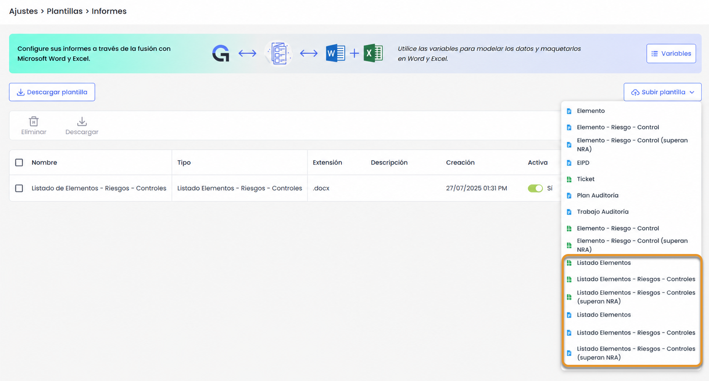
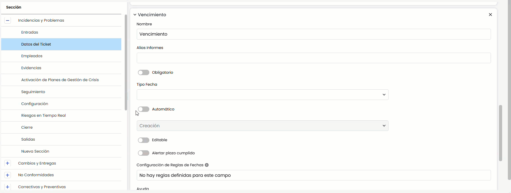
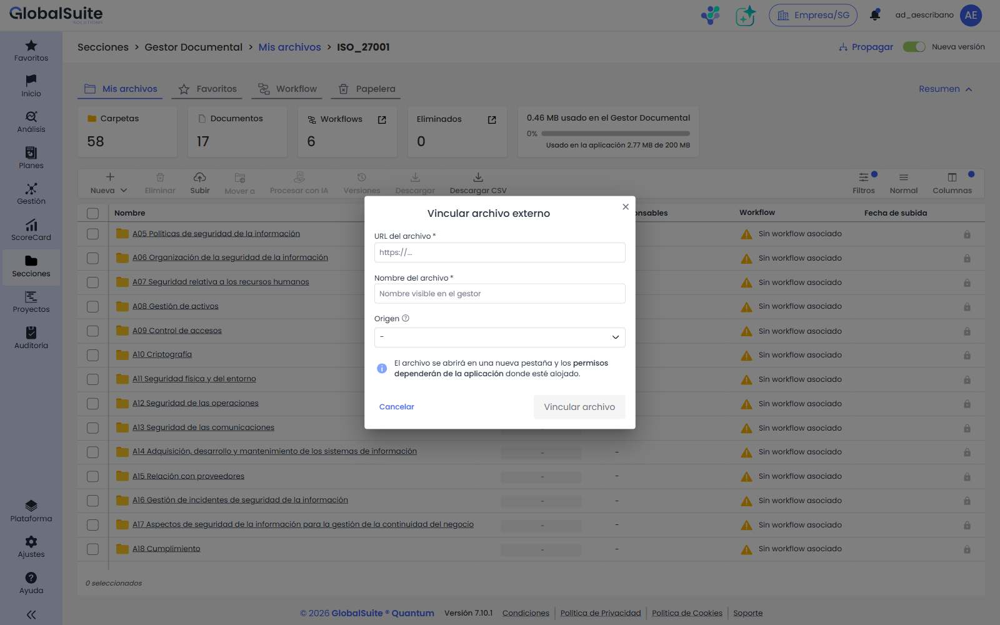
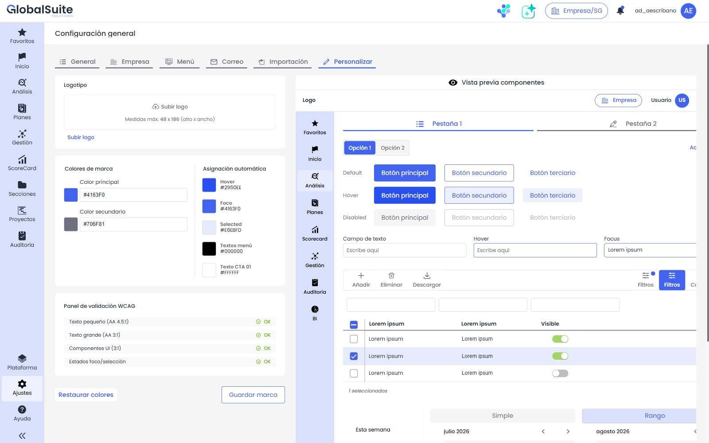

# Quantum v7.10 (Julio 2026)

## Nuevas funcionalidades y mejoras GlobalSuite®

### Informes completos de Elementos, Riesgos y Controles

Se amplía la generación de informes de Elementos, Riesgos y Controles para permitir la exportación masiva de información correspondiente a múltiples elementos o a análisis de riesgos completos.

Hasta ahora, estos informes solo podían generarse para un único elemento. Con esta mejora, los usuarios podrán configurar nuevas plantillas en **Ajustes > Plantillas >** [**Informes**](https://globalsuitesolutions.atlassian.net/wiki/spaces/GlobalSUITEes/pages/1037041672/Plantillas+de+Informes) y utilizarlas para exportar toda la información visible desde los listados de Inventario y Análisis de Riesgos, manteniendo los mismos campos y variables ya disponibles.

##### Nuevos tipos de plantilla

Desde **Ajustes > Plantillas > Informes**, la opción **Subir plantilla** incorpora tres nuevos tipos, disponibles en formato Word y Excel:

* **Listado de Elementos.**
* **Listado Elementos - Riesgos - Controles**
* **Listado Elementos - Riesgos - Controles (superan NRA)**

Cada plantilla permite configurar en qué apartados de la aplicación estará disponible su descarga:

* **Inventario - Listado**
* **Análisis de Riesgos - Listado de Elementos**

Además, la opción **Descargar plantilla** incluye **plantillas predefinidas en Word y en Excel** para facilitar su configuración, sin necesidad de crear el documento desde cero.

#### Características principales

* Exportación masiva de la información con el alcance completo de un análisis, sin repetir la descarga elemento a elemento.
* Exportación de información en formato Word y Excel.
* Nuevas plantillas predefinidas para:

  * Listado de Elementos, Riesgos y Controles.
  * Listado de Elementos, Riesgos y Controles que superan el NRA.


Para más información sobre esta funcionalidad, puedes consultar:
[Plantillas Informes ERC](https://globalsuitesolutions.atlassian.net/wiki/spaces/GlobalSUITEes/pages/1117061132/Plantillas+Informes+ERC)


### Tickets - Nuevo tipo de fecha automática “Fecha calculada”

Se incorpora el tipo de fecha automática **Fecha calculada**, que genera una fecha sumando una cantidad de días o meses a otra fecha del mismo ticket —vencimientos, revisiones o plazos— sin informarla manualmente. Se configura desde **Administración > Tickets > Campos**, marcando un campo de fecha como **Automático** y eligiendo **Fecha calculada**. Aplica a todos los tipos de tickets.

##### Características principales

* Fórmula sencilla: **fecha base + cantidad (entero positivo) + unidad (días o meses)**. La fecha base se elige entre los campos de fecha del mismo tipo de ticket; se excluyen el propio campo y otras fechas calculadas para evitar ciclos.

  
* Si se selecciona **días**, se suman días naturales; si se selecciona **meses**, se conserva el día del mes (o el último día válido si no existe). Ejemplo, partiendo del **15/02/2026**: +30 días → **17/03/2026** y +1 mes → **15/03/2026**.
* Campo **no editable**, que se **recalcula automáticamente** al completar o modificar la fecha base (vacío si la base no tiene valor).
* **Recálculo masivo** de los tickets existentes con el botón **Calcular Fecha**: en segundo plano, con confirmación previa y opción de incluir tickets cerrados.
* Se usa como cualquier fecha en **informes, filtros, búsquedas, exportaciones y copias**, y se calcula automáticamente sobre los **tickets importados**.
* Se puede combinar con **alertas de plazo** (*Alertar plazo cumplido*): un vencimiento calculado puede avisar automáticamente al cumplirse la fecha.

##### Beneficios

* **Menos trabajo manual y errores:** vencimientos, revisiones y plazos se calculan solos y se mantienen actualizados.
* **Consistencia e integración:** cálculo determinista, aplicable en masa e importaciones y usable como cualquier fecha del ticket.

### Gestor Documental - Enlazar archivos externos de SharePoint, OneDrive y Google Drive

El Gestor Documental permite ahora **vincular archivos externos mediante su URL** desde repositorios y gestores de contenido corporativos como **Microsoft SharePoint, Microsoft OneDrive, Google Drive** u otros orígenes, sin necesidad de duplicar la documentación dentro de GlobalSuite®.

Hasta ahora, para usar en GlobalSuite® un documento que ya vivía en el repositorio corporativo del cliente había que subir una copia, con el consiguiente doble mantenimiento, versiones desactualizadas e incoherencias. Con esta funcionalidad, el archivo se **enlaza** y se comporta como un documento propio del gestor, manteniendo un único origen de verdad.

##### Características principales

* Nueva opción **Vincular archivo externo** en el menú **Nueva** del Gestor Documental, para usuarios con permiso de creación de documentos.
* Orígenes admitidos configurables por empresa: **Microsoft SharePoint, Microsoft OneDrive, Google Drive y Otros** (URL libre). Se activan en **Ajustes > Configuración General > Configuración Gestor Documental**.
* El archivo enlazado se integra en la estructura de carpetas y **respeta los permisos de GlobalSuite®**, participa en los **workflows** documentales (aprobación/rechazo) y puede **asociarse a evidencias, planes y otras partes** del producto, igual que un documento propio.
* Muestra el **icono del origen**, admite etiquetas, favoritos y papelera, y su **vista previa y apertura** se realizan en una nueva pestaña del navegador.
* Queda **registrado en el log** y se incluye en la **copia de empresa**.

##### Beneficios

* **Sin duplicidades:** un único documento vigente en el repositorio corporativo, enlazado desde GlobalSuite®.
* **Gobierno dentro de GlobalSuite®:** permisos, workflows y asociaciones se gestionan en la herramienta, sin depender de los permisos externos.
* **Menos trabajo manual** y menor riesgo de versiones obsoletas.

Para más información, puedes consultar:

* [Mis Archivos](https://globalsuitesolutions.atlassian.net/wiki/spaces/GlobalSUITEes/pages/1610383386/Mis+Archivos)
* [Configuración Gestor Documental](https://globalsuitesolutions.atlassian.net/wiki/spaces/GlobalSUITEes/pages/266863779/Configuraci+n+Gestor+Documental)

### Personalización de la interfaz con los colores corporativos

GlobalSuite® permite ahora adaptar la interfaz a la **imagen corporativa** de cada empresa no solo con el logotipo, sino también con sus **colores de marca**, ajustando automáticamente los colores de texto para mantener el contraste y la legibilidad.

La configuración de logotipo y colores se unifica en la nueva pestaña **Personalizar** (**Ajustes > Configuración General > Personalizar**), y el tema resultante se aplica de forma **transversal** a toda la interfaz de la empresa.

##### Características principales

* Definición de **color principal y color secundario** (selector visual o valor hexadecimal), con **logotipo** configurable en el mismo lugar.
* **Asignación automática** de los colores derivados de la interfaz (hover, foco, seleccionado, textos de menú y CTA) a partir de los colores base.
* **Validación de accesibilidad WCAG 2.2 AA** en tiempo real y acción **Corregir** para ajustar automáticamente combinaciones que no cumplan el contraste.
* **Vista previa** de componentes en tiempo real antes de guardar, con opciones de **Guardar marca** y **Restaurar colores** por defecto.
* El tema se aplica a **toda la interfaz** (menús, módulos y componentes), se carga según la **empresa activa** y se incluye en la **copia de empresa**.

##### Beneficios

* **Imagen de marca coherente** en toda la plataforma, sin desarrollos a medida.
* **Legibilidad garantizada** gracias al cálculo automático de contraste (WCAG 2.2 AA).
* **Autonomía del cliente:** cada empresa configura su identidad visual desde el propio producto.

Para más información, puedes consultar:

* [Personalización](https://globalsuitesolutions.atlassian.net/wiki/spaces/GlobalSUITEes/pages/2006417409/Personalizaci+n)
* [¿Cómo personalizar GlobalSuite®?](https://globalsuitesolutions.atlassian.net/wiki/spaces/GlobalSUITEes/pages/2006450178/C+mo+personalizar+GlobalSuite)
