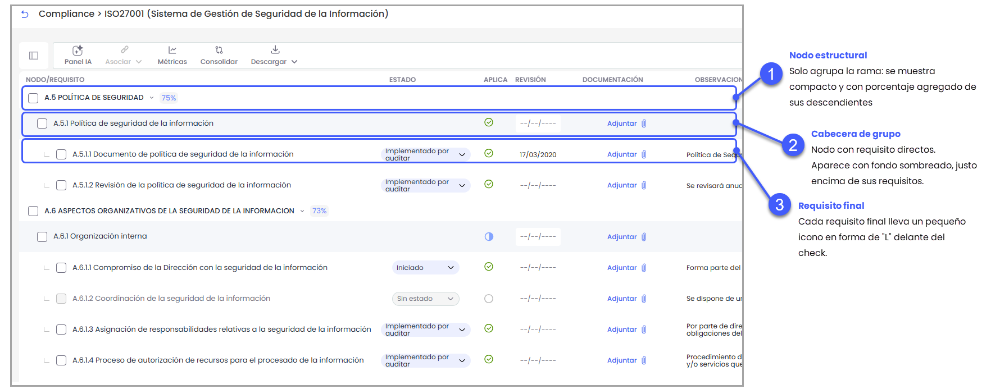
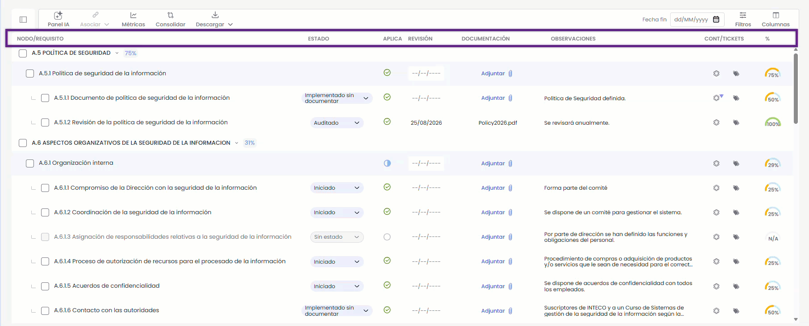
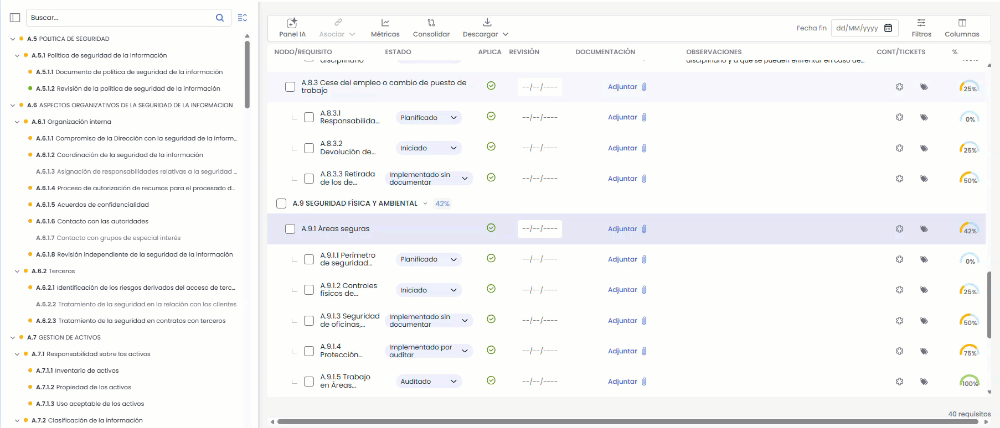
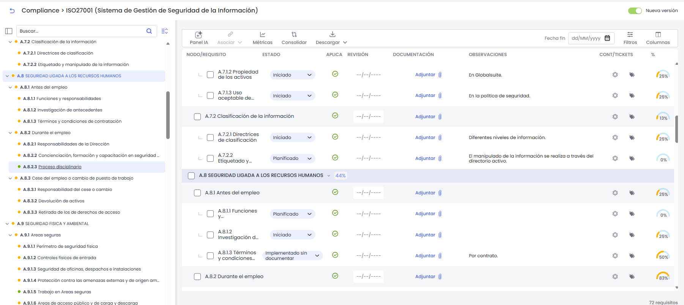
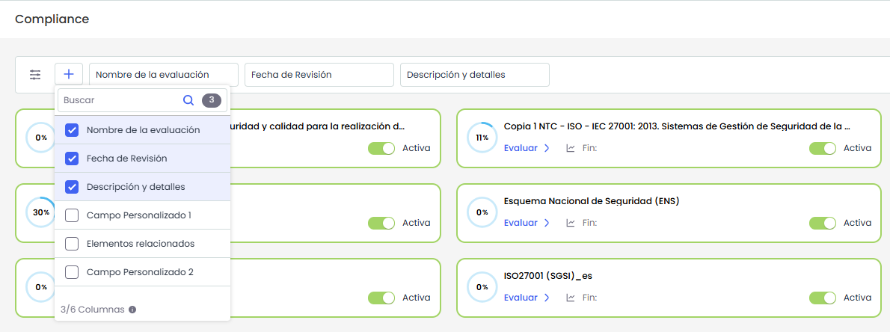
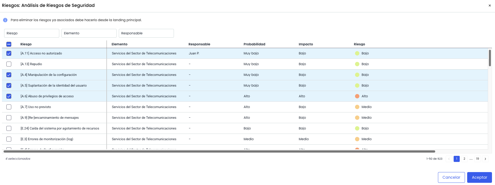
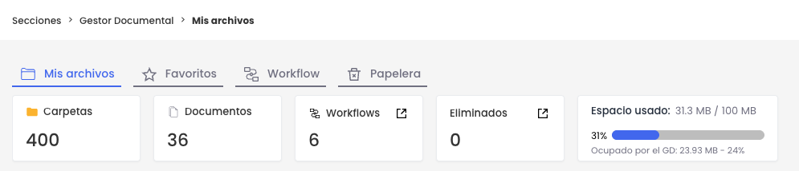
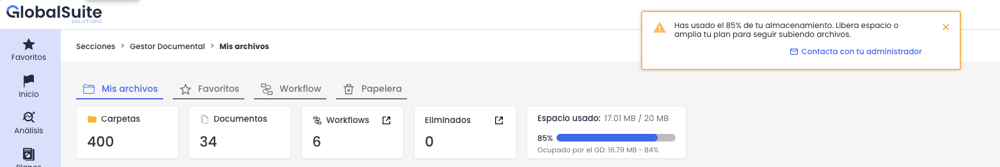
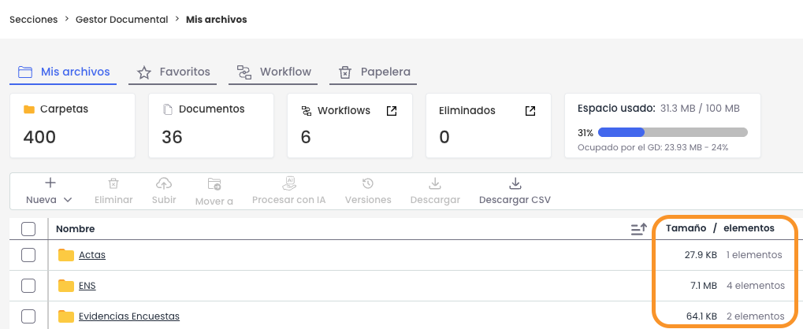

# Quantum v7.11 (Agosto 2026)

## Nuevas funcionalidades y mejoras GlobalSuite

### Compliance - Mejoras en la vista de catálogo de requisitos

Se rediseña la vista de catálogo de Compliance —tabla, índice y panel de detalle— para trabajar con más claridad y rapidez en catálogos extensos y mixtos (DORA, RGPD, ISO 27001/9001, etc.). Cada fila muestra su rol de un vistazo, las columnas tienen cabecera fija, los requisitos que no aplican se leen correctamente, índice y tabla quedan sincronizados y la aplicabilidad de los nodos es más precisa. Además, el landing gana nuevos filtros. No cambia el motor de cálculo del cumplimiento.

#### Orientación más clara en el catálogo

* Cada fila indica lo que es: los nodos que solo agrupan se muestran compactos y con su porcentaje, las cabeceras de grupo de requisitos aparecen con un fondo tintado justo encima de sus requisitos, y cada requisito final lleva un pequeño icono en forma de "L" delante del check.

  
* La tabla ya no se pliega ni se despliega: siempre se ve todo el contenido y basta con hacer scroll para avanzar por los requisitos.

#### Cabeceras de columna fijas

La tabla incorpora una fila de cabeceras que se mantiene visible durante todo el desplazamiento.

* Identifica cada columna de la tabla: Nodo/requisito, Estado, Aplica, Revisión, Documentación, Observaciones, Cont/ticks y %, con los rótulos alineados con sus valores y traducidos al idioma en uso.
* Permanece fija (*sticky*) mientras se hace scroll por el catálogo, de modo que siempre se sabe a qué corresponde cada valor por extensa que sea la lista de requisitos. Es únicamente informativa: no incluye acciones ni permite ordenar por columna.

#### Índice y tabla sincronizados

El índice lateral y la tabla actúan de forma coordinada, de modo que localizar un requisito es inmediato. Al entrar en una evaluación, el índice se muestra abierto y desplegado por defecto.

* Al seleccionar un nodo o un requisito en el índice, la tabla se actualiza automáticamente: se desplaza hasta él (autoscroll) y lo resalta. El desplazamiento responde únicamente a tus clics en el índice.
* Puedes minimizar y desplegar ramas en el índice para moverte con comodidad, sin que ello altere el contenido que se muestra en la tabla.

#### Panel de detalle rediseñado

* Cabecera con el código/sección como *chip* (p. ej. "5.1.c") junto a "Detalle del requisito"; los controles de expandir y cerrar pasan a la derecha.
* Recuadro único con nombre, medidor de % de cumplimiento, aplicabilidad y estado (editables como hasta ahora).
* Nuevo bloque **Descripción** en solo lectura, que reutiliza el dato del catálogo (con "Ver todo"); aplica a requisitos y nodos.

#### Aplicabilidad de nodos y lectura del cumplimiento (N/A)

* Ahora, cuando parte de la rama aplica y parte no existen requisitos que aplican y que no aplican, aparece un nuevo Estado que indica, aplica parcialmente representado a través de un icono azul antes de llenar. Si hacemos clic sobre este icono, aparece un menú que muestra el contador de requisitos que aplican con respecto al total.
* Nuevo estado derivado **Aplica parcialmente** —cuando parte de la rama aplica y parte no—, junto a "Aplica a todos" y "No aplica".
* Selector de tres estados con contador "X/Y requisitos aplican", en la tabla y en el panel, con icono de medio relleno para el estado parcial.
* Propagación a la descendencia y confirmación al marcar una rama o requisito como "No aplica"; la documentación, controles, tickets y observaciones asociados se conservan.
* Los requisitos que no aplican muestran **N/A** en la columna de % (y en el panel), en lugar de un 0 %, con texto explícito y estilo neutro.

#### Más filtros en el landing de Compliance

* Se puede filtrar por más campos configurados en **Ajustes > Compliance**, incluidos los personalizados (además de Nombre del catálogo, Fecha fin y Elementos relacionados).
* El selector "+" permite mostrar u ocultar cada campo como filtro, con el tipo adecuado (texto, fecha o numérico, como Nivel de cumplimiento, que ahora se muestra en %).
* Los filtros activos se aplican de forma combinada.

  

#### Beneficios

* **Menos carga cognitiva y menos errores** al delimitar el alcance en catálogos grandes: cada fila y cada acción se entienden de un vistazo.
* **Cumplimiento más fiable:** la aplicabilidad parcial y el N/A reflejan mejor el estado real de cada rama.
* **Navegación más rápida** con índice y tabla sincronizados y cabeceras siempre visibles.
* **Búsqueda más flexible** en el landing, con filtros por cualquier campo configurado.

### Proveedores - Noticias y Cumplimiento para Due Diligence

La opción **Proveedores** incorpora un apartado de **Noticias y Cumplimiento** que centraliza en GlobalSuite® la información de monitorización y screening de terceros que llega desde los **conectores del Marketplace**.

Hasta ahora la vigilancia continua de proveedores se realizaba fuera de la plataforma: el analista de Due Diligence revisaba en paralelo los portales de cada fuente de inteligencia, el listado de proveedores no señalaba quién tenía alertas pendientes y no quedaba constancia de la revisión. Con esta funcionalidad las noticias aterrizan en la ficha del proveedor, se destacan las pendientes y pueden archivarse una vez atendidas.

##### Características principales

* Activación por empresa desde **Ajustes > Configuración > Proveedores**, en el nuevo apartado **Due Diligence**, mediante la opción **Apartado de Noticias**.
* Nueva columna **Monitoreo** en el listado de Proveedores, con el enlace **Noticias** y el número de noticias pendientes de revisar. En los proveedores sin noticias la celda queda vacía.
* Acceso desde la ficha del proveedor con el botón **Ver novedades**, que muestra entre paréntesis las noticias pendientes.
* Vista **Noticias y Cumplimiento** por proveedor con las columnas **Resumen**, indicador de pendiente, **Fecha**, **Fuente**, **Tipo** y **Tickets**, además de **Filtros** y selector de **Columnas**.
* **Detalle de la noticia** en panel lateral, con el resumen, el tipo, el indicador de criticidad, la fecha, la fuente, el enlace a la noticia original y el ticket asociado.
* Creación de un **ticket** directamente desde la fila de la noticia, seleccionando el tipo de ticket que se quiere generar.
* Acción **Archivar** sobre una o varias noticias: dejan de mostrarse por defecto y se descuentan del contador de pendientes. El interruptor **Mostrar todos** permite volver a verlas.
* Descarga del listado de noticias del proveedor con la acción **Descargar**.
* Conectores de Due Diligence publicados en el Marketplace para alimentar el apartado: **Dow Jones Risk & Compliance**, **Axesor** y **Dun & Bradstreet**.

##### Beneficios

* **Monitorización continua dentro de la plataforma:** el analista trabaja en GlobalSuite® y no en los portales de cada fuente.
* **Prioridad visible:** el listado de proveedores indica quién tiene alertas pendientes y cuántas, sin revisar proveedor a proveedor.
* **Trazabilidad:** queda registro de las noticias revisadas y archivadas y de los tickets abiertos a partir de ellas.
* **Independiente de la fuente:** el mismo apartado sirve para cualquier conector de screening activado en el Marketplace.

Para más información, puedes consultar:

* [Noticias y Cumplimiento](https://globalsuitesolutions.atlassian.net/wiki/pages/createpage.action?spaceKey=GlobalSUITEes&title=Noticias%20y%20Cumplimiento)
* [Configuración de Proveedores](https://globalsuitesolutions.atlassian.net/wiki/spaces/GlobalSUITEes/pages/615972868/Configuraci+n+de+Proveedores)
* [Conectores disponibles](https://globalsuitesolutions.atlassian.net/wiki/spaces/MIG/pages/1225752585/Conectores+disponibles)

### Escenarios de Riesgos - Mejoras visuales

#### Centro de Simulaciones - Rediseño de la tarjetas de escenarios

Se han rediseñado las tarjetas de los escenarios de riesgos ya simulados en el **Centro de Simulaciones**, para resaltar visualmente la información más relevante de cada simulación, como la pérdida esperada, el VaR 95% o el alcance de la simulación.

#### Selección de riesgos - Ampliación información consultada

Al seleccionar los riesgos que formarán parte del escenario, el listado de riesgos disponibles muestra ahora más información, incorporando los valores de las dimensiones de frecuencia e impacto seleccionadas, además del nivel de riesgo actual.

### Gestor Documental - Mejora de la información de almacenamiento

#### Tarjeta de espacio usado - Indicadores más claro

Se ha actualizado la **tarjeta de espacio usado** para mostrar con mayor claridad el estado de almacenamiento del entorno. Como indicador principal, se muestra ahora la cantidad de espacio consumido respecto al espacio total contratado. Junto a éste, se mantiene el espacio consumido por el Gestor Documental, con el porcentaje que representa sobre el total contratado.

Además, en caso de que el almacenamiento supere el 85% del espacio total contratado, aparece un aviso de advertencia al ingresar al gestor documental.

#### Listado de carpetas - Tamaño por carpeta

Se ha actualizado la columna **Tamaño/elementos** del listado de carpetas para incluir, junto al número de elementos que ya mostraba, el tamaño que ocupa cada carpeta del gestor.

