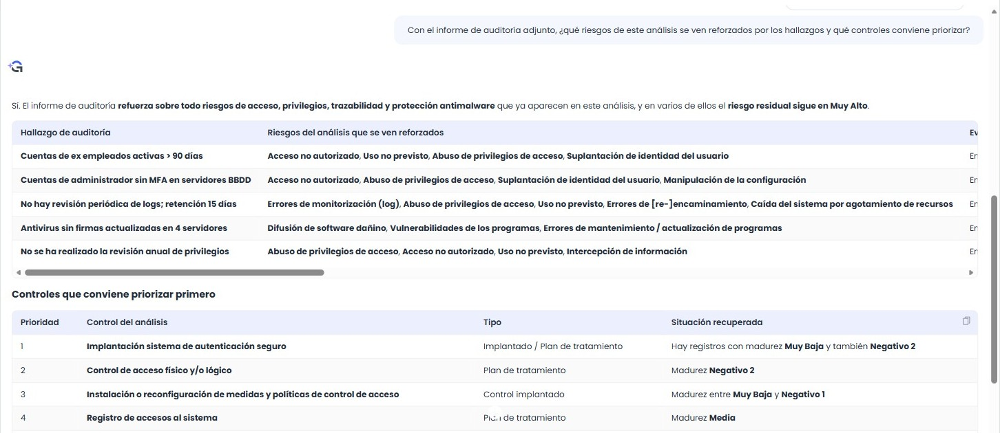

# Quantum v7.12 (Octubre 2026)

## Nuevas funcionalidades y mejoras GlobalSuite

### Inteligencia Artificial en GRC

#### MCP GlobalSuite: conecta GlobalSuite® con tu asistente de IA

Se incorpora el **MCP GlobalSuite**, el conector oficial que permite usar GlobalSuite® desde los principales asistentes de inteligencia artificial —Claude, ChatGPT, Microsoft Copilot y Cursor— mediante el estándar abierto Model Context Protocol (MCP). Si tu organización usa otro asistente, podemos valorar incluirlo más adelante.

Hasta ahora, responder a preguntas transversales —qué riesgos críticos no tienen controles, qué requisitos de una normativa tienen menor cumplimiento, qué elementos del inventario están sin valorar— obligaba a navegar por varias vistas, aplicar filtros y exportar. Con el MCP basta con preguntarlo en lenguaje natural: el asistente consulta GlobalSuite® con tu usuario y tus permisos y responde con los datos reales de tu sistema de gestión, en forma de texto, tablas, gráficas o archivos.

**PENDIENTE: SUSTITUIR LA ANIMACIÓN POR LA VERSIÓN ELEGIDA EN LA PÁGINA RAÍZ DEL MCP.**

##### Características principales

* Consulta en lenguaje natural de **Inventario**, **Análisis de Riesgos**, **Controles**, **Compliance**, **Gestor Documental** y novedades de la plataforma.
* Acciones de escritura en **Inventario, Análisis de Riesgos y Controles**: alta y modificación de elementos, creación y valoración de riesgos, controles, acciones y evidencias, y asociación de controles a riesgos, siempre con tus permisos. Cada asistente decide cuándo te pide confirmación antes de aplicar un cambio.
* Inicio de sesión con tu usuario de GlobalSuite® mediante OAuth, con tu método habitual —usuario y contraseña, Active Directory o LDAP, o Single Sign-On— y doble factor.
* Mismos permisos que en la web: el asistente accede solo a la información de tu empresa y tu sistema de gestión que tu usuario puede ver.
* Sesiones que se renuevan solas: el acceso dura 60 minutos y se renueva automáticamente; tras 7 días sin uso se solicita un nuevo inicio de sesión.
* Resultados listos para usar: tablas, gráficas, informes Word y hojas Excel, incluida la cumplimentación de plantillas de importación y de informe.
* Disponible para clientes de GlobalSuite® Cloud.

##### Beneficios

* **Respuestas en segundos** a preguntas que antes requerían navegar por varias pantallas y exportar datos.
* **Con la IA que ya usas:** sin cambiar de herramienta ni copiar información entre aplicaciones.
* **Seguridad y control:** tus credenciales, tus permisos y solo los cambios que tú pides.
* **Menos trabajo manual:** informes, gráficas y plantillas generados a partir de datos reales de GlobalSuite®.

#### Agente IA de Análisis y Evaluación de Riesgos

Evaluación de Riesgos y Análisis de Riesgos incorporan el **Agente IA**, un asistente conversacional que responde en lenguaje natural sobre el análisis que tienes abierto: qué riesgos son los más críticos, cuáles superan el nivel aceptable, qué controles siguen solo planificados o qué acciones conviene priorizar. Usa las mismas capacidades del MCP GlobalSuite, tanto para consultar como para aplicar cambios, pero integrado en la plataforma y sin necesidad de conectar ningún asistente externo.

*El Agente IA se abre desde la cabecera de Evaluación de Riesgos, en un panel lateral con consultas sugeridas para empezar.*

##### Características principales

* Acción **Agente IA** en la cabecera de Evaluación de Riesgos, en todas sus pestañas, y botón **IA** en los listados de análisis y en la pestaña Valoración de riesgos.
* Panel lateral que se abre sin salir del análisis y conserva la pestaña y los filtros. Se puede ampliar a todo el ancho del área de trabajo o cerrar, y la conversación se conserva.
* Contexto automático: el agente trabaja siempre sobre el análisis abierto, identificado con etiquetas fijas en el campo de escritura.
* Consultas sugeridas para empezar con un clic y consultas libres sobre los elementos, los riesgos, los controles y los planes de tratamiento, con respuestas en tablas y conclusiones que se pueden copiar.
* Documentos adjuntos a la consulta, por ejemplo un informe de auditoría, para relacionarlos con los riesgos y controles del análisis.
* Cambios en el análisis cuando se los pides —valorar elementos, crear riesgos, planes de tratamiento y acciones, y asociar controles a riesgos—, que solo se aplican cuando los apruebas, operación a operación.
* Avisa cuando le falta un dato, por ejemplo cuando los controles no tienen valoración de efectividad, en lugar de suponerlo.
* Disponible con el licenciamiento de IA de GlobalSuite®, con un cupo mensual de tokens por empresa.

*Con un informe de auditoría adjunto, el agente relaciona cada hallazgo con los riesgos del análisis y prioriza los controles.*

**PENDIENTE DE CONFIRMAR CON DESARROLLO ANTES DE COMUNICAR A CLIENTES: SI LA v7.12 INCLUYE LO QUE RECOGE EL PITCH CHAT-360 Y AÚN NO ESTÁ IMPLEMENTADO (MINIMIZAR, ADJUNTOS DESDE EL GESTOR DOCUMENTAL Y LAS 9 CONSULTAS SUGERIDAS), Y SI EL CUPO DE TOKENS DEL AGENTE ES PROPIO O COMPARTIDO CON EL ASISTENTE GENERAL (EN LAB-PO3 7.11.18 ES COMPARTIDO).**

##### Beneficios

* **Lectura inmediata del análisis:** de la foto de resultados a las conclusiones, sin filtros ni exportaciones.
* **Sin salir de GlobalSuite®:** el análisis y la conversación, en la misma pantalla.
* **Del diagnóstico a la acción:** recomendaciones basadas en los riesgos y planes reales del análisis, y cambios que se aplican con tu aprobación.

Para más información, puedes consultar:

* [MCP de GlobalSuite para conexión a Sistemas IA](https://globalsuitesolutions.atlassian.net/wiki/spaces/GlobalSUITEes/pages/2169765889/MCP+de+GlobalSuite+para+conexi+n+a+Sistemas+IA)
* [Guía de instalación y configuración del MCP GlobalSuite](https://globalsuitesolutions.atlassian.net/wiki/spaces/GlobalSUITEes/pages/2170781707/Gu+a+de+instalaci+n+y+configuraci+n+del+MCP+GlobalSuite)
* [Casos de uso y ejemplos de prompts del MCP GlobalSuite](https://globalsuitesolutions.atlassian.net/wiki/spaces/GlobalSUITEes/pages/2171043841/Casos+de+uso+y+ejemplos+de+prompts+del+MCP+GlobalSuite)
* [Preguntas frecuentes del MCP GlobalSuite](https://globalsuitesolutions.atlassian.net/wiki/spaces/GlobalSUITEes/pages/2171109377/Preguntas+frecuentes+del+MCP+GlobalSuite)
* [Agente IA en Riesgos](https://globalsuitesolutions.atlassian.net/wiki/spaces/GlobalSUITEes/pages/2194866191/Agente+IA+en+Riesgos)
