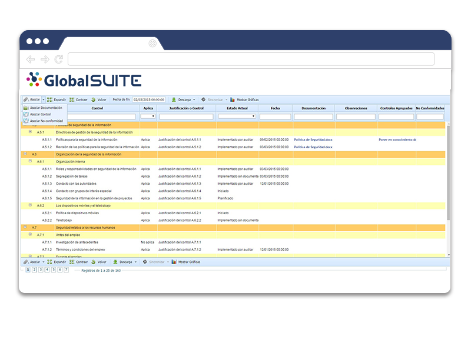
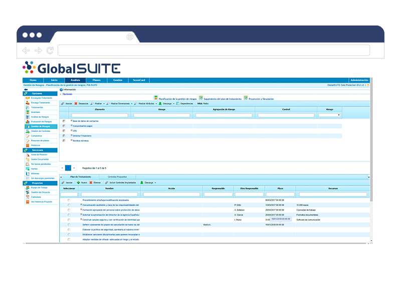
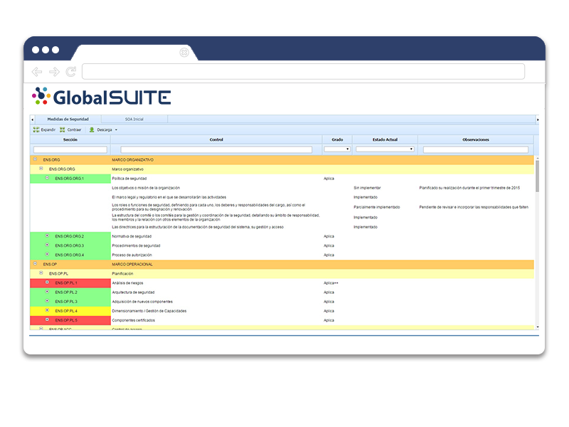
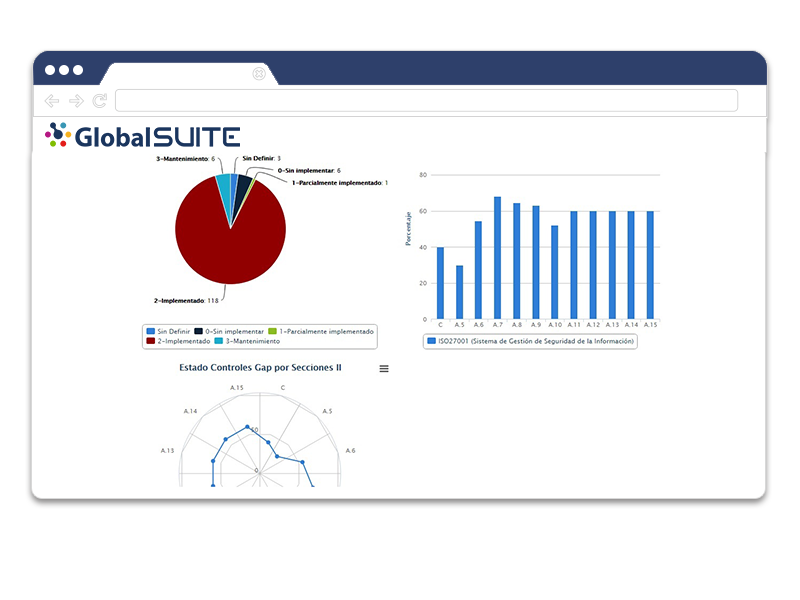
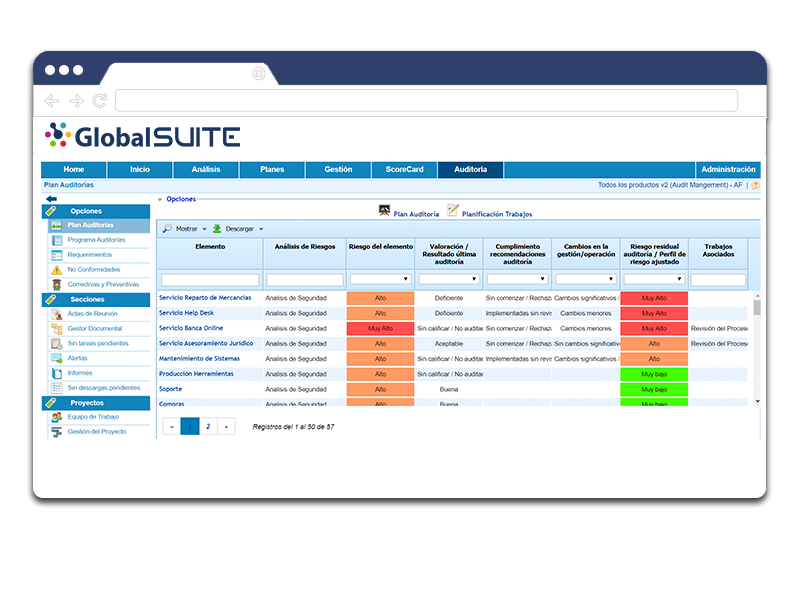

# v5.1 (Octubre 2019)

### Nuevas Funcionalidades y Mejoras generales de GlobalSUITE®

- Panel de Control de Trabajos: Vista específica para poder consultar el estado de los informes y actividades que se realizan en segundo plano, como la generación de informes, o cálculo del Análisis de Riesgos.

- En la sección de Tickets se incluyen las siguientes mejoras:

* Mejoras en la información enviada en notificaciones de Tickets. En caso de que el registro tenga asignado un WorkFlow, solamente se enviarán los campos visibles en el estado actual.
* Ampliación de la Importación de Tickets, nuevos campos permitidos (Select anidado, Workflow, Seguimientos, Impacto/Urgencia, Proveedor)
* Es posible configurar el máximo de decimales a almacenar en los campos numéricos.
* Posibilidad de establecer condiciones en los campos de Fecha, pudiendo controlar el registro de fechas anteriores o posteriores a otras.
* Descarga de Modelo Excel para realizar las importaciones de tickets.
* Cálculo de campos numéricos automáticos a partir de otros, en base a fórmulas configurables.
* Posibilidad de configurar si por defecto, se quiere notificar o no a los responsables de un estado del Workflow.
* Posibilidad de limitar la funcionalidad de Reabrir un ticket cerrado a ciertos responsables en el estado final.

- Mejoras de seguridad de la herramienta (algoritmos de cifrado)

- Mejoras en el multi-idioma de la solución. Posibilidad de configurar dimensiones y niveles del Inventario en los idiomas disponibles (Español e Inglés).

- Mayor detalle en los Logs de Acciones de la herramienta.

- Integración ADFS:

* Definición del rol de usuario por defecto.
* Creación y actualización de empleados asociados a los usuarios.
* Parametrización de URL de desconexión.
* Asignación y actualización del rol de usuario desde los datos de conexión

- Nuevo manual de usuario: accesible online, responsive y con posibilidad de búsqueda.

### GlobalSUITE® Information Security, PCI-DSS, Data Protection (GDPR), Compliance Penal

- Planes de Tratamiento en Encuestas: Posibilidad de incorporar planes de tratamiento y sus acciones en encuestas de controles, o Riesgos-Controles, para actualizar su información. Posibilidad de crear nuevos planes de tratamiento, o añadir acciones de mejora a controles ya implantados.

- Consolidación de Encuestas: Automatización de la consolidación de información en Encuestas de Elementos-Riesgos-Controles.

- Posibilidad de habilitar la vista de qué requisitos normativos afectan a un control del análisis de riesgos en la ficha del control.

### GlobalSUITE® Risk Management

- Campos numéricos automáticos en las tablas de Cuantificaciones y Recuperos, mediante el uso de fórmulas.

- Incluye además las mejoras incluidas en la sección anterior referentes a los Planes de tratamiento, Consolidación de encuestas y la posibilidad de habilitar la vista de requisitos normativos.

### GlobalSUITE® Data Protection (GDPR)

- Funcionalidades adicionales en la realización del Análisis de Impacto en la Privacidad (PIA).

* Cálculo de nivel de Riesgo por Elemento
* Cálculo de Nivel de Riesgo Repercutido por Elemento

### GlobalSUITE® Esquema Nacional de Seguridad

- Configuración de dimensiones del Inventario que se utilizan en la Valoración y Categorización del Sistema.

### GlobalSUITE® Compliance

- Nueva configuración de campos globales: Es posible configurar campos en el apartado de Compliance y Gap Analysis para facilitar la gestión de las distintas evaluaciones y normativas.

- Catálogos Compliance: Mayor tamaño en los campos de texto para describir el requisito normativo.

- Actualización de evaluaciones a partir de catálogos: Las modificaciones realizadas en un catálogo de cumplimiento (corrección de erratas, requisitos nuevos / modificados / eliminados), se pueden aplicar a las evaluaciones existentes del sistema de gestión para actualizarlos sin necesidad de crearlos de nuevo.

### GlobalSUITE® Audit Management

- Apartado de Alcance en la vista de Planificación del Trabajo. Posibilidad de visualizar qué elementos se han incorporado al mismo.

- Nuevos informes disponibles en el módulo:

* Informe Docx de metodología de Planificación de Auditoría (Administración)
* Listado Excel de Planificación de Auditorías
* Informe Excel con resultados de Planificación de Auditoría
* Listado Excel de Trabajos de Auditoría (Programa de Auditoría)
* Informe Excel con el detalle de Elementos, Riesgos, Controles, Papeles de Trabajo, Requerimientos y resultados obtenidos en la ejecución del trabajo.

- Evidencias de Controles: Posibilidad de consultar las evidencias aportadas para los controles, que justifican su implantación o efectividad.

- Nuevas Metodologías de Ejecución de Elementos, Riesgos y Controles. Es posible definir metodologías propias para ejecutar un trabajo de auditoría, con dimensiones y campos específicos de dicho proceso.

- Acceso a Mi Información en Planificación de Auditoría y Programa de Auditoría.

