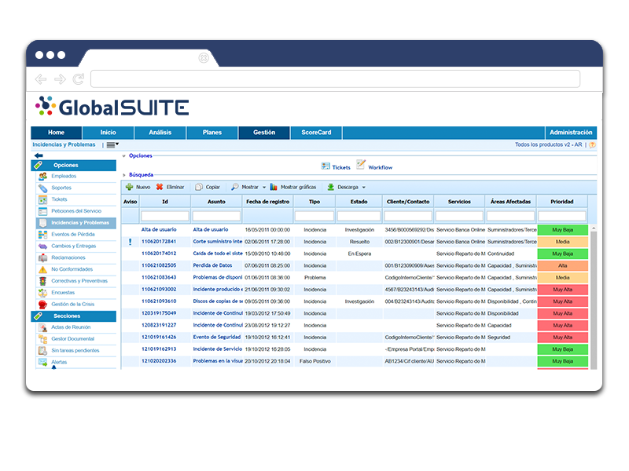
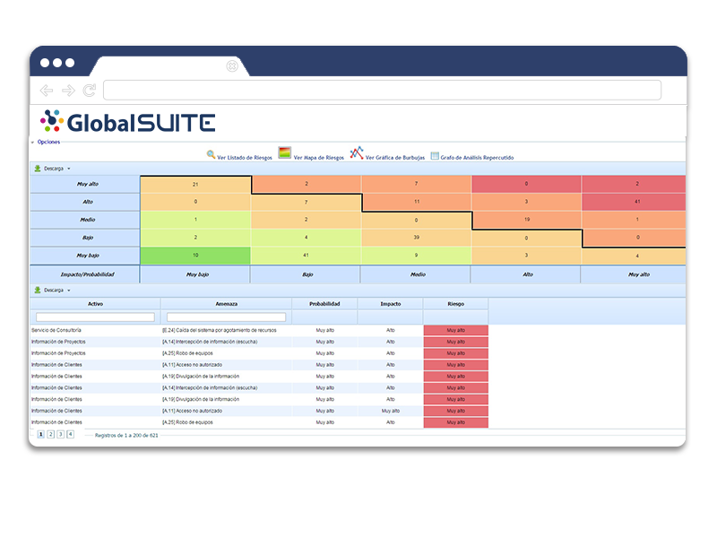
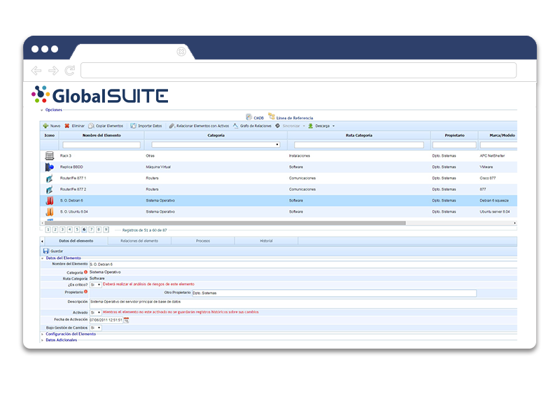
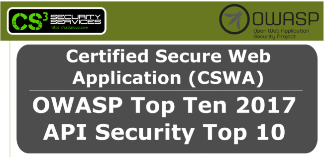

# v6.0 (Julio 2020)

### Nuevas funcionalidades y mejoras generales de GlobalSUITE®

**- Traducción y Multi-idioma**.

* Posibilidad de personalizar y configurar los textos de los parámetros de Administración en todos los idiomas disponibles. Dichos textos aparecerán en función del idioma del usuario.

**- ADFS**:

* Nuevo mecanismo de autenticación con ADFS mediante Single Sign-On (SP initiated).
* Posibilidad de integrar múltiples ADFS en un mismo entorno.

**- Gestor Documental**: Posibilidad de configurar en el Workflow si se envían alertas cuando pasa a estado Publicado.

**- Tickets**:

* Fechas automáticas: poder indicar si un campo fecha se completa automáticamente con la fecha de Creación, Modificación o Cierre de un Tickets.
* Acceso mediante link en las alertas y notificaciones de correo electrónico. Cuando se recibe una alerta, el correo incluye un enlace directo al ticket sobre el que se notifica.
* Mejoras de la Configuración de Alertas de Tickets (Intervalo Días Posterior, Intervalo Días Anterior, Campo Fecha).
* Logs completos: En el apartado de Logs de la herramienta, se almacena toda la información de los tickets, con una mayor legibilidad de la información.

### Risk Management, Information Security, PCI-DSS, Data Protection y Compliance Penal

**- Proyección y Simulación de Planes de Tratamiento** (Gestión de Riesgos). Permite valorar los planes de tratamiento y realizar proyecciones de riesgos.

**- Mapa de Riesgos**(Evaluación de Riesgos). Se puede definir qué dimensiones son visibles por defecto.

**- Encuestas de Riesgos** (desde Análisis de Riesgos). Nuevas columnas y campos para mayor información en esa vista.

**- Calcular AR en encuestas**: Posibilidad de modelar en las encuestas de Elementos, Riesgos y Controles si los cálculos se efectúan directamente al modificar valores o al pulsar un botón.

### Service Management

- Optimización de la funcionalidad de **CMDB.**

- Mejora de la gestion de relaciones entre elementos de configuración.

### Audit Management

- Ejecución de trabajos de auditoria. Visibilidad de **Papeles de Trabajo y tickets** por proceso.

- Nuevas columnas en la vista principal de **Programa de Auditoría, Fecha Inicio y Fecha Fin del trabajo**.

### Certificación de seguridad GlobalSUITE® (CSWA)

Como parte del ciclo de mejora continua en nuestros procesos de desarrollo utilizados en GlobalSUITE® hemos realizado una validación externa a través de una **auditoría de seguridad de Hacking Ético**.

Esta verificación ha sido llevada a cabo según los estándares **OWASP Top Ten 2017** y **API Security Top 10 2019**, integrando los controles propuestos por ambos estándares en nuestros procesos de verificación y cumplimiento.

Este proceso de auditoría ha permitido certificar la seguridad y resiliencia de GlobalSUITE®, trayendo consigo el **certificado CSWA**, en nuestros entornos SaaS y On Premise.

