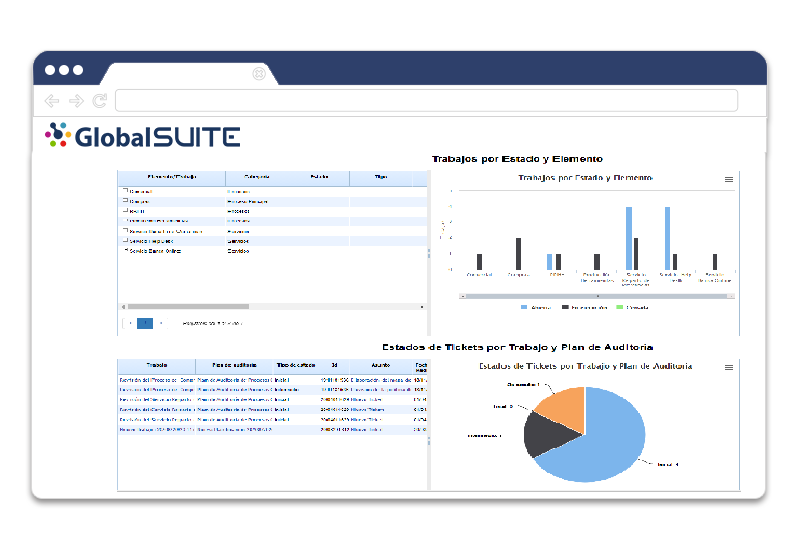

# v6.1 (Septiembre 2020)

### Nuevas funcionalidades y mejoras generales de GlobalSUITE®

- **Subentidades**: Posibilidad de configurar si los elementos propagados a las subentidades pueden ser modificados o no.

- **Optimización** de la generación de informes: Se ha optimizado la descarga de Excel en varios informes de la solución.

- Mejoras internas de rendimiento y corrección de errores.

### GlobalSUITE® Audit Management

**- Módulo de Tiempos y Costes**: Nuevo módulo para gestionar los equipos y trabajos de auditoría, pudiendo llevar seguimiento y control del proceso de auditoría interna.

**- Propagación de Auditoría**: Ahora es posible gestionar los planes y trabajos de auditoría y propagarlos a las subentidades inferiores para automatizar el proceso de planificación y definición del ciclo de auditoría.

**- Cuadro de Mando de Auditoría:** Nuevo Dashboard para el módulo de Audit Management. Este nuevo apartado permite obtener de forma visual un resumen del estado de las auditorías:

* Dedicación de Horas Planificadas y Reales por Auditor
* Horas totales por cada Trabajo de Auditoría
* Estado de los Trabajos y Planes
* Resumen de los Trabajos y estado por cada Elemento auditado
* Estado de las No Conformidades, acciones y requerimientos generados en los trabajos de auditoría

**- Consolidación de Auditoría:** Es posible ampliar el cuadro de mando de auditoría para compararlo entre las distintas entidades de la organización.

