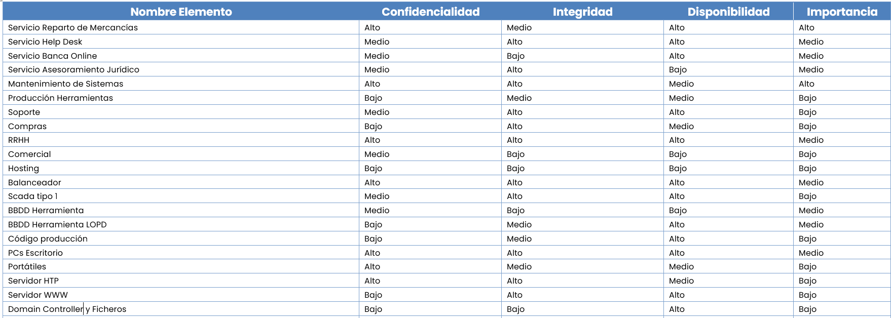

# v6.101 (Agosto 2024)

## Nuevas funcionalidades y mejoras generales de GlobalSuite®

### Ocultar el Identificador (alias) de las dimensiones en formularios e Informes.

Se ha quitado el identificador de las dimensiones con el objetivo de mejorar la usabilidad y alinear el comportamiento con el de las tablas principales. Esta mejora se aplica , a los siguientes formularios:

* [Catálogo de Servicios](https://help.globalsuitesolutions.com/es/globalsuite/v1/catalogo-de-servicios)
* [Procesos](https://help.globalsuitesolutions.com/es/globalsuite/v1/procesos)
* [Inventario](https://help.globalsuitesolutions.com/es/globalsuite/v1/inventario)
* [Tratamientos](https://help.globalsuitesolutions.com/es/globalsuite/v1/tratamientos)
* [Infraestructuras](https://help.globalsuitesolutions.com/es/globalsuite/v1/infraestructuras)
* [Proveedores](https://help.globalsuitesolutions.com/es/globalsuite/v1/proveedores)
* [Relaciones con el Negocio](https://help.globalsuitesolutions.com/es/globalsuite/v1/relaciones-con-el-negocio)
* [BIAs](https://help.globalsuitesolutions.com/es/globalsuite/v1/bia-business-impact-analysis)
* [Empleados](https://help.globalsuitesolutions.com/es/globalsuite/v1/empleados)

Además, el alias de las dimensiones también ha sido eliminado del apartado de[Informes](https://help.globalsuitesolutions.com/es/globalsuite/v1/informes), alineando así la visualización y presentación de datos en toda la plataforma.

