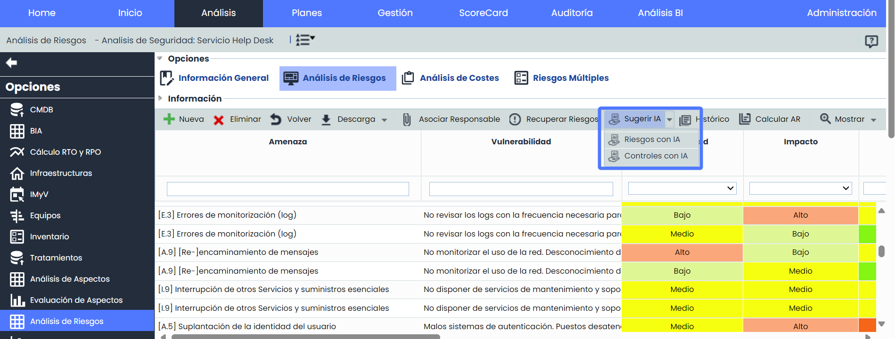
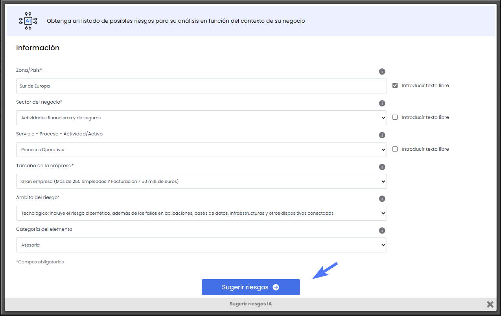
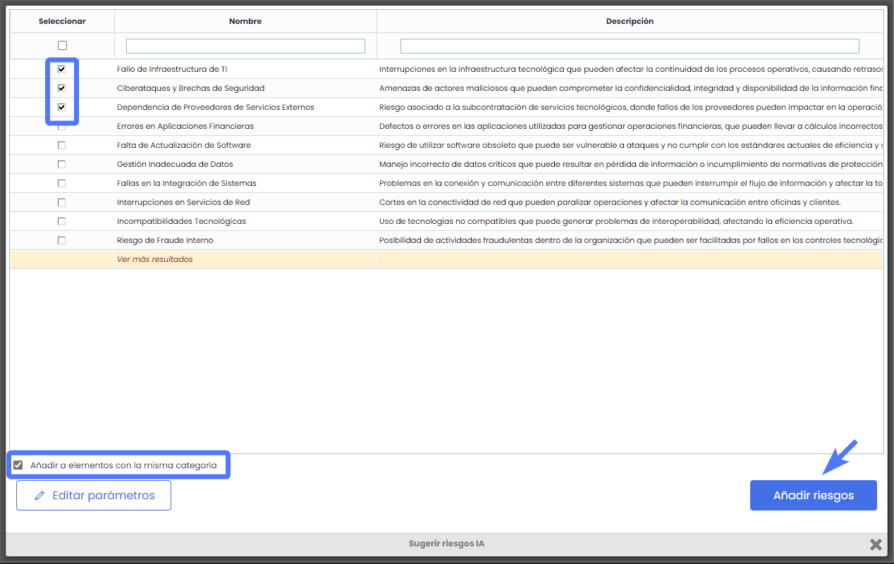
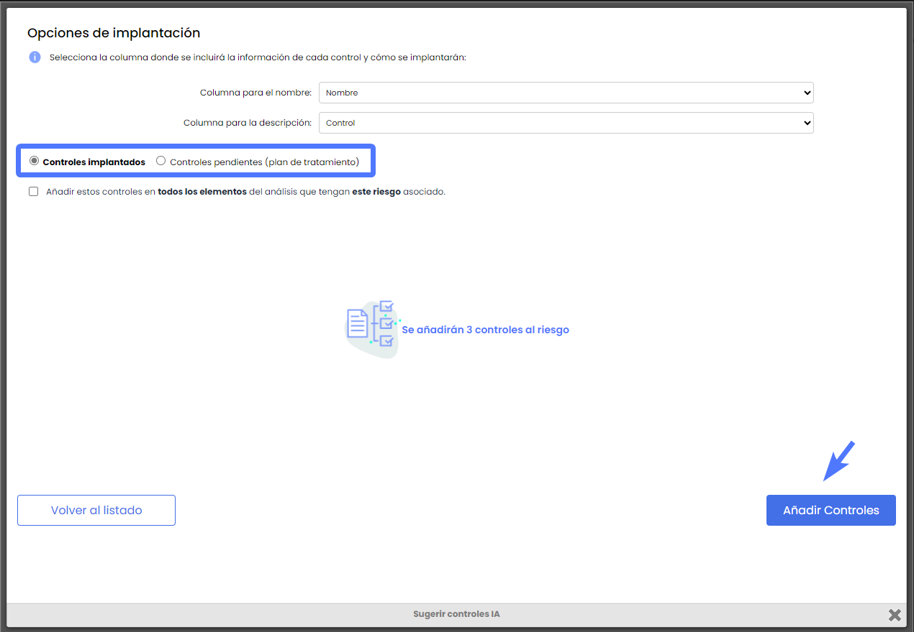
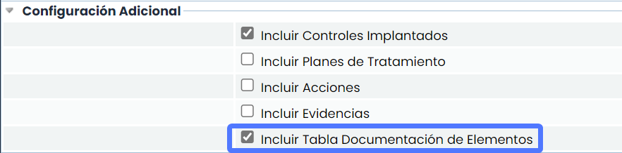
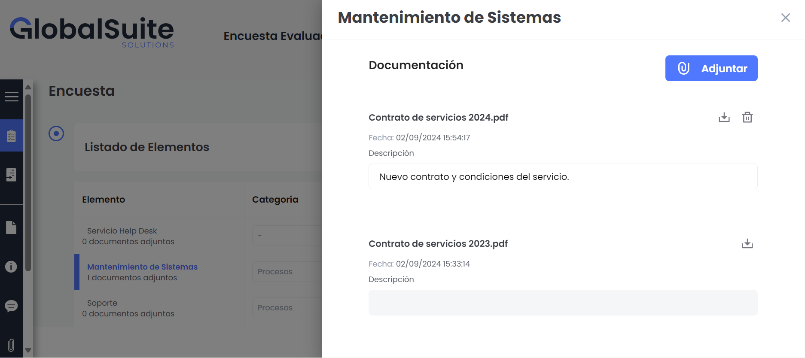
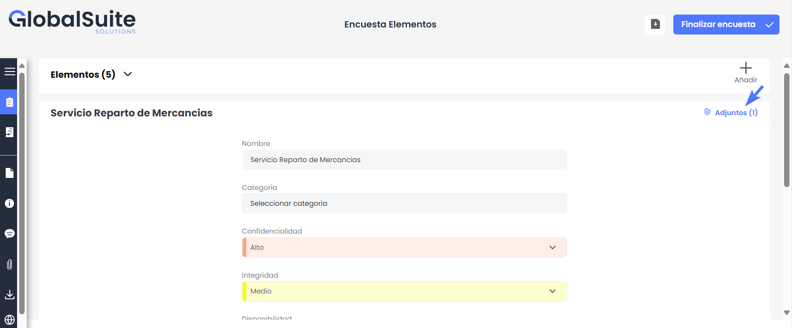

# v6.102 (Septiembre 2024)

## Nuevas funcionalidades y mejoras generales de GlobalSuite® GRC

### Recomendador Riesgos y Controles con IA


Hemos implementado un motor avanzado de recomendación basado en Inteligencia Artificial que permite generar de manera automática y precisa posibles riesgos y controles que se pueden incorporar al análisis de riesgos.
Esta funcionalidad se integra en la solución GlobalSuite® GRC, ofreciendo un enfoque dinámico y personalizado en la identificación de riesgos, sin requerir conocimientos exhaustivos ni depender de catálogos estáticos.


#### Características principales

* **Recomendaciones basadas en IA:** La herramienta sugiere riesgos y controles ajustados al contexto específico de la compañía, teniendo en cuenta el país, sector, proceso, tamaño de la empresa, y el ámbito de riesgo.

* **Identificación Dinámica de Riesgos y Controles:** La herramienta facilita la identificación automática y dinámica de riesgos y controles, sin la necesidad de depender de catálogos estáticos, mejorando la adaptabilidad del análisis.
* **Optimización del Tiempo y Esfuerzo:** Al aprovechar la potencia de la IA, se minimiza el esfuerzo manual necesario para identificar riesgos y controles, ofreciendo resultados rápidos y ajustados a las necesidades de la empresa.
* **Parámetros Configurables:** Permite ajustar y refinar los parámetros de contexto para generar resultados más precisos y personalizados, con la opción de modificar los datos para obtener nuevas sugerencias en tiempo real.
* **Flexibilidad en la Aplicación**

  * Los riesgos sugeridos pueden ser incorporados fácilmente al análisis de riesgos, permitiendo la aplicación selectiva a diferentes elementos o aplicar estos riesgos a todos los elementos con la misma categoría, incluidos en el alcance del análisis.

* Los controles recomendados pueden ser gestionados de manera flexible, ya sea como controles implantados o como parte de un plan de tratamiento, integrando así las recomendaciones en la estrategia de gestión de riesgos con el objetivo de mitigarlos.


\*\*Nota\*\*
Para conocer más detalles sobre esta funcionalidad, puedes acceder al siguiente tutorial [Descubre Nuestro Recomendador de Riesgos y Controles Potenciado por Inteligencia Artificial](https://help.globalsuitesolutions.com/es/globalsuite/v1/descubre-nuestro-recomendador-de-riesgos-y-control)


### Mejoras en encuestas ERC: Incluir documentación en Elementos


Esta mejora introduce la capacidad de incluir documentación asociada a los elementos de la encuesta, ampliando las funcionalidades y permitiendo una mejor gestión y seguimiento de la documentación relevante.
A partir de ahora, los usuarios podrán visualizar la documentación previamente asociada a los elementos desde el [Inventario](https://help.globalsuitesolutions.com/es/globalsuite/v1/inventario), así como adjuntar nueva documentación directamente en las encuestas de tipo ERC.
Esta actualización facilita un seguimiento más eficiente de la información crítica relacionada con los elementos de la encuesta.


#### Características Principales

**Incorporación de Documentación**

* **Activación Incluir Tabla Documentación:** Al activar la opción, se habilita la opción de adjuntar nueva documentación y visualizar documentación previa asociada que los elementos de la encuesta tienen en el [Inventario](https://help.globalsuitesolutions.com/es/globalsuite/v1/inventario).

Esta opción podrá habilitarse al acceder a Administración > Plantillas > [Modelos de Encuestas](https://help.globalsuitesolutions.com/es/globalsuite/v1/modelos-de-encuestas)


\*\*Nota\*\*
Para más información sobre cómo asociar documentación a los elementos del [Inventario](https://help.globalsuitesolutions.com/es/globalsuite/v1/inventario) puedes consultar el Changelog [v6.99 - Inventario y Tratamientos: Asociar y adjuntar Documentación](https://changelog.globalsuitesolutions.com/changelog/v6-99-julio-2024#v6.99(Julio2024)-InventarioyTratamientos:AsociaryadjuntarDocumentación)


**Gestión de Documentos**

* **Documentación Nueva:** Será posible adjuntar nuevos documentos a los elementos de la encuesta. Además, estos documentos podrán ser descargados y modificados directamente desde la encuesta.
* **Documentación Preexistente:** Se mostrará la documentación previamente asociada a los elementos desde el inventario como referencia. Estos documentos podrán ser descargados para consulta.

Esta opción también estará disponible en las encuestas con formato formulario


\*\*Nota\*\*
Para más información sobre cómo crear Encuestas formato formulario, puedes consultar el Changelog [v.6.99 - Encuestas Formato Formulario](https://changelog.globalsuitesolutions.com/changelog/v6-99-julio-2024#v6.99(Julio2024)-MejorasenencuestasERC:Nuevoformatoformulario)


**Consolidación**

* Al consolidar la encuesta, la documentación adjunta se integrará automáticamente al elemento correspondiente en el Inventario > [Tabla de elementos](https://help.globalsuitesolutions.com/es/globalsuite/v1/tabla-de-elementos), asegurando que toda la información esté centralizada y actualizada.

**Seguimiento y Trazabilidad**

* **Registro de Adjuntos:** Cada vez que se adjunta un nuevo documento a un elemento, se registra automáticamente en la encuesta, garantizando una completa trazabilidad de los cambios y adiciones realizadas.
