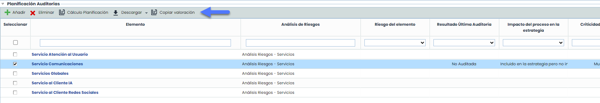
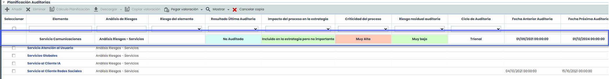
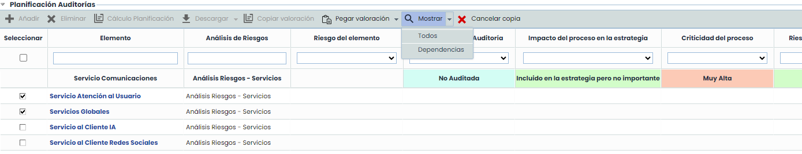
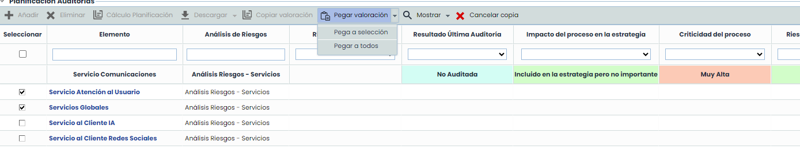

# v6.103 (Septiembre 2024)

## Nuevas funcionalidades en GlobalSuite - Audit Management

### Ayudas en valorar Planificación Auditoría


En esta versión, hemos introducido mejoras en el módulo de Auditorías, específicamente la funcionalidad de "Copiar valoración", diseñada para optimizar y agilizar la planificación de auditorías. Estas mejoras están dirigidas a los Auditores, permitiéndoles copiar valoraciones manuales entre distintos registros, facilitando así la gestión de grandes volúmenes de datos.


#### Características principales

* **Copiar Valoración:**

Se podrán copiar los valores de las dimensiones manuales de los elementos de la planificación. Para ello, primero hay que seleccionar el elemento 'origen' mediante el check, y luego, con la opción 'Copiar Valoración', se fijará este elemento en la cabecera de la tabla para tenerlo como referencia.

Al fijar el elemento origen, este se retira del listado de elementos. Mientras esté fijado, es posible aplicar filtros y ordenar la tabla para facilitar la búsqueda de elementos específicos.

Luego de presionar Copiar Valoración, las opciones del toolbar de la tabla cambiaran, mostrando habilitadas las relacionadas con la copia de valoración.

* **Mostrar Dependencias:**

Al seleccionar el elemento original, la opción "Mostrar > Dependencias" permitirá visualizar los elementos dependientes, facilitando la comprensión de las relaciones entre registros.

* **Pegar Valoración:**

Las valoraciones del elemento original se podrán pegar en todos o varios registros visibles en la tabla. Si se aplican filtros, solo se pegará en los elementos visibles.

Solo se copiarán las dimensiones manuales; las automáticas deberán actualizarse manualmente con la opción "Calcular Planificación".


Para mas información sobre el módulo de Audit Management de GlobalSuite®, puedes ver el manual correspondiente en nuestro [Centro de recursos](https://help.globalsuitesolutions.com/es/globalsuite/v1/auditoria).

