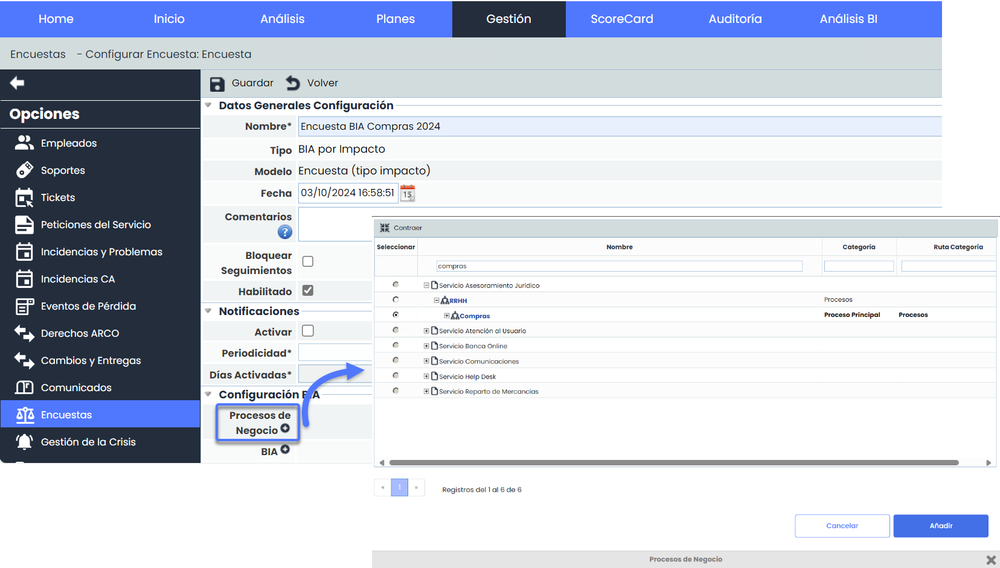

# v6.104 (Octubre 2024)

## Nuevas funcionalidades y mejoras generales de GlobalSuite® Continuity

### Configuración de Encuestas BIA - Mejora en la selección de Procesos de Negocio


Se ha optimizado la usabilidad del campo “Proceso de negocio” en la [Configuración de encuestas BIA](https://help.globalsuitesolutions.com/es/globalsuite/v1/encuestas-bia-configuracion). El desplegable ha sido reemplazado por una ventana interactiva con estructura en árbol, mejorando la visualización y selección de los procesos, especialmente en organizaciones con numerosos procesos y subprocesos.


#### Características Principales

* **Nueva ventana de selección**

  * **Estructura**  
    El campo desplegable "Proceso de negocio" ha sido sustituido por una ventana con estructura de árbol que permite navegar de forma intuitiva a través de la jerarquía de Servicios > Procesos, facilitando la selección.
  * **Filtros**  
    Se han añadido filtros de texto para los campos de Nombre, Categoría y Ruta de Categoría, permitiendo búsquedas más rápidas y precisas.
  * **Ordenación**  
    El contenido del modal puede ordenarse alfabéticamente, tanto por servicios como por procesos, facilitando su rápida ubicación.

