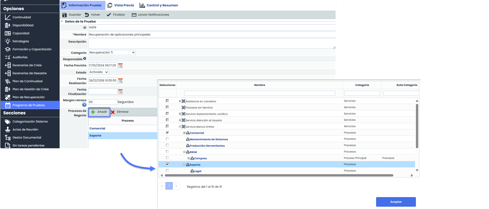

# v6.105 (Octubre 2024)

## Nuevas funcionalidades y mejoras generales de GlobalSuite® Continuity

### Programa de Pruebas - Tabla Procesos de Negocio


Esta mejora introduce la tabla "Procesos de Negocios" en la opción [Programa de Pruebas,](https://help.globalsuitesolutions.com/es/globalsuite/v1/programa-de-pruebas) permitiendo la asociación procesos, con el objetivo de mejorar la gestión y visibilidad de los mismos dentro del ciclo de pruebas.


#### Características Principales

**Nueva tabla Procesos de Negocio**

* Se incorpora esta nueva tabla en todos los formularios de Programas de pruebas.
* Permite la gestión directa de los procesos asociados al programa.
* Campos:

  * Cada proceso se añade como un enlace que redirige al formulario correspondiente del proceso.
  * Los campos RTO, RPO y MTPD muestran datos extraídos del BIA consolidado del proceso.

**Nueva ventana de selección**

* Permite añadir nuevos procesos a través de una ventana con estructura de árbol que permite navegar de forma intuitiva a través de la jerarquía de Servicios > Procesos, facilitando la selección.

  * **Filtros**

    * Se han añadido filtros en todos los campos de la ventana, permitiendo búsquedas más rápidas y precisas.
    * Posibilidad de aplicar múltiples filtros a la vez en distintos campos, mejorando la precisión de la búsqueda
  * **Ordenación**  
    Los procesos se presentan ordenados alfabéticamente en cada nivel para facilitar su selección, lo que permite una rápida ubicación de los procesos requeridos.

