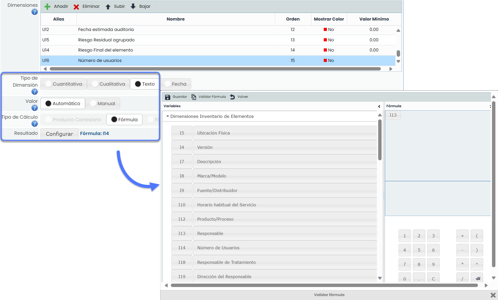
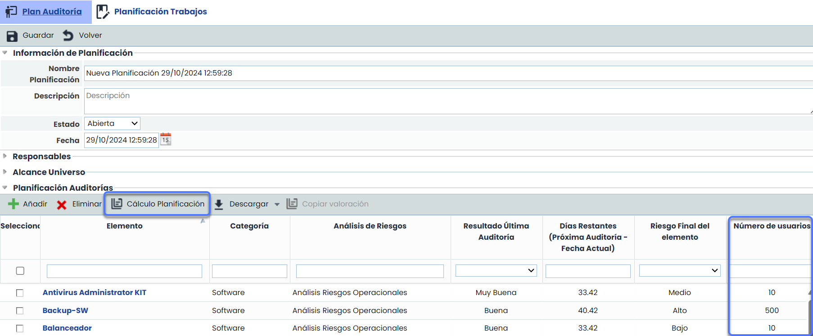
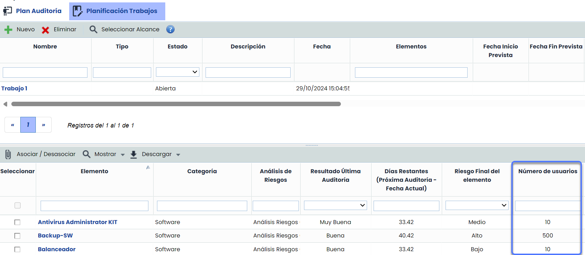

# v6.106 (Noviembre 2024)

## Nuevas funcionalidades y mejoras GlobalSuite® Audit Management

### Configuración de Dimensiones Textuales Automáticas


Esta mejora introduce la posibilidad de configurar dimensiones textuales automáticas en la planificación de auditoría, con el objetivo de facilitar la copia y visualización de dimensiones textuales desde el Inventario en la [Metodología de planificación de auditoría](https://help.globalsuitesolutions.com/es/globalsuite/v1/metodologias-auditorias#MetodologíasAuditorías-ConfiguracióndelaMetodología).


#### Características principales

* **Configuración de Dimensiones Textuales:** Permite configurar dimensiones textuales automáticas en la [Metodología de planificación de auditoría](https://help.globalsuitesolutions.com/es/globalsuite/v1/metodologias-auditorias#MetodologíasAuditorías-ConfiguracióndelaMetodología) y seleccionar este tipo de dimensiones del Inventario en el editor de fórmulas.

* **Tabla de** [**Plan Auditoría**](https://help.globalsuitesolutions.com/es/globalsuite/v1/plan-auditoria):

  * **Visualización:** Las dimensiones textuales automáticas se muestran por defecto y podrán ocultarse desde la cabecera de la tabla.
  * **Cálculo Planificación**: Las dimensiones textuales se actualizan automáticamente para cada elemento durante el cálculo de planificación.

* **Visualización en la Pestaña** [**Planificación Trabajos**](https://help.globalsuitesolutions.com/es/globalsuite/v1/planificacion-trabajos)**:** Las dimensiones textuales automáticas se muestran por defecto en la tabla inferior.

* **Informe Excel**: Se incluye las dimensiones textuales automáticas en los informes descargable de ambas vistas en formato Excel.
* **Propagación**: En caso de disponer de [subentidades](https://help.globalsuitesolutions.com/es/globalsuite/v1/subentidades), se incluyen las dimensiones textuales automáticas en la propagación de datos de la planificación.

### Integración Syslog / SIEM


Esta nueva funcionalidad permite enviar al sistema de recepción de logs y registros que tenga la compañía (Servidor de syslog o SIEM) los logs de GlobalSuite, tanto los [Logs de Accesos](https://help.globalsuitesolutions.com/es/globalsuite/v1/logs-de-accesos) como los [Logs de Acciones](https://help.globalsuitesolutions.com/es/globalsuite/v1/logs-de-acciones) y poder almacenarlos de forma centralizada para todo el ecosistema de soluciones corporativas, como para procesarlos y detectar anomalías y potenciales problemas de seguridad.


#### Características principales

GlobalSuite GRC ahora se integra de forma nativa con el servidor Syslog o SIEM de su organización, proporcionando una visibilidad centralizada y segura de la actividad en todas sus aplicaciones corporativas. Esta nueva funcionalidad utiliza el estándar [RFC 5424](https://datatracker.ietf.org/doc/html/rfc5424#section-6) para enviar los logs en un formato común, asegurando la compatibilidad y el cumplimiento de formatos de registro reconocidos. Entre sus principales características, permite el envío de logs de acceso, así como de logs detallados de acciones clave (creación, modificación y eliminación de registros). Esta integración facilita el control unificado de eventos críticos y optimiza la capacidad de respuesta en la gestión de riesgos.


\*\*Nota\*\*
Para más información, ponte en contacto con el equipo de [soporte.](https://support.services.globalsuitesolutions.com/servicedesk/customer/user/login?destination=portals)

