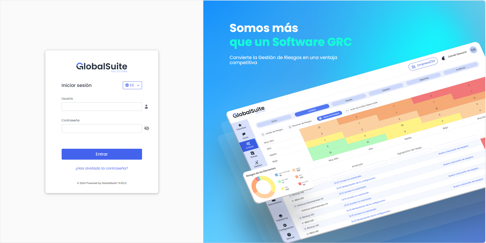

# v6.107 (Noviembre 2024)

## Nueva interfaz de GlobalSuite® GRC


En esta nueva versión, lanzamos una nueva interfaz de nuestra solución, diseñada para mejorar la experiencia de nuestros usuarios además de una modernización, no solo en la apariencia, sino en la arquitectura, para optimizar y hacer una plataforma más resiliente en el futuro.


#### Características principales

* **Nueva página de login**: Mejorado y simplificado el proceso de autenticación, modernizando la pantalla y agilizando el proceso [Más Información sobre Login](https://help.globalsuitesolutions.com/es/globalsuite/v1/acceso-a-la-plataforma)
* **Nueva estructura de menú:** Se ha reestructurado y simplificado el menú. [Más Información sobre el Menú](https://help.globalsuitesolutions.com/es/globalsuite/v1/navegacion-del-menu)
* **Nueva opción de Favoritos:** Se ha incorporado una mejora funcional para poder configurar accesos directos a los apartados más utilizados y poder acceder directamente [Más Información sobre Favoritos](https://help.globalsuitesolutions.com/es/globalsuite/v1/favoritos)
* **Nueva pantalla centralizada para Elegir Empresa y Sistema de Gestión**: Se ha simplificado el acceso y la navegación a distintas empresas o Entidades de un entorno, facilitando y centralizado el acceso [Más Información sobre Elegir Empresa y Sistema de Gestión](https://help.globalsuitesolutions.com/es/globalsuite/v1/elegir-sg)

#### Principales cambios tecnológicos

* Nueva arquitectura Clean: Separa claramente las capas del desarrollo para dotar al producto de más resiliencia en el cambio.

* Nueva interfaz orientada a componentes y a la reutilización de los mismos, reduciendo el tiempo de desarrollo.

* Arquitectura serverless donde se elimina la parte del servidor de los clientes haciéndolos mucho más ligeros de tamaño y fáciles de desplegar y cargar.

* Nuevo sistema de registro de logs para centralizar la trazabilidad de la información.


\*\*Más Información\*\*
Para conocer más detalles sobre este cambio, puedes acceder al siguiente artículo [Descubre los principales cambios de la Nueva Interfaz GlobalSuite](https://help.globalsuitesolutions.com/es/globalsuite/v1/descubre-los-principales-cambios-de-la-nueva-inter)

