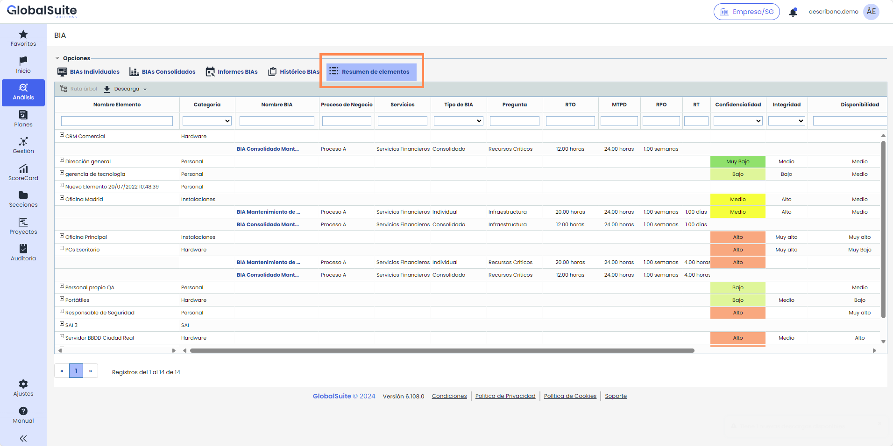
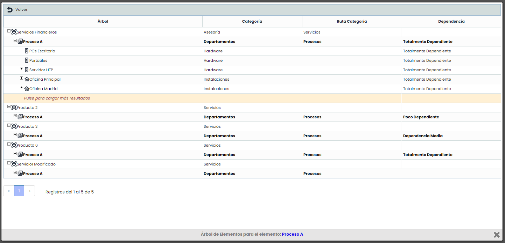
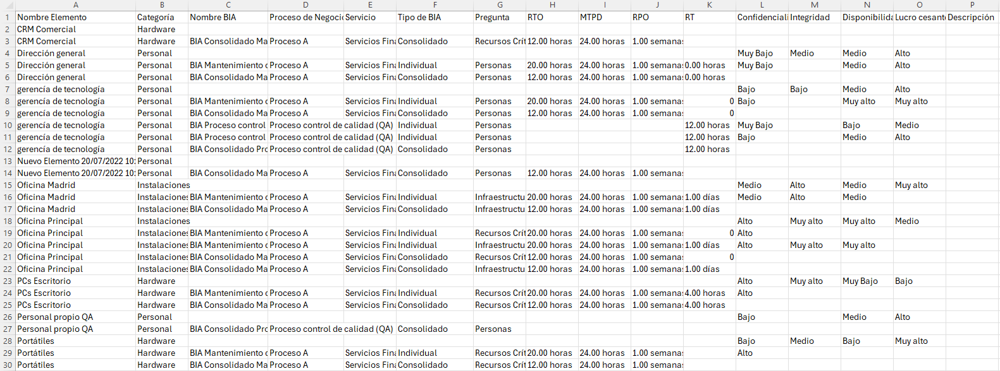

# v6.108 (Diciembre 2024)

## Nuevas funcionalidades y mejoras GlobalSuite® Continuity

### Nueva vista de Elementos en BIAs


Este nuevo apartado de la funcionalidad de [\*\*BIAs\*\*](https://help.globalsuitesolutions.com/es/globalsuite/v1/bia-business-impact-analysis)permite visualizar de forma ágil, los elementos identificados como necesarios para los Procesos de Negocio en las preguntas viendo toda la información de los elementos necesarios para llevar a cabo las actividades, de los propios procesos y del BIA.


#### Características principales

* **Visualización agregada:** Permite mostrar toda la información de los elementos identificados como necesarios para los Procesos de Negocio evaluados en los BIAs a través de las preguntas de tipo Tabla Elementos. Esta información será tanto la propia del elemento del Inventario, como la del Proceso de Negocio y el BIA.


\*\*Nota\*\*
Para más detalles sobre cómo configurar y utilizar las Tablas de Elementos en los BIAs, consulta el tutorial: [¿Cómo configurar y utilizar las Tablas de Elementos en los BIAs de GlobalSuite®?](https://help.globalsuitesolutions.com/es/globalsuite/v1/como-configurar-y-utilizar-las-tablas-de-elementos)


* **Filtrado de información:** Se puede realizar búsquedas por distintos parámetros (nombre, categoría, tipo de BIA, valores de dimensiones, etc.) para poder localizar resultados.
* **Visualización en árbol:** Para un proceso o elemento concreto, es posible visualizar en una ventana específica su ubicación dentro del árbol de dependencias y donde está ubicado.

* **Informe CSV**: Se incluye la posibilidad de descargar los elementos y los BIAs en los que se han identificado con todos los campos en un informe en segundo plano en formato CSV, incluyendo los filtros aplicados para obtener solo los resultados que se deseen.


\*\*Nota\*\*
Esta vista sólo estará disponible cuando se tenga configurada para el formulario del BIA alguna dimensión de tipo Tabla Elementos en el apartado de [Configuración BIA](https://help.globalsuitesolutions.com/es/globalsuite/v1/configuracion-bia#Configuraci%C3%B3nBIA-PreguntasPersonalizadas).

