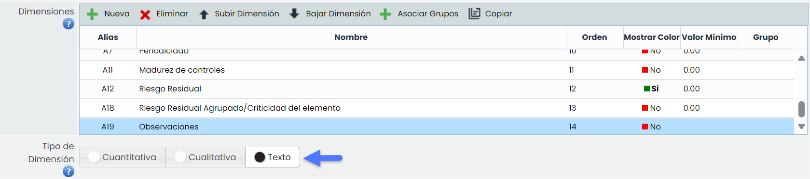
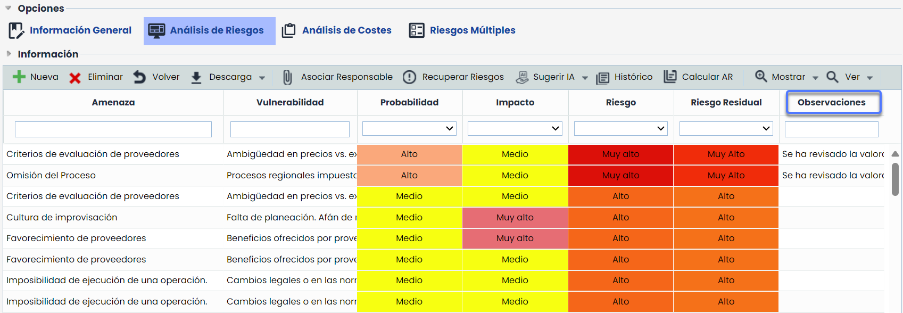
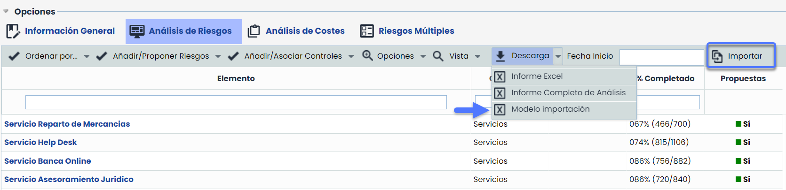
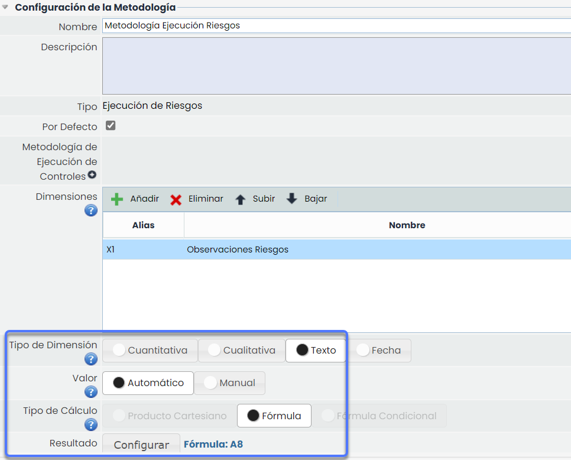
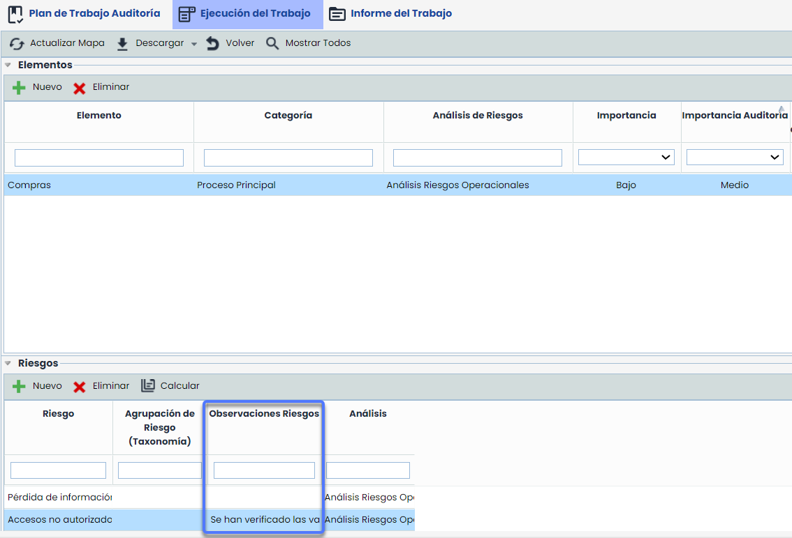
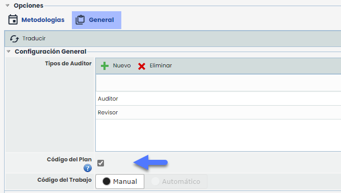
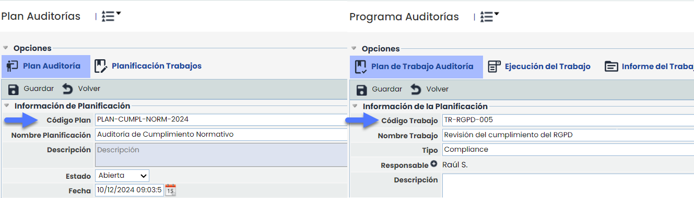
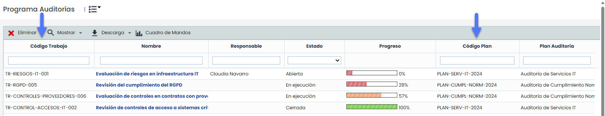

# v6.109 (Diciembre 2024)

## Nuevas funcionalidades y mejoras GlobalSuite® GRC

### Dimensiones Textuales en Metodología de Riesgos


Esta mejora introduce la posibilidad de configurar dimensiones de tipo texto dentro de las [metodologías de riesgos](https://help.globalsuitesolutions.com/es/globalsuite/v1/metodologia-riesgos), con el objetivo de mejorar la flexibilidad y personalización en el análisis, visualización y gestión de datos relacionados con la gestión de riesgos.
Esta funcionalidad permite:
\* Posibilidad de intercalar campos textuales con otro tipo de dimensiones cualitativas o cuantitativas.
\* Capacidad para renombrarlas y personalizar cuáles se incluyen en las plantillas e Informes.
\* Posibilidad de incluirlas como dimensiones obligatorias en encuestas, y que se puedan editar para riesgos existentes.


### Características principales

#### Configuración de dimensiones textuales en la metodología de riesgos

Se permite la creación de dimensiones de tipo texto desde Ajustes > Metodología > [Riesgos](https://help.globalsuitesolutions.com/es/globalsuite/v1/metodologia-riesgos)

#### Visualización

Las dimensiones textuales se podrán visualizar en las siguientes opciones:

* [Análisis de Riesgos](https://help.globalsuitesolutions.com/es/globalsuite/v1/analisis-riesgos):

**Tabla y formulario**

**Importación**

* Se han incorporado las dimensiones textuales en el modelo de importación.
* Se podrán mapear e importar dimensiones textuales como cualquier otra dimensión.

* [Evaluación de Riesgos](https://help.globalsuitesolutions.com/es/globalsuite/v1/evaluacion-de-riesgos): Las dimensiones textuales se visualizarán en las evaluaciones de riesgos para facilitar su análisis. Específicamente en las opciones de [Resumen de Riesgos](https://help.globalsuitesolutions.com/es/globalsuite/v1/resumen-de-riesgos) y [Ver Mapa de Riesgos](https://help.globalsuitesolutions.com/es/globalsuite/v1/ver-mapa-de-riesgos).
* [Históricos](https://help.globalsuitesolutions.com/es/globalsuite/v1/historicos): Se incluye el registro de las dimensiones textuales en los históricos, permitiendo consultar su evolución.
* [Encuestas](https://help.globalsuitesolutions.com/es/globalsuite/v1/encuestas): Se podrán incluir estas dimensiones en los [modelos de encuesta](https://help.globalsuitesolutions.com/es/globalsuite/v1/modelo-encuesta-elementos-riesgos-y-controles) de riesgos y en los formularios de encuestas podrá visualizarse el contenido de las mismas.
* [Auditoría](https://help.globalsuitesolutions.com/es/globalsuite/v1/auditoria).

  * Se habilita la posibilidad de seleccionar dimensiones textuales de riesgos en la metodología de ejecución.
  * Estas dimensiones se integran automáticamente en los trabajos de auditoría junto con su información.

* [Tickets](https://help.globalsuitesolutions.com/es/globalsuite/v1/tickets): Para los tickets que tengan campos tipo SIMULATION RISK o THREATS, se mostrarán las dimensiones de texto con su valoración correspondiente.

#### Compatibilidad en informes

Las dimensiones textuales están incluidas en los informes generados para todas las opciones anteriores, garantizando su visibilidad y trazabilidad.

## Nuevas funcionalidades y mejoras GlobalSuite® Audit

### Auditorias – Código en Planes y Trabajos de Auditoría


Esta mejora introduce el campo "Código" en los planes y trabajos de auditoría para identificarlos de forma única. En esta actualización, se incluye la posibilidad de definir estos códigos de forma manual.
En próximas versiones, se añadirá la opción de configurar la generación automática de códigos para los trabajos, y que estos se construyan para cada trabajo del [Programa de Auditoría](https://help.globalsuitesolutions.com/es/globalsuite/v1/programa-auditorias) de forma unívoca y sin intervención manual.


#### Configuración Código Manual

Para habilitar esta funcionalidad, se debe acceder a **Ajustes > Auditorías > General** y activar el check Código del Plan. Al hacerlo, los campos "Código de Plan" y "Código de Trabajo" estarán disponibles en los formularios de planes y trabajos, respectivamente

#### Funcionalidad

Los campos "Código de Plan" y "Código de Trabajo" estarán visibles en los formularios de planes y trabajos una vez habilitados y podrán editarse mientras el plan o trabajo permanezcan abiertos.

Los códigos estarán visibles en tablas, tickets e informes relacionados con auditorías.

**Copia de Plan/ Trabajo:** Al copiar un plan o trabajo, los códigos no se duplicarán y quedarán en blanco para completarse posteriormente.

**Propagación**: Al propagar un plan, este y sus trabajos se copiarán junto con sus códigos.
