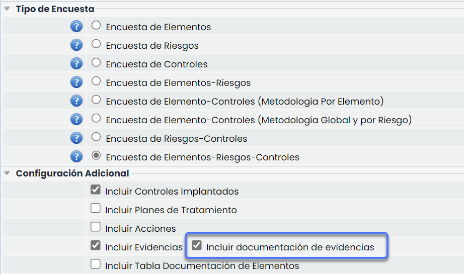
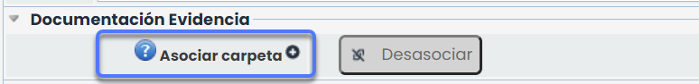
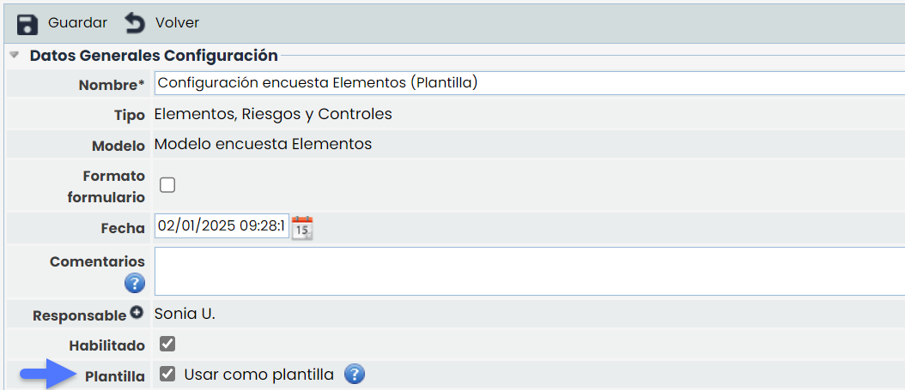
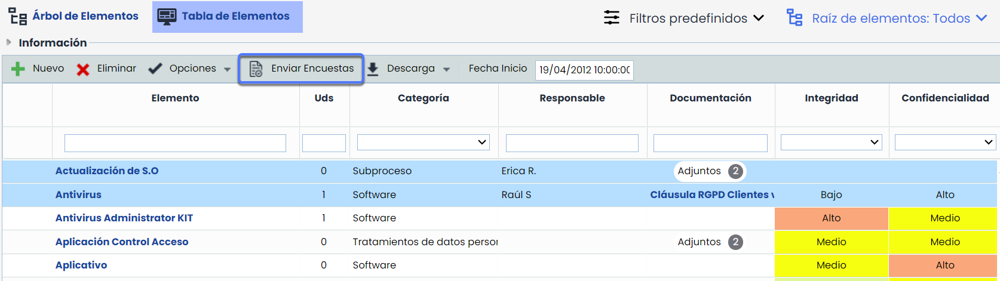
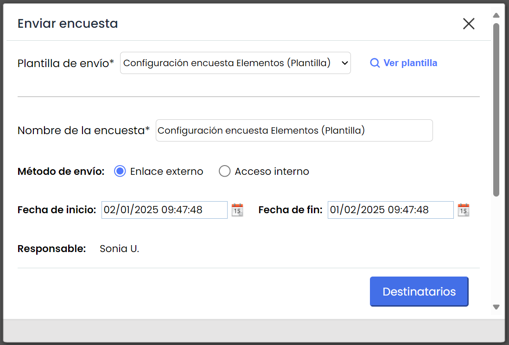
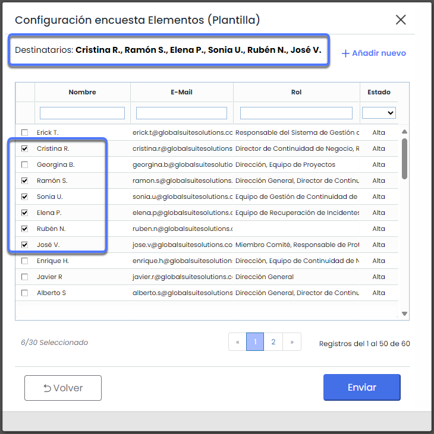

# v6.110 (Enero 2025)

## Nuevas funcionalidades y mejoras GlobalSuite® GRC

### Mejoras en Encuestas con evidencias


Esta mejora introduce la capacidad de gestionar la visibilidad de la documentación asociada a las evidencias en las encuestas, principalmente permitiendo:
\* Consultar documentos anteriores asociados a las evidencias en las encuestas.
\* Consolidar la documentación de evidencias en distintas carpetas dentro del [Gestor Documental](https://help.globalsuitesolutions.com/es/globalsuite/v1/gestor-documental).
\* Adicionalmente, se podrá restringir el acceso a la documentación de las evidencias, lo que potenciará la solución de TPRM, permitiendo que cada proveedor vea solo la documentación relevante para él en las encuestas.


#### Características principales

##### Visualización de documentación asociada a la evidencia

Permite configurar si la documentación asociada a las evidencias será visible en las encuestas.

Esta opción se habilita en Ajustes > [Modelos de encuestas](https://help.globalsuitesolutions.com/es/globalsuite/v1/modelo-encuesta-elementos-riesgos-y-controles)

##### Consolidación de documentación

* Garantiza que los documentos recopilados durante la encuesta se consoliden en carpetas específicas del Gestor Documental.
* Ofrece flexibilidad para definir el destino de la documentación consolidada.

##### Configuración de visibilidad y consolidación de documentación

Existen dos opciones para gestionar la visibilidad de los documentos mostrados en las encuestas:

* **Visibilidad total de la documentación de la evidencia** > **Sin carpeta asociada**

  * Si no se selecciona ninguna carpeta y se incluye más de un elemento en el alcance, en la encuesta se mostrarán todos los documentos de las evidencias.
  * La consolidación de la encuesta se realiza en la carpeta "Evidencias Encuestas".
* **Restringir la visibilidad de la documentación de las evidencias > Asociar carpeta**

  * Los documentos visibles en la encuesta serán únicamente los que estén incluidos en la carpeta seleccionada y que estén asociados a la evidencia.
  * La consolidación de la encuesta se realiza en la misma carpeta seleccionada.

##### Opción TPRM

Para los usuarios del módulo de TPRM, se ofrece una opción que simplifica la creación de carpetas para cada proveedor. En lugar de tener que crear manualmente una carpeta para cada uno, la carpeta se generará automáticamente al consolidar la encuesta.

Además, al consolidarse la encuesta, la documentación se consolidará en esa misma carpeta generada.

Estas configuraciones se realizan en Encuestas > [Configuración](https://help.globalsuitesolutions.com/es/globalsuite/v1/encuestas-elementos-riesgos-y-controles-configurac)


\*\*Más Información\*\*
Para mas información sobre esta funcionalidad, puedes ver el manual en nuestro [Centro de recursos](https://help.globalsuitesolutions.com/es/globalsuite/v1/encuestas-elementos-riesgos-y-controles-configurac#EncuestasElementos,RiesgosyControles(Configuración)-DocumentaciónEvidencia).


### Automatización de envío de encuestas desde el Inventario mediante plantillas


Esta mejora introduce la posibilidad de definir plantillas de encuestas, para dar la posibilidad de lanzar encuestas de elementos desde Inventario > [Tabla de elementos](https://help.globalsuitesolutions.com/es/globalsuite/v1/tabla-de-elementos). Con esta funcionalidad, además de enviar encuestas de manera centralizada desde [Gestión de Encuestas](https://help.globalsuitesolutions.com/es/globalsuite/v1/gestion-encuestas), se dará capacidad a los usuarios de enviar encuestas directamente desde el Inventario a partir de estas plantillas, agilizando y simplificando el proceso, y dando capacidad a usuarios sin privilegios de administración de encuestas para enviar encuestas seleccionando uno o varios elementos a incluir en el alcance y configurando rápidamente el envío.


#### Características principales

* **Envío automatizado de encuestas ERC de elementos:** Se podrá realizar el envío automatizado de encuestas desde el Inventario, con un alcance de uno o más elementos.
* **Método de envío**: Podrán enviarse encuestas mediante enlace externo (a través de link único), como encuestas de acceso interno para que la completen otros usuarios de GlobalSuite®.
* **Gestión de destinatarios**: La encuesta se podrá enviar al responsable del elemento seleccionado o a otra persona de entre los empleados registrados o añadiendo destinatarios manualmente ingresando su nombre y correo electrónico.

**Acceso a la opción**

Para habilitar esta opción, en Encuestas > [Configuración de Encuestas](https://help.globalsuitesolutions.com/es/globalsuite/v1/encuestas-elementos-riesgos-y-controles-configurac) deberá marcarse el check Plantilla en una configuración de encuesta de tipo ERC de elementos.

Al marcar una configuración de encuesta como Plantilla, no podrá elegirse un alcance de elementos concretos, ya que estos se seleccionan en el momento de lanzarse.

En caso de que haya Plantillas habilitadas, en Inventario > Tabla elementos se podrá seleccionar uno o varios elementos y pulsar **Enviar encuestas.**

**Configuración de envío**

En la ventana que se abrirá se deberá seleccionar en el desplegable **Plantilla de envío**, la configuración deseada, el método de envío y las fechas de inicio y fin.

**Selección destinatarios**

Luego de elegir la plantilla, se deberá pulsar **Destinatarios**.

En esta ventana se podrán seleccionar los destinatarios de la encuesta desde el listado de empleados, o bien podrán añadirse nuevos manualmente, mediante la opción **Añadir nuevo**.

En caso de que el elemento o elementos seleccionados tengan responsable definido, este aparecerá como destinatario automáticamente aunque podrá modificarse para enviarlo a un tercero.

Una vez configurados todos los campos y seleccionados los destinatarios, y pulsar **Enviar**, se generarán las encuestas automáticamente según lo configurado.

Estas encuestas lanzadas desde Inventario a partir de una plantilla se podrán gestionar y hacer seguimiento desde el apartado de Encuestas > [Gestión de Encuestas](https://help.globalsuitesolutions.com/es/globalsuite/v1/gestion-encuestas), según el workflow definido.
