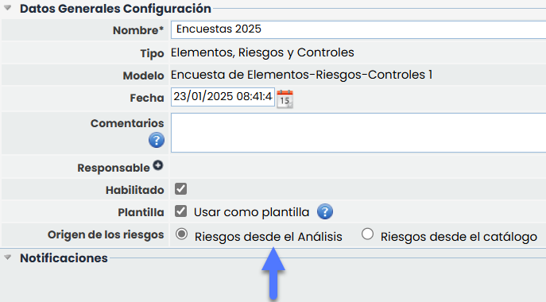
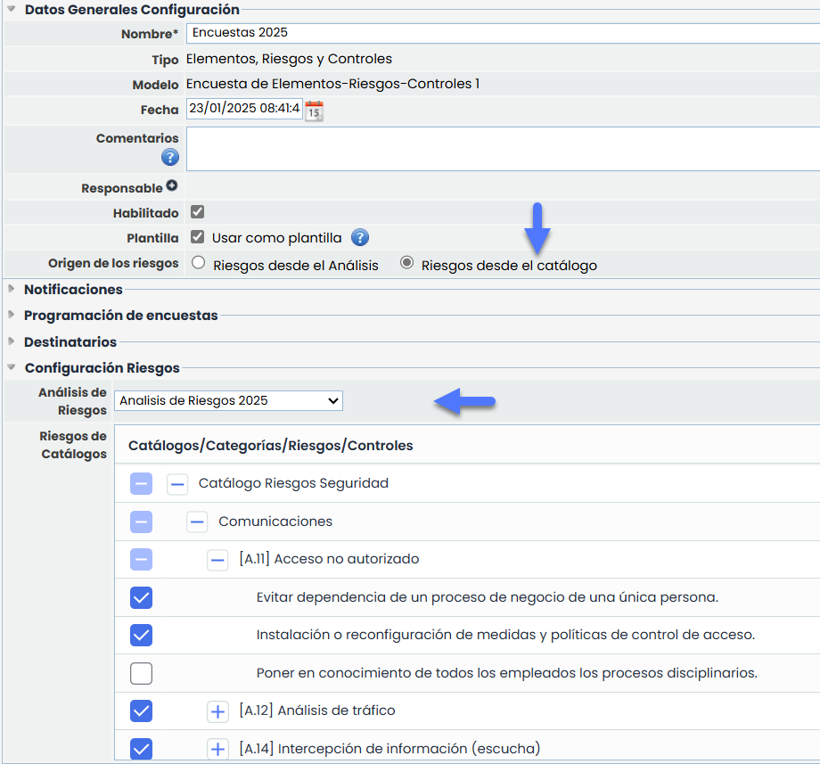
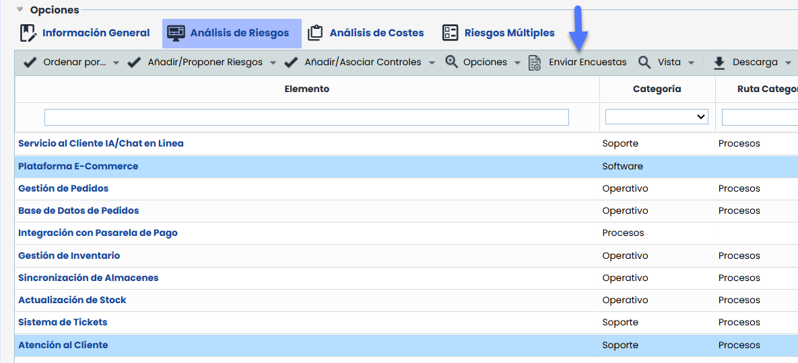
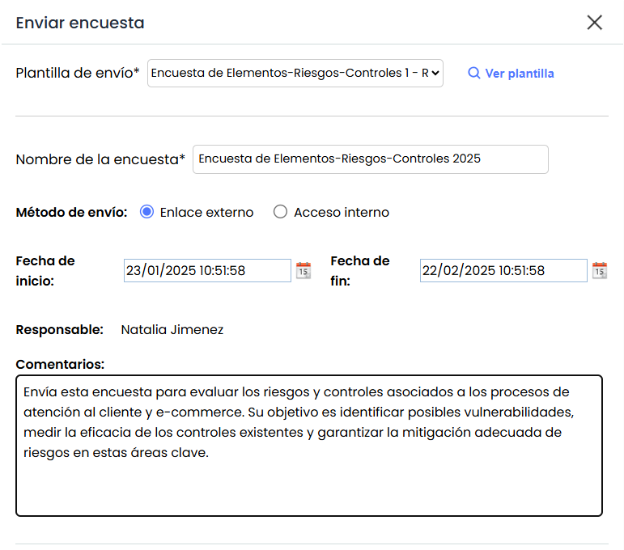
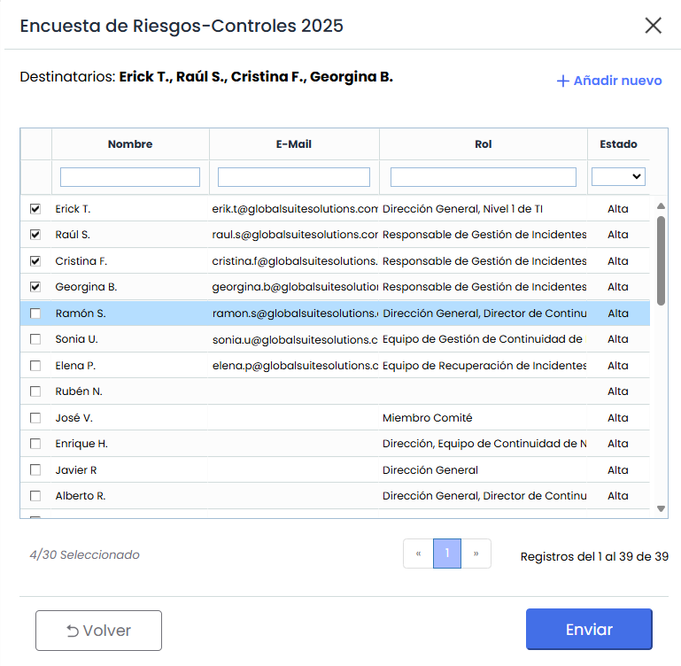
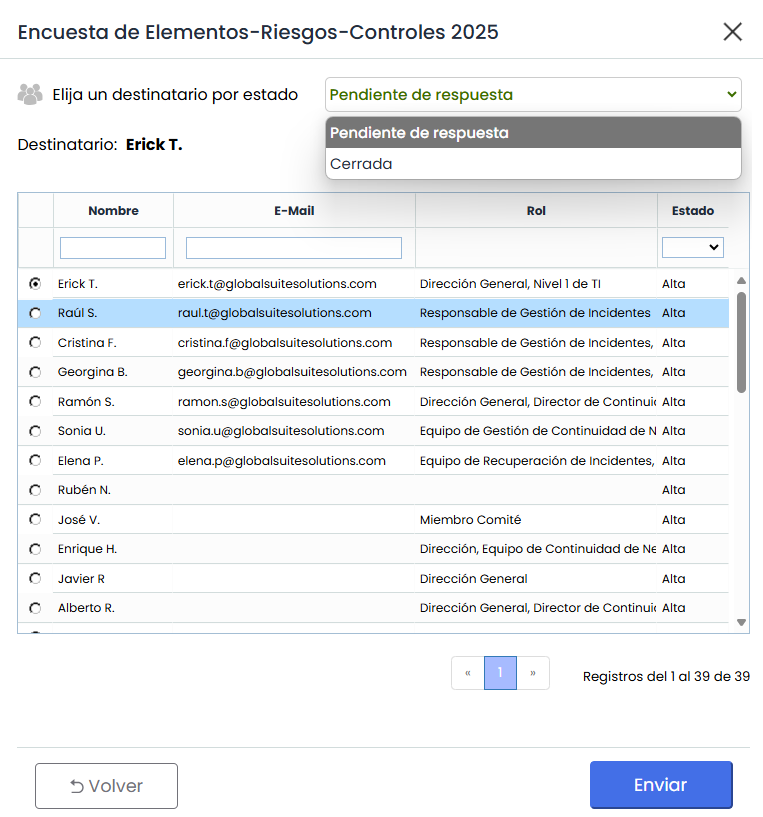
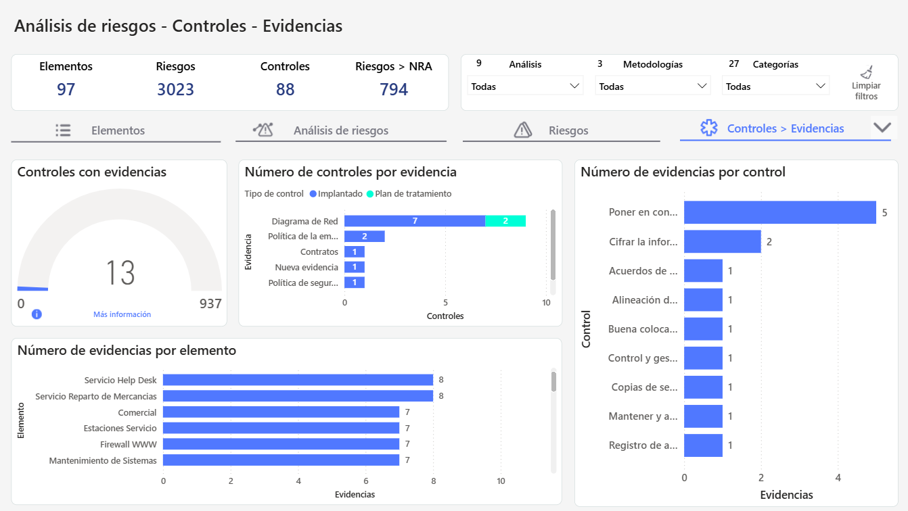
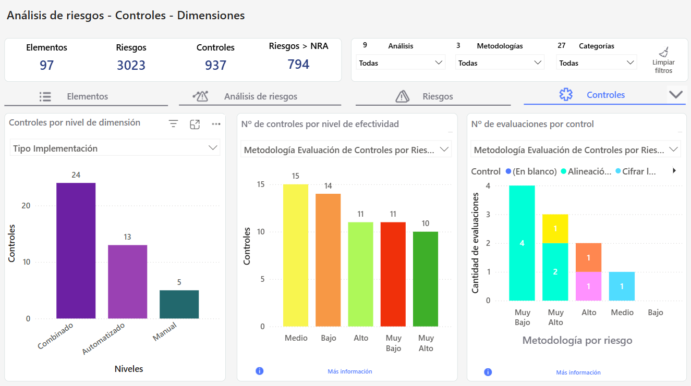

# v6.112 (Enero 2025)

## Nuevas funcionalidades y mejoras GlobalSuite® GRC

### Automatización de envío de encuestas desde el Análisis de Riesgos mediante plantillas


El objetivo de esta funcionalidad es simplificar el proceso de envío de encuestas en GlobalSuite®. Para ello, se ha incorporado la opción de enviar encuestas desde un [Análisis de Riesgos](https://help.globalsuitesolutions.com/es/globalsuite/v1/analisis-de-riesgos), utilizando [plantillas](https://help.globalsuitesolutions.com/es/globalsuite/v1/encuestas-elementos-riesgos-y-controles-configurac) que sirven como base genérica y que se pueden personalizar en cada caso antes de realizar el envío.


#### Características Principales.

##### Configuración de Plantilla de Encuestas

En la [configuración](https://help.globalsuitesolutions.com/es/globalsuite/v1/encuestas-elementos-riesgos-y-controles-configurac#EncuestasElementos,RiesgosyControles(Configuración)-Plantilla) de “Encuestas de Riesgos-Controles” o “Encuestas de Elemento-Riesgos-Controles”, se ha añadido un nuevo atributo llamado “Plantilla”. Al seleccionar esta opción, aparece un nuevo campo denominado “Origen de los riesgos”, que incluye dos opciones posibles (excluyentes):

* Riesgos desde el Análisis
* Riesgos desde el Catálogo

##### Configuración de Plantilla con Riesgos desde el Análisis

Las plantillas con origen de los riesgos desde el Análisis permiten enviar encuestas que incluyen los riesgos asociados al elemento seleccionado en el Análisis de Riesgos.

* Estas plantillas son de uso general y pueden aplicarse en cualquier Análisis de Riesgos (AR).
* Los destinatarios pueden configurarse desde la plantilla o modificarse al momento de realizar el envío.

##### Configuración de Plantilla con Riesgos desde el Catalogo

Las plantillas con Origen de los riesgos desde el Catálogo permiten seleccionar específicamente los riesgos sobre los cuales se enviará la encuesta.

Para ello, se debe seleccionar un Análisis de Riesgos y a partir de esta selección, se mostrarán los catálogos asociados al análisis, permitiendo elegir los riesgos que se incluirán en la encuesta.

* Estas plantillas estarán asociadas al Análisis de Riesgos seleccionado.
* Los destinatarios pueden configurarse desde la plantilla o modificarse al momento de realizar el envío.

##### Envío de Encuestas desde el Análisis de Riesgos.

En Análisis > Análisis de Riesgo > Dentro de un Análisis, Pestaña [Análisis de Riesgos](https://help.globalsuitesolutions.com/es/globalsuite/v1/analisis-de-riesgos) se ha añadido la opción “Enviar Encuesta”

Se deben seleccionar previamente los Elementos sobre los que se enviara la encuesta y luego “Enviar Encuestas”. Para realizar el envío, serán necesarios dos pasos:

##### 1- Atributos de la encuesta

Antes de realizar el envío, se podrán modificar los datos configurados en la plantilla, tales como:

* Nombre de la encuesta.
* Fechas de inicio y de fin. (Solo disponible si selecciona Enlace Externo)
* Comentario que aparece en el landing de la encuesta.
* Método de envío

  * Acceso Interno: Se creará la encuesta dentro de GlobalSuite para los destinatarios seleccionados.
  * Enlace Externo: Se generará una publicación que agrupe las encuestas accesibles desde fuera de GlobalSuite®.

##### 2- Destinatarios

Los destinatarios de la encuesta podrán seleccionarse si no vienen configurados en la plantilla o editarse si ya están definidos.

* Si la plantilla no tiene destinatarios seleccionados, el responsable del elemento se asignará como destinatario.
* Si la plantilla incluye estados configurados, será posible seleccionar o editar el destinatario de cada estado de la encuesta.

Al presionar "Enviar", se generará automáticamente la configuración, la publicación y una encuesta individual para cada destinatario seleccionado. Tras el envío, las encuestas estarán disponibles para su gestión y consulta, siguiendo el mismo flujo que el resto de las encuestas en GlobalSuite®

## Módulo Business Intelligence

### Mejoras en el Cuadro de mandos de Análisis de Riesgos


Esta mejora introduce nuevas visualizaciones en la [Pestaña Controles](https://help.globalsuitesolutions.com/es/globalsuite/v1/pestana-controles) del [Tablero Análisis de Riesgos](https://help.globalsuitesolutions.com/es/globalsuite/v1/tablero-analisis-de-riesgos), permitiendo visualizar y analizar información clave sobre evidencias, evaluaciones y dimensiones de controles.


#### Controles - Evidencias

Esta mejora introduce una nueva vista que incorpora gráficas relacionadas con la gestión de evidencias, con el objetivo de proporcionar una visión más detallada de las evidencias asociadas a los controles.

##### Controles - Dimensiones y Evaluaciones

Esta mejora amplía la pestaña de controles con nuevas gráficas orientadas a evaluar la efectividad de los controles, así como las dimensiones cualitativas que se tengan configuradas.

