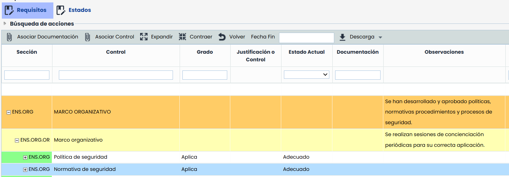

# v6.114 (Febrero 2025)

## Nueva Solución Informes - Informes dinámicos en Word


Esta nueva funcionalidad introduce la posibilidad de generar [Informes personalizados](https://help.globalsuitesolutions.com/es/globalsuite/v1/plantillas-de-informes) en formato Word utilizando plantillas dinámicas, con el objetivo de optimizar la gestión de documentos y reportes en GlobalSuite®.


#### Características principales

* **Plantillas dinámicas**: Será posible crear documentos en Word con variables que permiten la automatización del contenido.
* **Integración con GlobalSuite®**: Se podrá utilizar datos configurados previamente en la plataforma para generar informes sin necesidad de edición manual.
* **Flexibilidad en la personalización**: Será posible adaptar el diseño y la estructura de los informes según las necesidades.
* **Listados de variables**: Se podrá acceder a un catálogo completo de variables para elementos, amenazas, riesgos y controles, incluyendo estructuras de bucles para la extracción masiva de datos.

Con esta funcionalidad, será posible optimizar flujos de trabajo y mejorar la eficiencia en la documentación y reporte dentro de GlobalSuite®.


\*\*Más Información\*\*
Para mas información sobre esta funcionalidad, puedes consultar el tutorial [Personaliza y descarga informes con nuestras plantillas dinámicas en Word](https://help.globalsuitesolutions.com/es/globalsuite/v1/personaliza-plantillas-informes-riesgos)


## Nuevas funcionalidades y mejoras generales de GlobalSuite® Security

### ENS - Edición de campos Justificación o Control y Observaciones


Esta mejora introduce la posibilidad de editar los campos \*Observaciones\* y \*Justificación o Control\* en niveles superiores al requisito (4º nivel), incluyendo Medida de Seguridad, Sección y Dominio, tanto en Medidas de Seguridad aplicables como en las que no aplican, con el objetivo de optimizar la definición de información general, evitando repetirla en cada requisito.


#### Características principales

* Posibilidad de editar el campo "Observaciones" en la opción de [Medidas de Seguridad](https://help.globalsuitesolutions.com/es/globalsuite/v1/medidas-de-seguridad) en todos los niveles.
* Posibilidad de editar los campos "Observaciones" y "Justificación o Control" en la opción de[Compliance](https://help.globalsuitesolutions.com/es/globalsuite/v1/compliance-ens) en todos los niveles.
* Edición habilitada tanto en Medidas de Seguridad aplicables como en las que no aplican.
* Inclusión de esta información Históricos.
* Inclusión de esta información en la descarga del informe Docx de una evaluación, tanto de versiones activas, como históricos.

