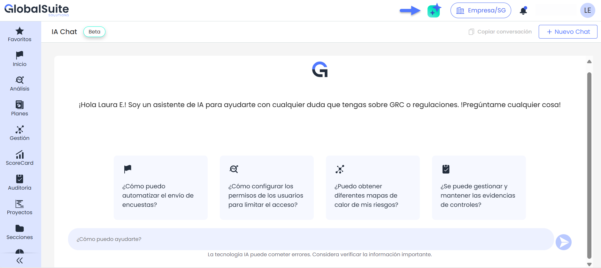
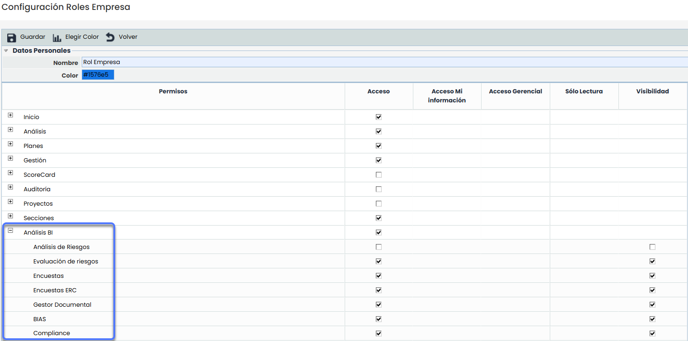

# v6.115 (Marzo 2025)

### Nuevas funcionalidades y mejoras generales

### ¡Conoce el nuevo Asistente IA de GlobalSuite®!


Mejora tu experiencia con GlobalSuite® gracias a nuestro [Asistente IA](https://help.globalsuitesolutions.com/es/globalsuite/v1/chatbot), diseñado para ofrecer soporte inmediato y facilitar el acceso a información clave de manera rápida y sencilla, mejorando la eficiencia en la gestión de consultas.


#### Características principales

* **Atención en tiempo real:** Obtén respuestas rápidas sobre el uso de GlobalSuite® y estándares de cumplimiento en cualquier momento.
* **Acceso directo a información importante:** Encuentra datos sobre productos, regulaciones y mejores prácticas.
* **Interfaz intuitiva:** Navega fácilmente y recibe respuestas inmediatas.

#### Ventajas adicionales

* **Soporte 24/7:** Disponible en cualquier momento para brindar asistencia sin interrupciones.
* **Eficiencia mejorada:** Reduce el tiempo en consultas y optimiza la gestión de tareas.
* **Optimización constante:** El asistente IA se actualiza periódicamente para adaptarse mejor a tus necesidades y ofrecerte una experiencia cada vez más personalizada.


Disponible en la versión Enterprise o versiones superiores.


### Conexión SAML - Creación de usuarios con idioma por defecto

Al realizar la conexión con usuarios por SAML el idioma de creación del usuario será el idioma por defecto de la empresa.

## Nuevas funcionalidades y mejoras GlobalSuite® Business Intelligence

### Acceso a Análisis BI usuarios Enterprise


Esta mejora permite a los usuarios Enterprise acceder a la sección [Análisis BI](https://help.globalsuitesolutions.com/es/globalsuite/v1/analisis-bi) y habilita la configuración de la visibilidad de los dashboards desde [Roles empresa](https://help.globalsuitesolutions.com/es/globalsuite/v1/roles-de-empresa), con el objetivo de ampliar las capacidades de análisis y visualización de datos dentro de la plataforma.


#### Características principales

* Los usuarios Enterprise con o sin subrol podrá acceder a la opción [Análisis BI](https://help.globalsuitesolutions.com/es/globalsuite/v1/analisis-bi).
* Para los usuarios con subrol se podrá gestionar la visibilidad de cada dashboard en Ajustes > [Roles Empresa](https://help.globalsuitesolutions.com/es/globalsuite/v1/roles-de-empresa).
* Esta mejora incluye tanto [dashboards predefinidos](https://help.globalsuitesolutions.com/es/globalsuite/v1/analisis-bi) como los personalizados.

