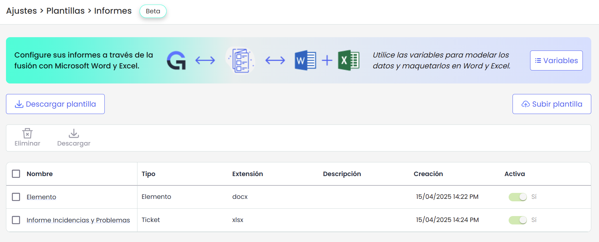
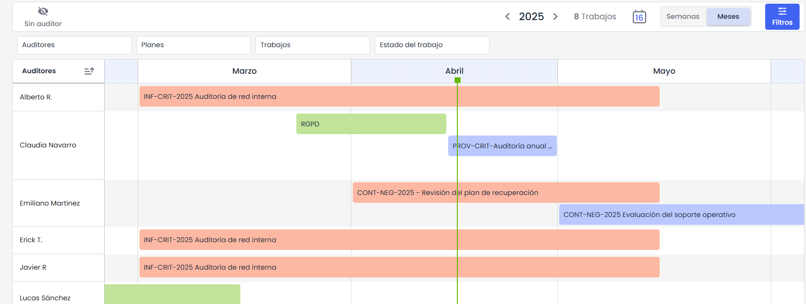
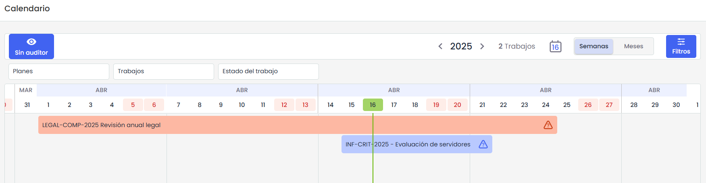
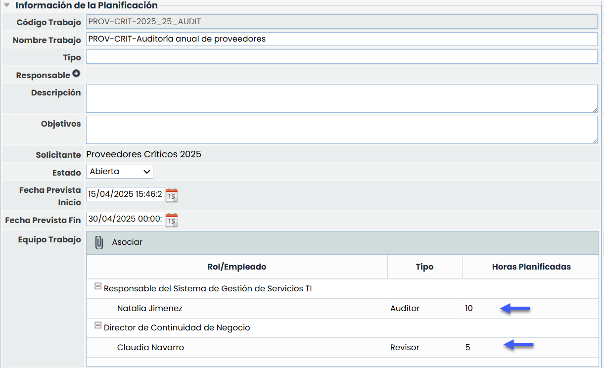
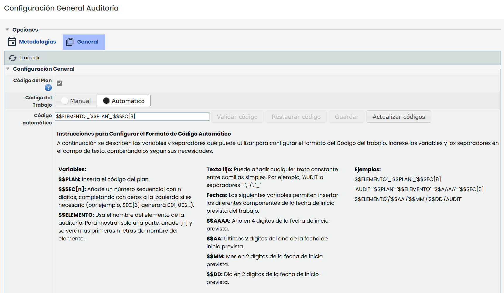
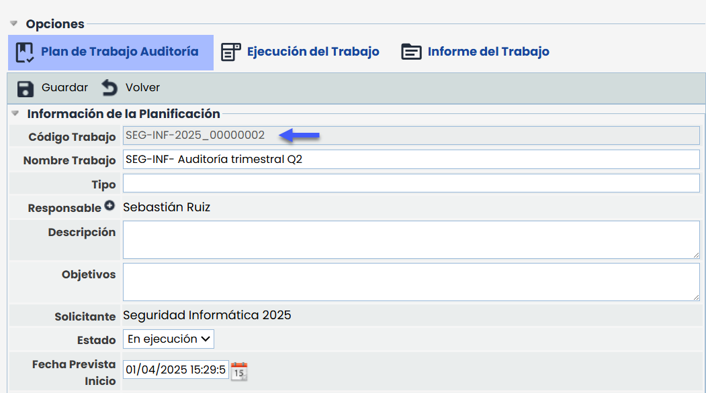

# v6.118 (Abril 2025)

## Nueva Solución Informes - Informes dinámicos en Excel


Esta nueva funcionalidad introduce la posibilidad de generar [Informes personalizados en formato Excel](https://help.globalsuitesolutions.com/es/globalsuite/v1/plantillas-informes-excel) utilizando plantillas dinámicas, con el objetivo de optimizar la gestión de documentos y reportes en GlobalSuite®.
En esta primera versión, los informes en Excel estarán disponibles para la funcionalidad de \*\*Ticketing\*\*, y próximamente se irán incorporando progresivamente a otras funcionalidades.


> Esta mejora se suma a la ya existente funcionalidad de generación de [informes dinámicos en Word](https://help.globalsuitesolutions.com/es/globalsuite/v1/plantillas-informes-word), ampliando las opciones de personalización y exportación para los usuarios.

#### Características principales

* **Plantillas dinámicas**: Será posible crear documentos en Excel con variables que permiten la automatización del contenido.
* **Integración con GlobalSuite®**: Se podrá utilizar datos configurados previamente en la plataforma para generar informes sin necesidad de edición manual.
* **Flexibilidad en la personalización**: Será posible adaptar el diseño y la estructura de los informes según las necesidades.
* **Listados de variables**: Se podrá acceder a un catálogo completo de variables para elementos, amenazas, riesgos y controles, incluyendo estructuras de bucles para la extracción masiva de datos.

Con esta solución, será posible optimizar flujos de trabajo y mejorar la eficiencia en la documentación y reporte dentro de GlobalSuite®.

## Nuevas funcionalidades y mejoras GlobalSuite® Audit

### Calendario de Auditores


La nueva vista de Calendario de Auditores permite visualizar gráficamente los trabajos asignados a cada auditor a lo largo del tiempo, facilitando el seguimiento y la planificación del equipo.
Disponible desde Auditorías > [Calendario de Auditores](https://help.globalsuitesolutions.com/es/globalsuite/v1/calendario-de-auditores), esta herramienta ofrece escalas diarias/semanales o mensuales, y permite desplazarse por el año para consultar fácilmente todos los trabajos planificados.


Cada trabajo se muestra como un bloque de color que refleja su estado actual:, azul para los trabajos abiertos, rojo para los trabajos en ejecución y verde para los trabajos cerrados. Estos bloques incluyen el nombre del trabajo y su duración estimada, y se distribuyen horizontalmente según las fechas asignadas. Una línea vertical indica el día actual, lo que ayuda a ubicar rápidamente el presente dentro del calendario.

La vista incluye una sección específica para mostrar los trabajos que aún no tienen auditor asignado, lo que facilita su identificación y gestión. También se incorporó un panel de filtros que permite acotar la información por nombre de trabajo o por estado, mejorando la navegación cuando hay una gran cantidad de datos en pantalla.

Además, dentro de cada trabajo de auditorias se añadieron validaciones para evitar solapamientos dentro del equipo de trabajo: si se intenta asignar a un empleado que ya participa en otro trabajo en las mismas fechas, el sistema muestra una alerta. Esta funcionalidad, junto con la visualización general del calendario, ayuda a prevenir conflictos y planificar mejor los recursos disponibles.

### Horas Trabajadas por Auditor


Esta mejora incorpora la posibilidad de registrar las \*\*horas planificadas y trabajadas\*\* por cada auditor en los [trabajos de auditoría](https://help.globalsuitesolutions.com/es/globalsuite/v1/programa-auditorias), sin necesidad de asociarlas a un proyecto específico. Esta información se carga manualmente desde el detalle del trabajo y refleja el esfuerzo real invertido por cada miembro del equipo.


#### Horas Planificadas

Las horas planificadas se pueden cargar desde Auditorías > [Programa de Auditorías](https://help.globalsuitesolutions.com/es/globalsuite/v1/programa-auditorias), accediendo a un trabajo en estado Abierto o Borrador, o bien desde la pestaña Plan de Trabajo de Auditoría cuando el trabajo ya está en Ejecución o Cerrado. Para mayor claridad, se actualizó la tabla “Equipo de Trabajo” dentro de esta pestaña, renombrando la columna “Horas” por “Horas Planificadas”, reflejando así de forma más precisa el dato que se está gestionando.

#### Horas Dedicadas

Las horas reales trabajadas se gestionan desde la pestaña [Ejecución del Trabajo](https://help.globalsuitesolutions.com/es/globalsuite/v1/ejecucion-del-trabajo), disponible cuando el trabajo está en estado En Ejecución. En esta vista, se incorporó una nueva opción en la barra de herramientas llamada “Registrar horas”, desde la cual cada usuario logueado puede cargar el tiempo que ha dedicado. Al registrar horas, se debe indicar la cantidad, la fecha y un detalle asociado a cada imputación, permitiendo así un seguimiento más preciso del esfuerzo realizado.

Además, se actualizaron tanto el informe del trabajo como los cuadros de mando para mostrar correctamente las horas estimadas y reales.

### Auditorias – Código automático en Trabajos de Auditoría


A partir de esta versión, se habilita la opción de generar automáticamente los códigos de los trabajos dentro del Programa de Auditoría, construyéndolos de forma unívoca y sin intervención manual.
El sistema asigna los códigos según el formato configurado, asegurando secuencia, trazabilidad y consistencia.


> Esta mejora es la continuación del cambio que introdujo el campo Código manual en los planes y [trabajos de auditoría](https://help.globalsuitesolutions.com/es/globalsuite/v1/ejecucion-del-trabajo) ([Changelog v6.109](https://changelog.globalsuitesolutions.com/changelog/v6.109-diciembre-2024))

#### Configuración Código Automático

Para habilitar esta funcionalidad, se debe acceder a Ajustes > Auditorías > [General](https://help.globalsuitesolutions.com/es/globalsuite/v1/metodologias-auditorias) y activar la opción "Código del Plan". Al hacerlo, el campo “Código de Plan” estará disponible en los formularios de los planes, y el campo “Código de Trabajo” podrá definirse como manual o automático. Si se selecciona la opción automática, se habilita un apartado para configurar el formato del código, permitiendo combinar variables, valores secuenciales y textos fijos, adaptando la codificación a las necesidades de cada cliente.

El sistema ofrece varias acciones para facilitar esta configuración:

* **Validar Código**, que permite comprobar si el formato ingresado es correcto antes de guardarlo.
* **Restaurar Código**, que recupera la última configuración válida en caso de haber realizado cambios.
* **Guardar**, que solo está habilitado si el formato es válido y permite elegir si se recalcula la numeración o se mantiene la actual.
* **Actualizar Códigos**, que renumera todos los trabajos abiertos aplicando el formato actual sin modificarlo, útil para eliminar huecos en la secuencia. Esta acción requiere confirmación previa, ya que no se puede deshacer.

#### Funcionalidad

Cuando el campo Código de Trabajo está configurado como automático, este no puede modificarse manualmente desde el formulario del trabajo.

El sistema lo genera y actualiza en función de las variables definidas en el formato configurado. Siempre que se edite alguno de los datos del trabajo o del plan que afecten al código (por ejemplo, el codigo de plan), el sistema actualizará automáticamente el código del trabajo.

## Nuevas funcionalidades y mejoras GlobalSuite® Business Intelligence

### Dashboard TPRM


Esta nueva funcionalidad introduce un dashboard especializado para la gestión de proveedores, con el objetivo de centralizar y facilitar el seguimiento del estado de proveedores, encuestas asociadas y tickets, a través de gráficos, métricas y filtros interactivos.


#### Características principales

* **Pestañas de navegación:**

  * **TPRM**: Visualización de datos clave sobre los proveedores, como criticidad, riesgos, país, evidencias y controles.
  * **Encuestas**: Métricas sobre el envío y estado de cuestionarios a proveedores, incluyendo gráficas por modelo y estado.
  * **Tickets**: Información asociada a tickets relacionados con proveedores, incluyendo estado, fecha prevista de cierre y prioridad.
* **Indicadores clave y gráficas**:

  * Cards con métricas relevantes (ej. Proveedores totales, Encuestas enviadas, Tickets por estado).
  * Gráficas de barras, tartas, acumulativas y mapas interactivos.
  * Tablas detalladas con opción de acceder a "Más información" para ver información detallada.
* **Filtros avanzados**: Posibilidad de aplicar filtros por Metodologías, Análisis, Subcategorías, Modelos de encuestas y Proveedores para personalizar la visualización de los datos.
