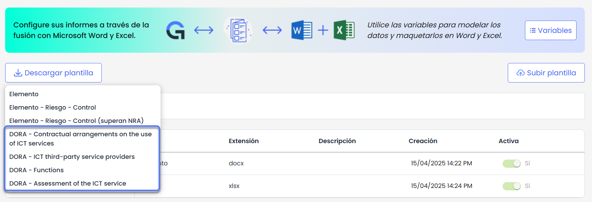

# v6.119 (Mayo 2025)

## Nuevas funcionalidades y mejoras – Informes Dinámicos Excel

### Informes Excel para la normativa DORA


Esta mejora introduce una plantilla predefinida para generar informes en Excel específicos de la normativa \*\*DORA\*\*, complementando la funcionalidad ya existente de [\*\*informes dinámicos de tickets en Excel\*\*.](https://help.globalsuitesolutions.com/es/globalsuite/v1/plantillas-informes-excel)


#### Características principales:

* Incorporación de **plantillas preconfiguradas** con los campos requeridos por DORA, disponible para descarga directa desde Ajustes > Plantillas > [Informes](https://help.globalsuitesolutions.com/es/globalsuite/v1/plantillas-informes-excel), en la opción Descargar plantilla.

* Todos los tickets específicos de DORA incluyen los **alias de los campos de tickets configurados por defecto**, para facilitar la descarga directa sin necesidad de ajustes adicionales en las plantillas predefinidas.
* Acceso a la descarga de los informes desde los tipos de tickets específicos de DORA:

  * Contratos
  * Evaluaciones del Servicio TIC
  * Proveedores de terceros de servicios TIC


Esta funcionalidad complementa la mejora ya publicada de generación de [informes dinámicos en Excel](https://changelog.globalsuitesolutions.com/changelog/v6-118-abril-2025), añadiendo una aplicación directa a marcos normativos como DORA.
Para mas información sobre esta funcionalidad, puedes consultar el tutorial [Personaliza y descarga informes con nuestras plantillas dinámicas en Excel](https://help.globalsuitesolutions.com/es/globalsuite/v1/personaliza-plantillas-informes-excel)

