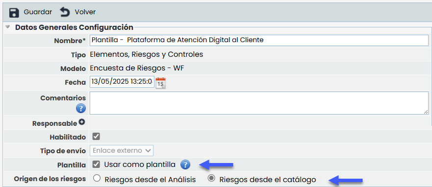
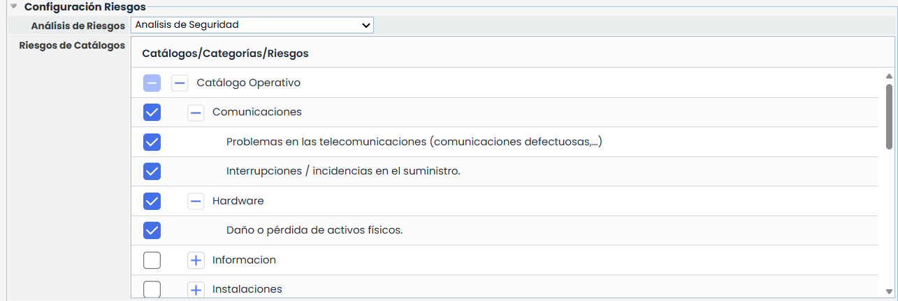
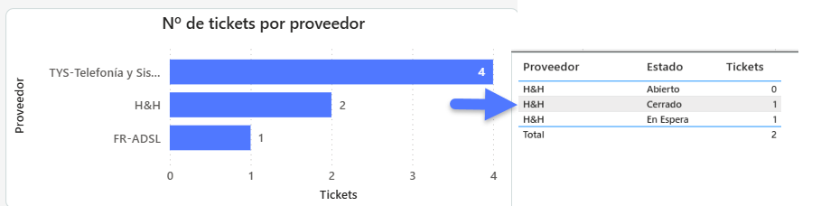
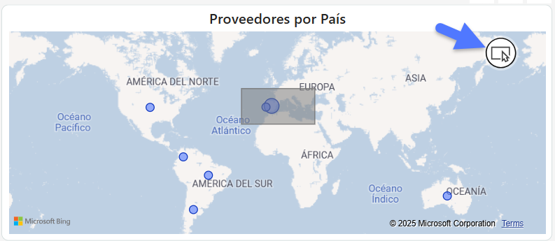

# v6.120 (Mayo 2025)

## Nuevas funcionalidades y mejoras GlobalSuite® GRC

### Automatización de envío de encuestas desde el Análisis de Riesgos - Nuevas plantillas


Se amplía la funcionalidad de envío automatizado de encuestas desde el Análisis de Riesgos con soporte para dos nuevos tipos: \*\*“Encuesta de Riesgos”\*\* y \*\*“Encuesta de Elemento-Riesgos”\*\*.


En la configuración de los modelos de encuesta de tipo **“Encuesta de Riesgos”** y **“Encuesta de Elemento-Riesgos”** se ha incorporado la opción **“Usar como plantilla”**, que permite automatizar el envío de encuestas desde un Análisis de Riesgos.

Al activar esta opción, se habilita el campo **“Origen de los riesgos”**, con dos alternativas excluyentes: **“Riesgos desde el análisis”** y **“Riesgos desde el catálogo”**. Según la opción seleccionada, el formulario se adapta automáticamente. Si se elige **“Riesgos desde el catálogo”**, se habilita la selección de un análisis concreto y se muestra una tabla jerárquica con los riesgos estructurados por **Catálogo > Categoría > Riesgo**.

El sistema incluye validaciones que aseguran la selección tanto del análisis como de al menos un riesgo antes de poder guardar la plantilla.

Por otro lado, si se selecciona **“Riesgos desde el análisis”**, la encuesta se enviará automáticamente con todos los riesgos asociados al elemento que se seleccione dentro del análisis de riesgos.

## Nuevas funcionalidades y mejoras GlobalSuite® Business Intelligence


Se incorporan mejoras y ajustes en la pestaña \*Tickets\* del [\*\*Dashboard TPRM\*\*](https://help.globalsuitesolutions.com/es/globalsuite/v1/dashboard-tprm), orientadas a mejorar la visibilidad y análisis de los tickets relacionados con proveedores. Estas actualizaciones refuerzan la utilidad del dashboard como herramienta de seguimiento integral, añadiendo nuevas gráficas, funcionalidades interactivas y mejoras visuales.


#### Nueva Gráfica "Nº de tickets por proveedor"

Se añade una nueva visualización en formato de barras horizontales, que permite consultar rápidamente el volumen de tickets asociados a cada proveedor.

* En esta gráfica, cada barra representa un proveedor y su longitud indica el número total de tickets registrados. Los proveedores se muestran listados verticalmente, y se ordenan de mayor a menor según el número de tickets asociados.
* Al pasar el cursor por cada barra, se despliega un *tooltip* con información detallada que incluye el nombre del proveedor, el estado de los tickets y el número de tickets, tanto por estado como en total.

#### Filtro por región en el mapa de proveedores

Se incluye un nuevo filtro por región que permite delimitar geográficamente la visualización de los proveedores a través de un botón de lazo (*draw region*) sobre el mapa.

