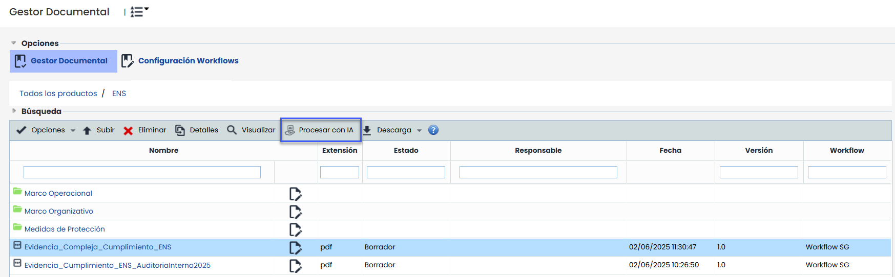
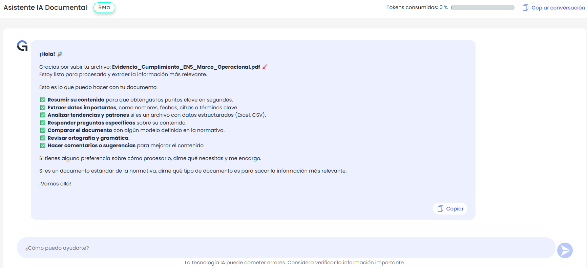
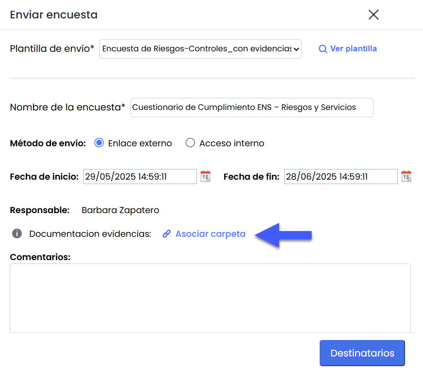
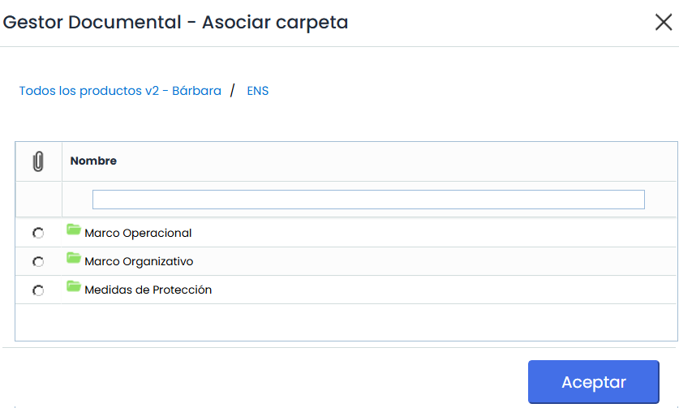
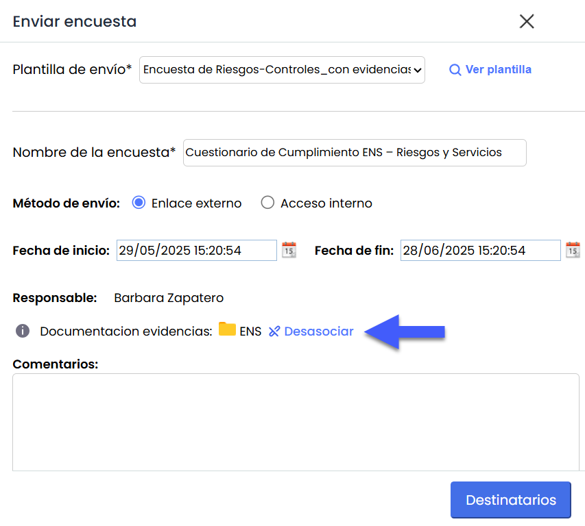
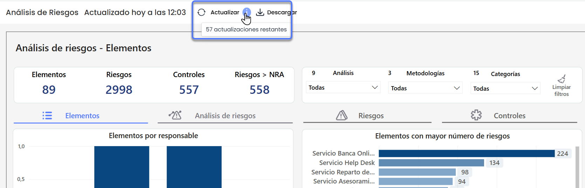

# v6.121  (Junio 2025)

## Nuevas funcionalidades y mejoras GlobalSuite® GRC

#### Asistente IA Documental


Se incorpora una primera versión del \*\*Asistente IA Documental\*\*, una funcionalidad en fase beta que permite procesar documentos directamente desde el [Gestor Documental.](https://help.globalsuitesolutions.com/es/globalsuite/v1/gestor-documental)


Este asistente utiliza inteligencia artificial para analizar documentos y extraer información relevante, identificar mejoras en su contenido, proponer posibles planes de acción y generar resúmenes automáticos. Su objetivo es facilitar la actualización y gestión documental, optimizando el tiempo dedicado a tareas de análisis y revisión.

Al subir o seleccionar un documento, se habilita el botón **“Procesar con IA”**, que permite acceder a las distintas capacidades del asistente, entre ellas:

* Resumen del contenido.
* Extracción de datos clave como nombres, fechas, cifras o términos relevantes.
* Análisis de tendencias y patrones en archivos estructurados (Excel, CSV).
* Respuesta a preguntas sobre el contenido.
* Comparación con modelos normativos definidos.
* Revisión ortográfica y gramatical.
* Sugerencias de mejora y comentarios contextualizados.

Las respuestas generadas pueden copiarse fácilmente para su reutilización en otros entornos o documentos.

Solo se permite el procesamiento de archivos con las siguientes extensiones: **pdf, doc, docx, txt, pptx, xlsx, png, jpg, jpeg, csv y zip**.

#### Asociación de carpeta de evidencias en el envío de encuestas desde el Análisis de Riesgos


Se incorpora una mejora en el envío de encuestas desde el \*\*Análisis de Riesgos\*\*, que permite asociar una carpeta del Gestor Documental donde se almacenarán las evidencias adjuntas a controles.


El campo **“Documentación Evidencias”** se muestra únicamente al seleccionar plantillas de tipo **Riesgos-Controles** o **Elementos-Riesgos-Controles**, siempre que el modelo tenga activada la opción *“Incluir documentación de evidencias”*.

Este campo permitirá seleccionar el sitio del Gestor Documental donde se subirán las evidencias asociadas a los controles evaluados en la encuesta. La carga de documentos aplicará las mismas validaciones de workflows y reglas de visibilidad definidas en la [configuración de encuestas](https://help.globalsuitesolutions.com/es/globalsuite/v1/encuestas-elementos-riesgos-y-controles-configurac#EncuestasElementos,RiesgosyControles(Configuración)-DocumentaciónEvidencia)

* Si el Workflow está activo en el [Gestor Documental](https://help.globalsuitesolutions.com/es/globalsuite/v1/gestor-documental), solo se podrán seleccionar carpetas con un workflow válido.
* Los administradores podrán ver todas las carpetas.
* Los usuarios básicos solo podrán ver:

  * Con WF activo: carpetas donde sean responsables de algún estado.
  * Sin WF activo: carpetas donde tengan acceso total o solo lectura.

Al seleccionar una carpeta válida y pulsar “Aceptar”, esta queda asociada al envío. Si la plantilla ya tiene una carpeta predefinida, esta aparecerá seleccionada por defecto. En cualquier caso, se mostrará un enlace junto al nombre para desasociarla fácilmente.

## Nuevas funcionalidades y mejoras – GlobalSuite® BI Plus

### Actualización de dashboards bajo demanda


Esta mejora introduce una nueva funcionalidad que permite a los usuarios con licencia BI Plus actualizar manualmente los dashboards, con el objetivo de ofrecer información actualizada bajo demanda, sin tener que esperar la actualización automática diaria.


#### Características principales

* Inclusión de un botón **"Actualizar"** visible en todos los dashboards del entorno para los usuarios con licencia **GlobalSuite BI - Plus**.
* Permite hasta **60 actualizaciones por entorno al mes**. Al pulsarlo en cualquier dashboard, se actualizarán automáticamente todos los dashboards del entorno.
* Además de las actualizaciones manuales, los dashboards continuarán **actualizándose automáticamente una vez al día**.
* Todas las actualizaciones manuales realizadas quedarán registradas en el **log del sistema**.

