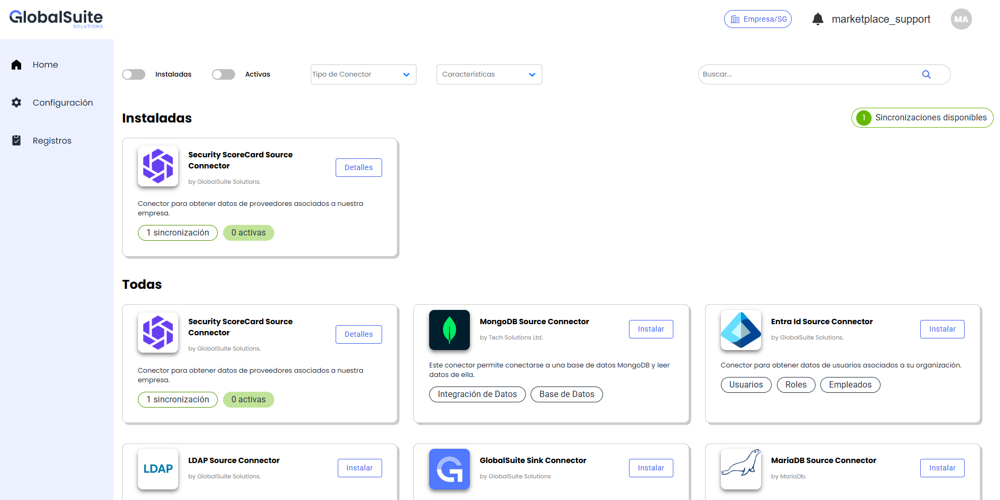
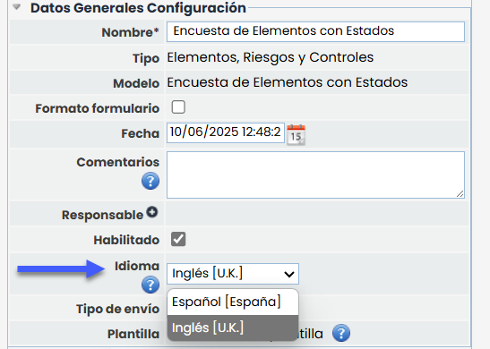

# v6.122 (Junio 2025)

## Nueva solución Marketplace de Integraciones


Estamos encantados de presentar una nueva solución dentro del \*\*ecosistema GlobalSuite®\*\*, que es el nuevo [\*\*Marketplace de Integraciones\*\*](https://help.globalsuitesolutions.com/marketplace/), una aplicación diseñada para acelerar, simplificar y escalar la conectividad entre tu plataforma GRC y el resto de herramientas corporativas.


### ¿Qué es el Marketplace de Integraciones GlobalSuite?

Es una solución centrada en la integración de aplicaciones, donde exsten **conectores predefinidos** que te permiten integrar fácilmente GlobalSuite con aplicaciones externas como:

* **Plataformas de ciberseguridad** (Tenable, SIEM, autodescubrimiento, gestión de vulnerabilidades…)
* **Sistemas de Scoring** Financiero y de Seguridad (Security Scorecard, Axesor)
* **Data Lakes, ETLs** y herramientas de Data Analytics.
* **Aplicaciones de desarrollo propio** sin interfaces de integración (API), a través de **BBDD**

### Principales características

* **Conectores listos para usar**: configura y activa la sincronización en minutos, sin desarrollos complejos.
* **Actualizaciones automáticas** de los conectores con la frecuencia deseada.
* **Panel de configuración unificado**, intuitivo y ágil.
* **Monitorización** y gestión de las integraciones en tiempo real.

### Beneficios clave

* **Ahorro de tiempo y costes** al evitar actualizaciones y cargas manuales.
* **Automatización de procesos críticos** entre sistemas, eliminación de incoherencias entre aplicaciones o datos obsoletos.
* **Mejora de la visibilidad y trazabilidad** en tu ecosistema GRC.
* **Escalabilidad**: Añade nuevas integraciones según tus necesidades actuales y futuras.

#### ¿Cómo activarlo?

Esta solución se habilita bajo demanda, por lo que si lo tienes incluido en tu licenciamiento de GlobalSuite®, ponte en contacto con nuestro Centro de Soporte a Clientes para que te ayuden.


Disponible en la versión Enterprise o versiones superiores.
Para más información, contacta con tu responsable comercial de GSS.


## Nuevas funcionalidades y mejoras GlobalSuite® GRC

### Configurar idioma de encuestas

Se incorpora la posibilidad de seleccionar manualmente el idioma en que se enviarán las encuestas de tipo **Elementos, Riesgos y Controles (ERC)** y **BIA (Impacto y Tiempo)**. Hasta ahora, el idioma se determinaba automáticamente en función del tipo de destinatario. Con esta mejora, se añade flexibilidad para adaptar el envío según las necesidades específicas de cada organización.

En las configuraciones de encuestas, dentro del apartado **Datos Generales Configuración**, se ha añadido un nuevo selector de idioma:

Este selector será editable únicamente cuando la SG tenga más de un idioma configurado, y mostrará por defecto el idioma principal de la SG. Solo se aplica a destinatarios que no tienen usuario en GlobalSuite; si el destinatario tiene usuario, se seguirá utilizando el idioma definido en su perfil.

El idioma seleccionado afectará al contenido de todos los correos, notificaciones y enlaces a la encuesta.

Este cambio se aplica de forma retroactiva a las configuraciones ya existentes, que adoptarán como valor inicial el idioma principal de la SG.
