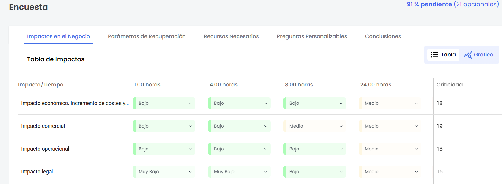
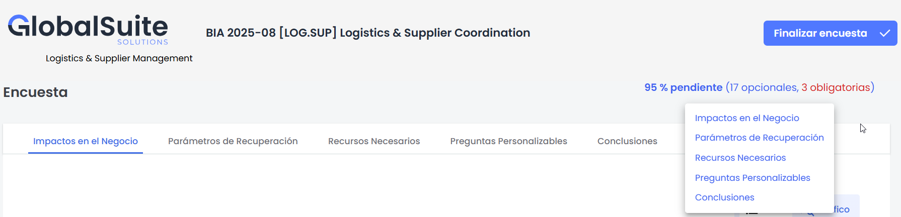
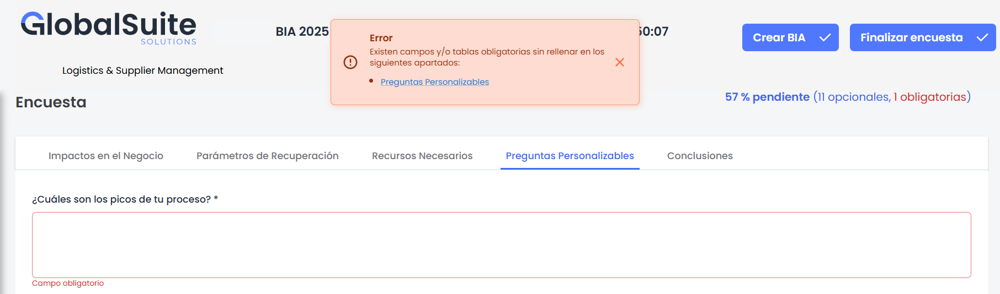
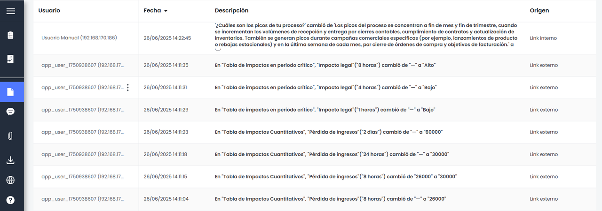

# v6.123 (Junio 2025)

## Nuevas funcionalidades y mejoras generales de GlobalSuite® Continuity

### Nuevo cliente de encuestas BIA


Se renueva por completo la interfaz de encuestas \*\*BIA por Impacto\*\*, con un nuevo cliente más intuitivo, organizado y orientado a facilitar la navegación y configuración del contenido. La nueva experiencia de usuario sigue la misma línea que el cliente actual de encuestas de tipo \*\*Elementos, Riesgos y Controles (ERC)\*\*, lo que aporta coherencia y familiaridad para quienes ya trabajan con ese modelo.


Entre las principales mejoras incorporadas se destacan:

#### Nueva navegación por pestañas y bloques

La configuración de las encuestas ahora se organiza en secciones más accesibles y estructuradas, lo que facilita la revisión de la información y la edición por partes.

#### Mejoras en la experiencia al responder la encuesta

Se incorporó la posibilidad de **definir campos como obligatorios** en el modelo de una encuesta BIA, una funcionalidad que no estaba disponible anteriormente. Además, se añadió una **leyenda informativa** en la parte superior del formulario que muestra en tiempo real el porcentaje de preguntas pendientes, indicando cuántas son obligatorias y cuántas opcionales.

Al desplegar el detalle, el sistema informa en qué pestaña se encuentra cada una de las preguntas pendientes, y permite **navegar directamente** hacia ellas con un clic. Esta mejora facilita el seguimiento del avance y asegura una revisión más ágil antes de finalizar la encuesta.

#### Validación de errores más intuitiva

En caso de errores, el sistema ahora muestra de forma clara y directa el apartado específico donde se encuentra el problema, lo que agiliza su localización y corrección.

#### Seguimiento de cambios

Se mejoró el **registro de cambios** en encuestas BIA, permitiendo un mayor control sobre las modificaciones realizadas durante todo el ciclo de vida de la encuesta. A partir de ahora, el sistema distingue claramente entre dos tipos de seguimiento:

* Por un lado, los **registros automáticos** del sistema (logs), que documentan de forma estructurada las acciones realizadas.

  
* Por otro, los **comentarios manuales**, que ahora se presentan en un nuevo modo tipo conversación, más visual y enfocado en el intercambio entre usuarios.

  

Esta separación permite consultar los cambios con mayor claridad y seguir el historial de ajustes de forma más ordenada y contextual.

Todos los cambios realizados sobre encuestas BIA quedan ahora registrados en el sistema, lo que mejora el control de modificaciones y el seguimiento histórico de ajustes.
