# v6.124 (Julio 2025)

## Nuevas funcionalidades y mejoras GlobalSuite® GRC

### Nueva Vista Elementos - Ticket


Se incorpora una nueva vista que consolida en una sola pantalla la relación entre elementos, tickets y riesgos, con el objetivo de facilitar el análisis y seguimiento de estas vinculaciones en el sistema.
La información se obtiene a partir del campo \*\*THREATS\*\* presente en los tickets, donde actualmente se vincula el elemento, el análisis de riesgos asociado y los riesgos seleccionados. Esta vista organiza toda esa información de forma jerárquica, permitiendo una navegación clara y contextual.


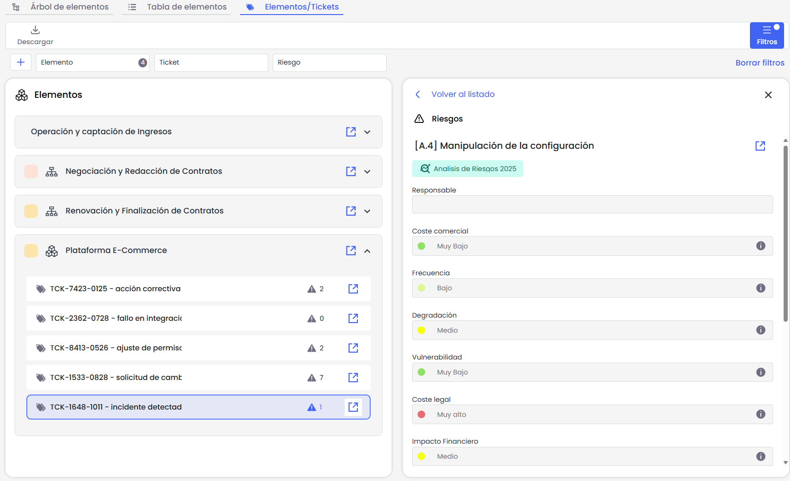

#### Elementos

Cada elemento se presenta como una tarjeta desplegable que resume la información clave y permite explorar los tickets y riesgos vinculados. Esta vista incluye únicamente los elementos que tienen al menos un ticket asociado.

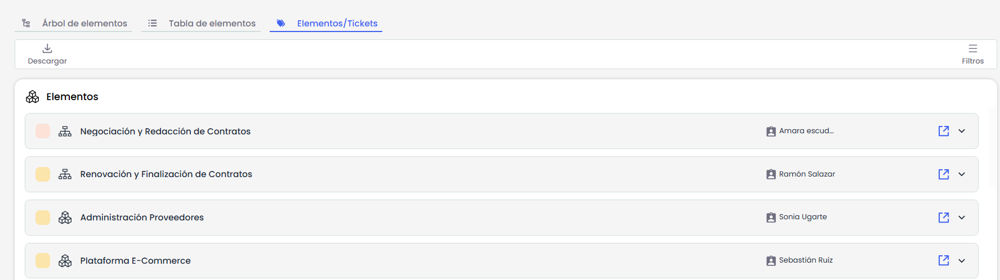

En la parte superior de cada tarjeta se muestra el nombre del elemento, el icono correspondiente a su categoría, un indicador visual del nivel de la Dimensión Criticidad y el responsable asignado. A la izquierda, el botón “Ver detalles” que nos lleva al formulario del elemento en el inventario.

#### Tickets

Dentro de cada card, se muestran los tickets que contienen al elemento en el campo **THREATS**.

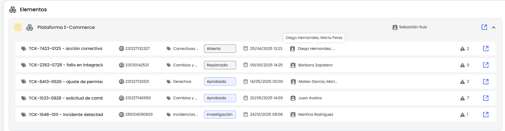

Los datos visibles para cada ticket están definidos en Ajustes > Tickets > [Pantalla común](https://globalsuitesolutions.atlassian.net/wiki/spaces/GlobalSUITEes/pages/266863466/Pantalla+Com+n), donde es posible configurar específicamente qué campos deben mostrarse en esta vista. Las configuraciones disponibles incluyen:

* **Asunto**: Se debe seleccionar un campo de tipo **INPUT** para mostrar como nombre o asunto del ticket.

  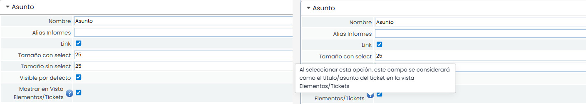
* **ID**: Puede configurarse un único campo de tipo ID para su visualización.
* **Estado**: Se debe seleccionar un solo campo de tipo STATUS, que se mostrará con colores diferenciados

  * En la vista los estados tendrán el color segun su tipo: Gris para estados iniciales, azul para intermedios y verde para finales.
* **Fecha**: Es posible seleccionar un solo campo de tipo DATE.
* **Responsables**: Puede configurarse un único campo entre OWNER, EMPLOYEES o SUPERVISOR.

#### Riesgos

Cuando el usuario pulsa sobre un ticket, se abre un panel lateral que muestra los riesgos vinculados al ticket y al elemento correspondiente.

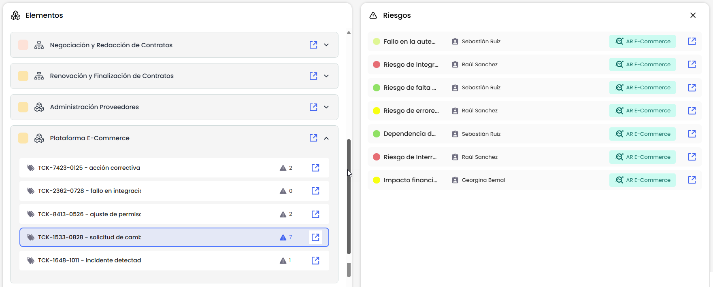

En esta vista se presenta información clave como el nivel de riesgo en la dimensión configurada como principal, el nombre del riesgo, el responsable asignado en el Análisis de Riesgo y el nombre del análisis al que pertenece.

#### Detalle del riesgo

Desde el listado de riesgos, al hacer click sobre un riesgo, el usuario puede acceder a un formulario de solo lectura con el detalle completo del riesgo, según la metodología del Análisis de Riesgo al que pertenece.

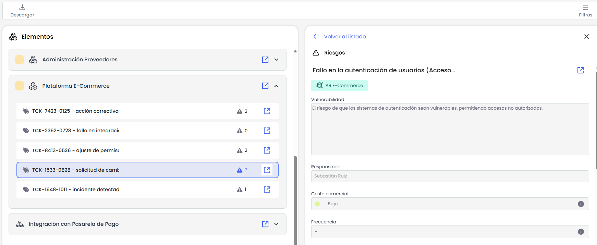

Al presionar “Ver detalles”, se abre el detalle del riesgo directamente dentro del Análisis de Riesgo, en una nueva pestaña del navegador.

#### Filtros

La vista consolidada permite aplicar filtros para facilitar la exploración de los datos mostrados.

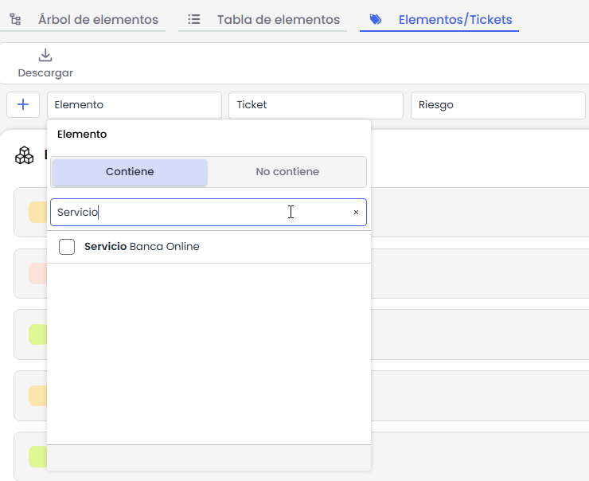

Los filtros disponibles incluyen:

* Elemento
* Ticket
* Tipo de ticket
* Riesgo
* Responsable del elemento
* Responsable del ticket
* Responsable del riesgo

  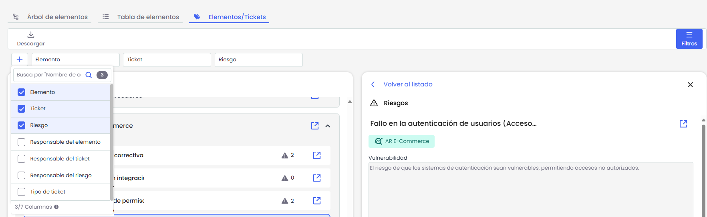

#### Descarga

La vista incorpora un botón de descarga que permite exportar la información mostrada a un archivo en formato CSV. El informe consolidado incluye los datos de elementos, tickets y riesgos, organizados de forma que cada fila representa una combinación única entre estos tres niveles.

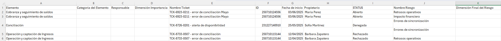

La descarga respeta los filtros activos en la vista en el momento de la exportación, asegurando que el archivo refleje con precisión los datos visualizados.

## Nuevas funcionalidades y mejoras generales de GlobalSuite® Continuity

### Mejora en la creación de BIAS Individuales


Se mejora la usabilidad en la creación de BIA individuales, incorporando una nueva ventana emergente que permite seleccionar el proceso de negocio desde una tabla organizada y filtrable. Esta mejora reemplaza los antiguos selectores del toolbar y facilita una interacción más clara y visual para el usuario.


#### Nueva ventana emergente al pulsar “Nuevo”

Se ha sustituido el uso de los selectores “Proceso/Servicios” y “Proceso de Negocio” por un modal que permite elegir directamente un proceso válido desde una tabla.

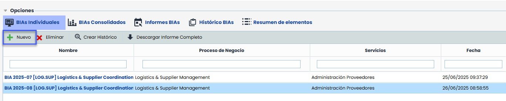

**Selección de procesos**   
La tabla presenta la jerarquía de servicios y procesos definidos en el Alcance de continuidad de negocio.  
Incluye filtros por nombre, categoría y ruta de categoría mediante campos de texto libre, y no permite ordenar por columnas.

1. 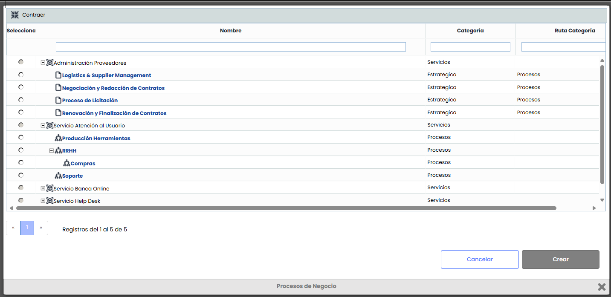

   Al crear un BIA, el sistema regresa automáticamente a la tabla principal, posicionándose en la página donde se encuentra el nuevo BIA.
