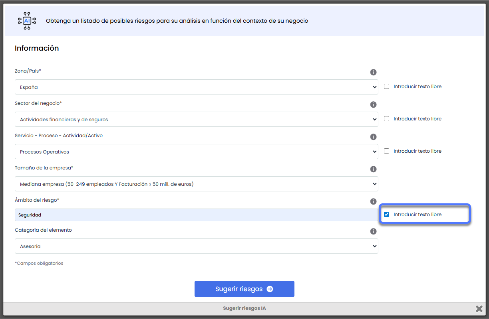

# v6.125 (Julio 2025)

### Nuevas funcionalidades y mejoras – Recomendador de Riesgos y Controles

#### Ampliación del criterio de Ámbito del Riesgo

Se ha ampliado la funcionalidad del [recomendador de riesgos](https://help.globalsuitesolutions.com/es/globalsuite/v1/descubre-nuestro-recomendador-de-riesgos-y-control), permitiendo introducir el Ámbito del Riesgo como texto libre además de seleccionar una opción del desplegable. Esto facilita la propuesta de riesgos y controles cuando no encajan en las opciones predefinidas..

