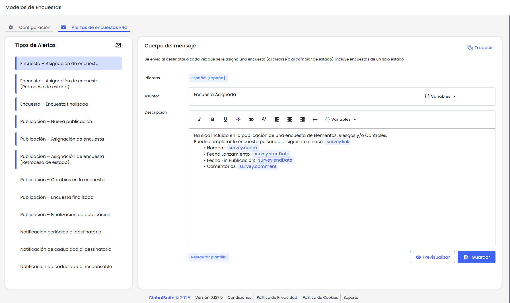
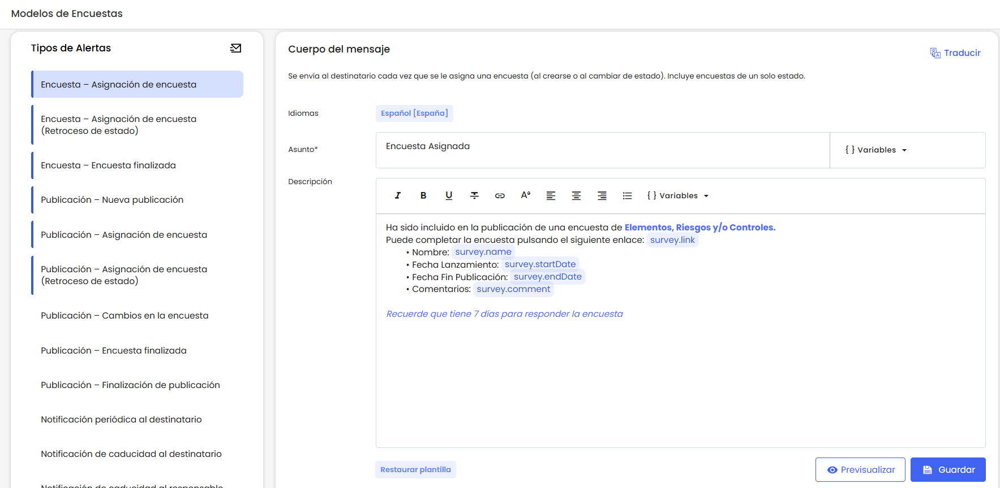
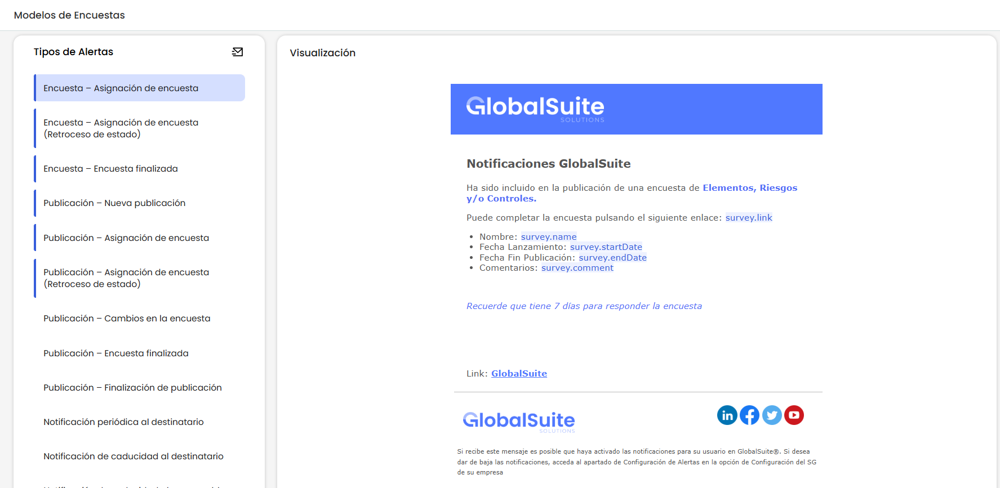
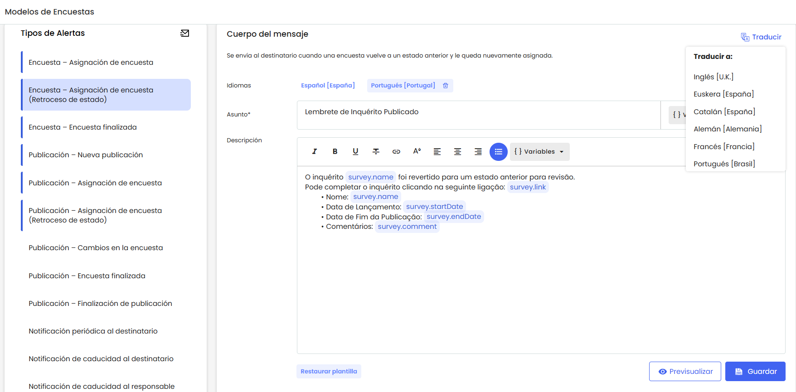
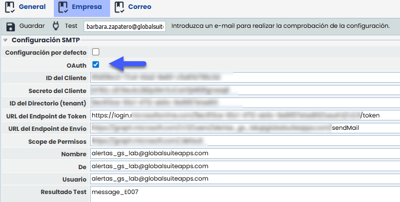

# v6.127 (Agosto 2025)

## Nuevas funcionalidades y mejoras GlobalSuite® GRC

### Configurar notificaciones de encuestas ERC.


Se ha incorporado una nueva funcionalidad que permite configurar todos los tipos de notificaciones que se generan durante el ciclo de vida de las encuestas ERC (como publicación, finalización, cambios de estado, recordatorios, entre otros).


Esta configuración se encuentra disponible en Ajustes > Modelos de Encuestas > Pestaña "Alertas de Encuestas ERC", y permite definir el asunto y el contenido del correo mediante plantillas personalizables, utilizando variables dinámicas para adaptar los mensajes a cada situación.

Además, se ha incorporado la posibilidad de definir el contenido del correo en distintos idiomas, para que los mensajes se envíen adaptados al idioma del destinatario.

### Alertas disponibles

En el panel izquierdo se listan todas las alertas disponibles para configurar. Aquellas que ya tienen al menos una plantilla definida se muestran con un borde izquierdo resaltado.

Es importante aclarar que si una alerta no tiene ninguna plantilla configurada, el sistema no enviará un correo vacío: se continua utilizando el modelo de correo por defecto que ya se encontraba activo antes de esta funcionalidad.

* **Encuesta – Asignación de encuesta**
* **Encuesta – Asignación de encuesta (Retroceso de estado)**
* **Encuesta – Encuesta finalizada**
* **Publicación – Nueva publicación**
* **Publicación – Asignación de encuesta**
* **Publicación – Asignación de encuesta (Retroceso de estado)**
* **Publicación – Encuesta finalizada**
* **Publicación – Cambios en la encuesta**
* **Publicación – Finalización de publicación**
* **Notificación periódica al destinatario**
* **Notificación de caducidad al destinatario**
* **Notificación de caducidad al responsable**


Para mas información sobre las plantillas, puedes consultar el apartado [Listado de alertas disponibles](https://help.globalsuitesolutions.com/es/globalsuite/v1/alertas-de-encuestas-erc#AlertasdeencuestasERC-Listadodealertasdisponibles) del manual.


### Configurar Plantillas

En la parte central de la pantalla se encuentra el área destinada a configurar el asunto y el mensaje de cada notificación.

#### Asunto de la notificación

Se puede personalizar el asunto del correo utilizando texto libre y variables dinámicas, como por ejemplo el nombre de la encuesta o la fecha de publicación.  
Las variables se insertan automáticamente desde el menú de ayuda y se reemplazan por su valor real al momento de enviar el correo.


Este campo tiene un límite técnico de caracteres definido por los servidores de correo, por lo que se recomienda mantener un texto breve, claro y evitar un uso excesivo de variables.


#### Mensaje de la notificación

El cuerpo del mensaje se puede redactar con total libertad y admite formato enriquecido: colores, negritas, subrayado, enlaces, listas, entre otros.  
Al momento de enviar el mensaje se le añade automáticamente el encabezado y pie de página configurado por la empresa (Ajustes > Configuración general> Correo).   
El usuario puede **previsualizar** en todo momento cómo se verá el mensaje final antes de guardarlo.

#### Variables

Las variables deben insertarse mediante la opción llamada “Variable”. Estas se añaden completas y con un formato especial, que las resalta del texto e impide editarlas parcialmente. De esta forma se evita que se escriban de manera incorrecta o que, al borrarlas solo en parte, el correo quede con errores.


Para mas información sobre las variables, puedes consultar el apartado [Variables](https://help.globalsuitesolutions.com/es/globalsuite/v1/alertas-de-encuestas-erc#AlertasdeencuestasERC-Variables) del manual.


#### Traducción del contenido

Tanto el asunto como el mensaje pueden traducirse a los idiomas que tenga configurados la empresa.

Cada vez que se añade un nuevo idioma, el sistema carga automáticamente la plantilla por defecto traducida (solo se traduce la plantilla por defecto, no el contenido personalizado por el usuario).

#### Envío de correo

Se mantiene la lógica actual que utiliza GlobalSUITE para el envío de notificaciones.  
Si el destinatario del correo tiene usuario en la plataforma, el idioma del envío se determina según el configurado en su perfil.  
Si el destinatario no tiene usuario, el idioma del envío se toma del idioma [configurado en la encuesta](https://help.globalsuitesolutions.com/es/globalsuite/v1/encuestas-elementos-riesgos-y-controles-configurac).

La novedad es que ahora, antes de enviar el correo, el sistema comprueba si existe una plantilla definida para ese idioma y tipo de notificación.  
En caso afirmativo, se utiliza dicha plantilla; si no, se envía el contenido por defecto.

## Otras mejoras de GlobalSuite ®

### Actualización del sistema de autenticación de correo mediante OAuth2

Se ha actualizado el sistema de autenticación de servidores de correo, ya que el uso de usuario y contraseña quedará obsoleto próximamente.

La nueva autenticación mediante el protocolo OAuth2 podrá gestionarse tanto a nivel de entorno como a nivel de Cliente para permitir la configuración de servidores propios.

#### Configuración por empresa

En Ajustes > Configuración > General > Empresa se ha habilitado una nueva opción para activar OAuth2 y completar los siguientes campos:

Se podrá probar que los datos son correctos, al presionar “Test”.

Una vez configurados los datos de conexión, si la información es correcta, los envíos de notificaciones se realizarán utilizando esta autenticación. El formato HTML de los correos (definido en la pestaña “Correo”) se seguirá utilizando como hasta ahora.


Los clientes que ya tengan configurado el envío de correos mediante sus propios servidores, sin utilizar OAuth2, se mantendrá activa de forma transitoria la opción de autenticación por usuario y contraseña. Esta opción quedará disponible hasta que cada cliente complete su migración.

