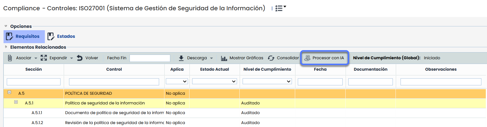
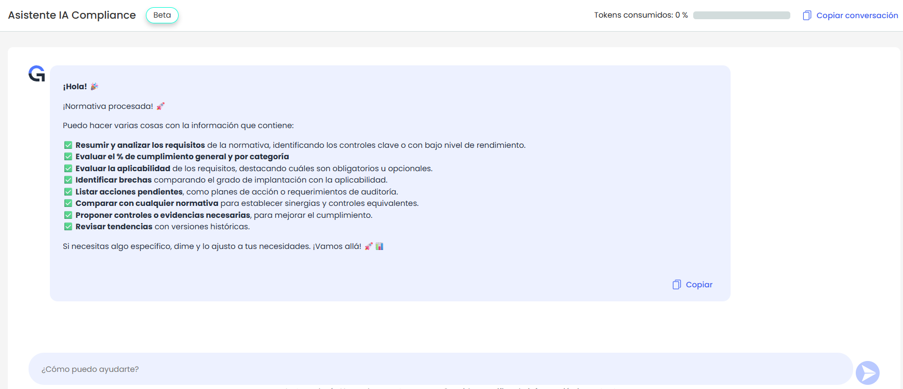
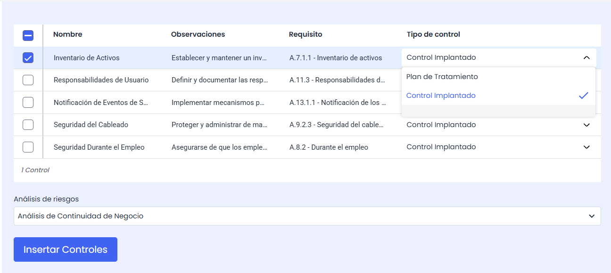
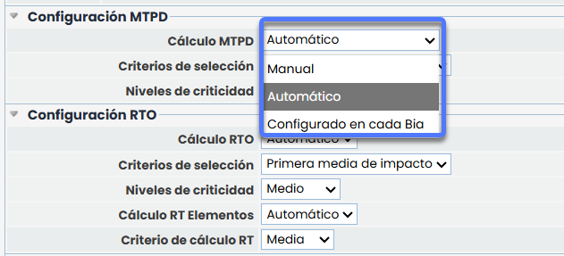
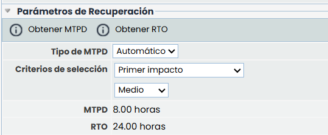
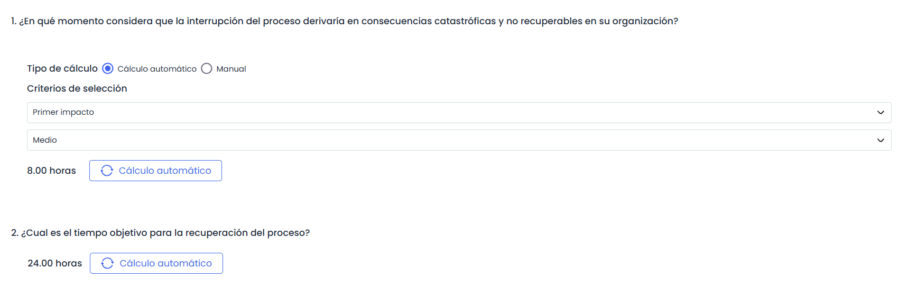
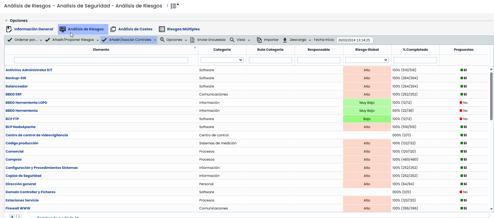

# v6.129 (Septiembre 2025)

## Nuevas funcionalidades y mejoras generales

### Nuevo asistente IA Compliance


Esta mejora introduce un asistente inteligente para el análisis y gestión de normativas, con el objetivo de facilitar la evaluación de cumplimiento, identificar brechas y proponer acciones de mejora y automatizar la creación de controles en GlobalSuite®.


#### Características principales

* **Resumir y analizar los requisitos** de una normativa, destacando los controles clave o con bajo nivel de rendimiento.
* **Evaluar el porcentaje de cumplimiento** tanto general como por categoría.
* **Determinar la aplicabilidad** de los requisitos, diferenciando entre obligatorios y opcionales.
* **Identificar brechas** al comparar el grado de implantación con la aplicabilidad.
* **Listar acciones pendiente**s, incluyendo planes de acción y requerimientos de auditoría.
* **Comparar con cualquier otra normativa** para establecer sinergias y controles equivalentes.
* **Proponer controles o evidencias** necesarias para mejorar el nivel de cumplimiento.
* **Revisar tendencias** y evolución del cumplimiento con versiones históricas.
* **Automatización de propuestas y controles:**

  * **Mostrar propuestas de acciones en formato tabla**, con la posibilidad de seleccionarlas para incluirlas en un análisis de riesgos, ya sea como plan de tratamiento o como control implantado.
  * **Asociar los controles creados** directamente a los requisitos de la normativa.

## Mejoras GlobalSuite® Continuity

* **Cálculo automático de MTPD, RTO en BIAs**, **Pre-BIAs** y **Cálculo RTO y RPO**, con posibilidad de aplicar criterios configurables y de aplicación global.
* **Cálculo automático de MTPD y RTO en encuestas BIA**, con integración de criterios de configuración y copia automática de valores desde el BIA de origen.

### Cálculo automático de MTPD y RTO en BIAS


Se incorpora la posibilidad de \*\*automatizar el cálculo de MTPD, RTO en BIAs\*\*, aplicando los criterios definidos \*\*de manera global\*\* desde Ajustes, lo que evita la necesidad de introducir estos valores manualmente en cada uno.


**Características principales:**

* **Configuración global** del tipo y criterios de cálculo en Ajustes > Continuidad de Negocio > [BIAs](https://help.globalsuitesolutions.com/es/globalsuite/v1/configuracion-bia)**,** con opción de definir si el **MTPD** y el **RTO** son **manuales** o **automáticos o configurados en cada BIA** (para el MTPD). Esto permite definir el cálculo del MTPD y RTO de todos los BIAs, sin necesidad de acceder a cada uno de forma individual.

* Posibilidad de elegir criterios como **primer impacto**, **primera media de impacto**, **primer impacto por tipo** o **porcentaje del MTPD** (para el RTO).
* Visualización diferenciada en los formularios de [**BIAs**](https://help.globalsuitesolutions.com/es/globalsuite/v1/bia-business-impact-analysis), [**Pre-BIAs**](https://help.globalsuitesolutions.com/es/globalsuite/v1/pre-biahttps://help.globalsuitesolutions.com/es/globalsuite/v1/pre-bia) y en la sección [**Cálculo RTO y RPO**](https://help.globalsuitesolutions.com/es/globalsuite/v1/calculo-rto-y-rpo), según el criterio de cálculo establecido (manual, automático o configurado en cada BIA).

Ejemplo tipo de MTPD configurado en cada BIA, y RTO como automático:

### Mejora en la vista de Cálculo RTO y RPO


Se amplía la vista existente en \*\*Análisis > Cálculo RTO y RPO\*\*, incorporando nuevas capacidades que permiten \*\*calcular de manera global el MTPD y el RTO consolidados para servicios y procesos\*\*, Este cálculo global se basa, al igual que en los BIAs, en la configuración definida en Ajustes > Continuidad > BIAs.


#### Mejoras principales:

* **Cálculo masivo de MTPD y RTO consolidados** para servicios y procesos según los criterios definidos en Ajustes > Continuidad > BIAs.
* **Automatización de cálculos**: posibilidad de calcular el MTPD y el RTO de forma manual o automática, con criterios como primer impacto, primera media de impacto, primer impacto por tipo o porcentaje del MTPD (para el RTO).
* **Ejecución global desde la barra de acciones**, con nuevas opciones en el botón *Calcular*:

  * MTPD consolidado
  * RTO consolidado
  * MTPD Acumulado y Repercutido
  * RTO Acumulado y Repercutido
* **Validaciones automáticas** para detectar incoherencias: en caso de incoherencias, los valores se muestran en rojo.
* **Nuevo botón Detalles** para acceder directamente al formulario de inventario del elemento seleccionado y poder editarlo.

### Cálculo automático de MTPD y RTO en encuestas de BIA


Se añade la posibilidad de \*\*calcular automáticamente el MTPD y el RTO en las encuestas de BIA por Impacto\*\*, ampliando la funcionalidad que hasta ahora permitía introducir los valores únicamente de forma manual.


#### Características principales:

* Ajuste dinámico de los formularios de encuesta en función del criterio configurado:

  * Si el cálculo es **manual**, se mantiene la introducción de valor + unidad.
  * Si el cálculo es **automático**, se muestra la opción de **Obtener MTPD** u **Obtener RTO** según el criterio definido en la configuración.
  * Si el calculo es **Configurado** **en cada BIA** para el MTPD,se tendrá la posibilidad de seleccionar el tipo (manual o automático), y criterio de cálculo en la encuesta.

Ejemplo tipo de MTPD configurado en cada BIA, y RTO como automático:

## Nuevas mejoras GlobalSuite® GRC

### Visualización permanente del Riesgo Global por Elemento (RGE)


Se incorpora la columna \*\*Riesgo Global por Elemento (RGE)\*\* por defecto en el listado de elementos dentro de los Análisis de Riesgos.


Esta columna muestra de forma automática el riesgo consolidado de cada elemento, actualizándose siempre que se modifiquen riesgos asociados, se consoliden encuestas o se utilice la funcionalidad *Calcular AR*.

Además, puede ordenarse y filtrarse como cualquier otra columna de la tabla, facilitando la consulta permanente del RGE sin necesidad de cálculos manuales.
