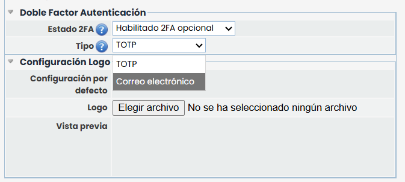
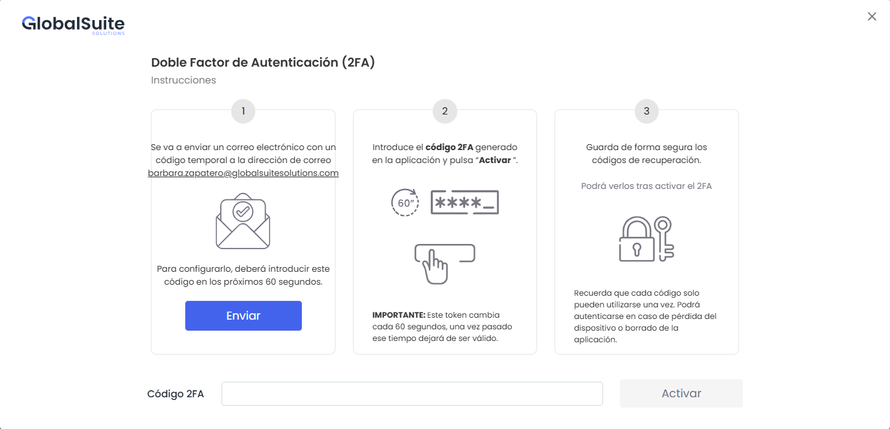
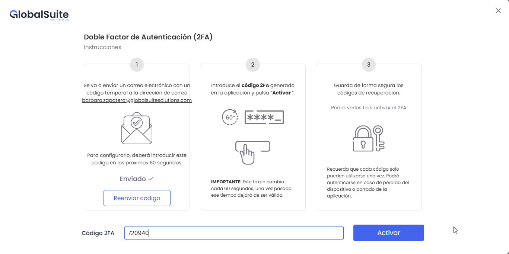
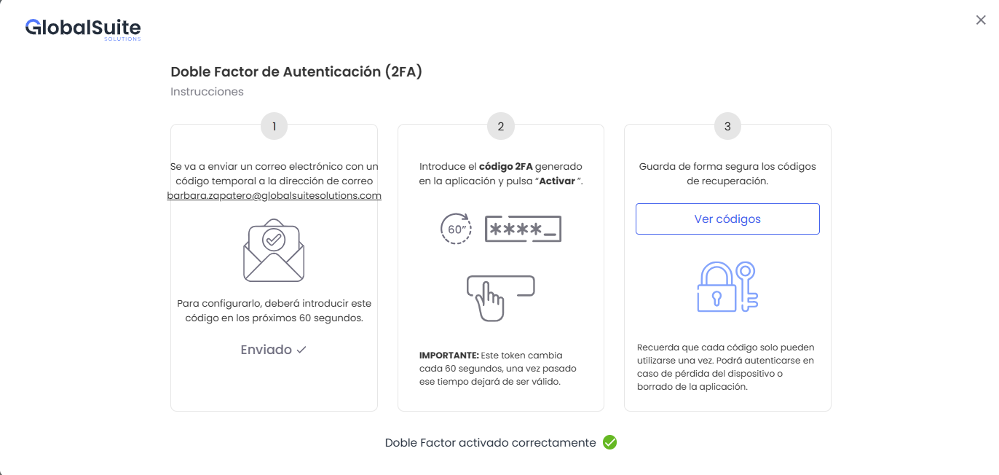
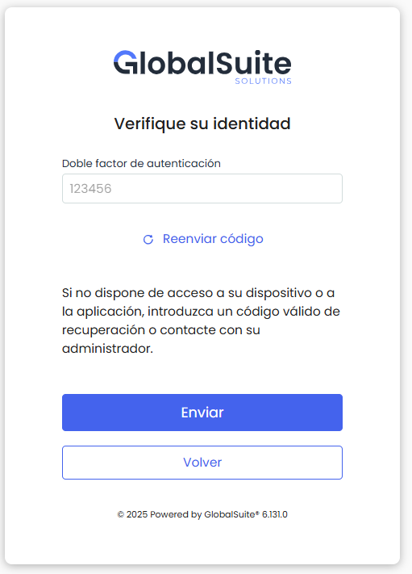

# v6.131 (Octubre 2025)

## Nuevas funcionalidades y mejoras generales

### Nuevo método de Doble Factor de Autenticación (2FA) con Correo Electrónico

Se incorpora un nuevo método de **autenticación en dos pasos (2FA)** mediante el **envío de un código temporal por correo electrónico**, como alternativa al mecanismo actual basado en aplicación TOTP. Este nuevo sistema permite a las empresas definir el medio de autenticación preferido (**TOTP o Correo Electrónico**) cuando el 2FA esté habilitado, manteniendo **TOTP como opción por defecto** y en todas las empresas que ya tenían el 2FA activo.

**Características principales:**

* Configuración del método 2FA en el nivel de **empresa**, pudiendo definirse como **opcional** u **obligatorio**.

  * Si el 2FA es **opcional**, cada usuario podrá activarlo manualmente desde su perfil.
  * Si el 2FA es **obligatorio**, se solicitará su configuración en el siguiente acceso al sistema.

* Integración completa del método de **correo electrónico** tanto en el **inicio de sesión** como en la **gestión del perfil de usuario**.  
  El flujo de configuración guiado consta de **tres pasos**:  
   1 . **Envío del código temporal**: se envía un correo electrónico con un código válido durante 60 segundos.

  

  Luego de realizar el primer envío, se habilita la opción **Reenviar el código**, limitada a un máximo de **3 reenvíos por usuario en un periodo de 5 minutos**.

  

2. **Activación del 2FA:** el usuario recibe un correo con el código e introduce el código recibido en el campo “Código 2FA” y pulsa *Activar*. Se validará si el código es correcto y no está caducado.

**3. Códigos de recuperación**: se muestran tras la activación para guardarlos de forma segura y permitir el acceso en caso de pérdida de acceso al correo electrónico, para recibir nuevos códigos.

* Una vez configurada esta modalidad, cada vez que se **inicie sesión en la aplicación** (tras introducir usuario y contraseña correctos) se **enviará automáticamente un correo con el código 2FA**, que el usuario deberá ingresar para completar el acceso.

