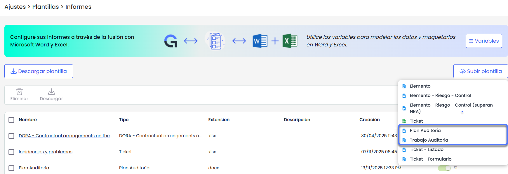
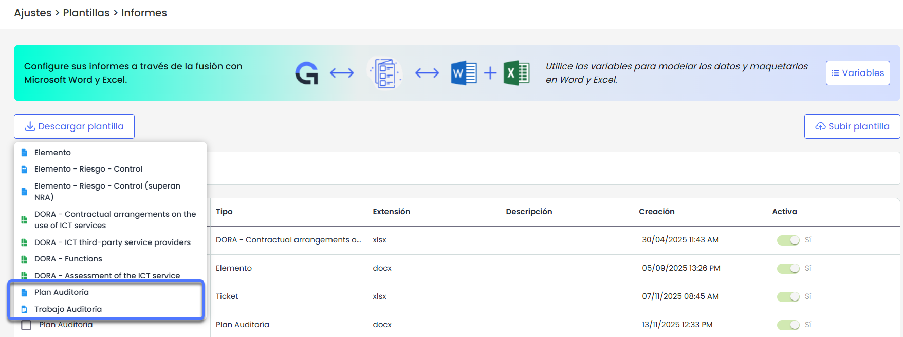
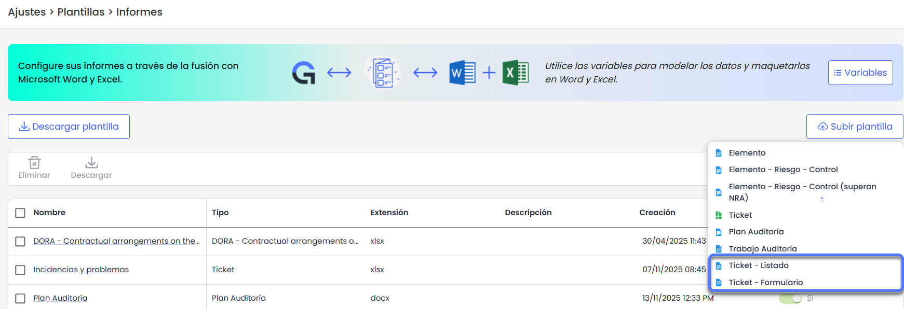

# v6.133 (Noviembre 2025)

## Nuevas funcionalidades y mejoras – Informes Dinámicos en Word

### Informes dinámicos de Auditoría


Se incorpora la posibilidad de generar \*\*informes dinámicos de auditoría en formato Word\*\* (.docx), permitiendo crear documentos totalmente personalizables tanto para la información del \*\*Plan de Auditoría\*\* como para los \*\*Trabajos de Auditoría\*\*.
Esta funcionalidad amplía el sistema actual de plantillas Word con \*\*dos nuevos tipos de informe específicos para el módulo de Auditoría\*\*, ofreciendo mayor \*\*flexibilidad y control\*\* sobre el contenido y el formato, de manera que los informes puedan adaptarse a las \*\*metodologías y necesidades de cada organización\*\* y exportarse como documentos Word totalmente configurables.


**Características principales:**

* **Gestión de plantillas DOCX**: en la opción Subir plantilla en **Ajustes > Plantillas >** [**Informes**](https://help.globalsuitesolutions.com/es/globalsuite/v1/plantillas-de-informes) se podrán cargar plantillas para Plan de Auditoría y Trabajo de Auditoría, disponibles para usuarios con acceso al módulo de Auditoría y licencia de Reports.

* **Plantillas predefinidas:** Adicionalmente, se incluyen dos plantillas predefinidas —una para el **Plan de Auditoría** y otra para el **Trabajo de Auditoría**— como propuesta inicial para facilitar la creación y personalización de informes.

* **Contenido disponible para informes**

  * En los **informes de Plan de Auditoría**, se puede incluir información detallada del plan, su descripción, estado, fechas, responsables, metodología de planificación y análisis de riesgos, así como los trabajos asociados con sus categorías, dimensiones, demás elementos vinculados, además de todos los campos configurables definidos en la metodología de auditoría.
  * En los **informes de un Trabajo de Auditoría**, se pueden mostrar los datos principales del trabajo (nombre, tipo, responsable, descripción, objetivos, estado, plan asociado y fechas previstas)
  * Ambos informes permiten incluir información completa sobre:
  * **Equipo de trabajo y roles asignados.**
  * **Documentación asociada**, incluyendo archivos, extensiones, fechas y descripciones.
  * **Metodologías de ejecución**, con sus elementos, riesgos y controles vinculados.
  * **Alcance**, incluyendo elementos, categorías, rutas, análisis de riesgos y dimensiones configuradas.
  * **Ejecución del trabajo**, con la información de elementos, riesgos, controles, papeles de trabajo, tickets asociados y planificación del proyecto.

### Mejora en los informes dinámicos de Tickets


Se amplían las capacidades de los \*\*informes dinámicos de tickets\*\*, que hasta ahora permitían su generación en \*\*Excel\*\*, incorporando ahora la posibilidad de crear \*\*informes en Word\*\* tanto para el \*\*formulario de un ticket individual\*\* como para \*\*listados de tickets.\*\*
Además, se amplía el conjunto de \*\*variables disponibles\*\* para ambos formatos (Word y Excel), ofreciendo más información sobre la gestión, el seguimiento y los elementos asociados a los tickets, y aumentando la flexibilidad en la creación y personalización de plantillas.


**Características principales:**

* **Nuevos tipos de plantilla de Tickets:**

  * **Ticket – Listado**, para generar informes Word con listados de tickets.
  * **Ticket – Formulario**, para generar informes Word con el detalle de un ticket concreto.  
    Estas opciones están disponibles en **Ajustes > Plantillas >** [**Informes**](https://help.globalsuitesolutions.com/es/globalsuite/v1/plantillas-de-informes), dentro del desplegable **Subir plantilla**, junto con el resto de tipos ya existentes.

* **Informes de tickets en Word:** se añade la posibilidad de **descargar informes de tickets en Word**, tanto en formato de formulario individual como en formato listado, complementando la funcionalidad previa de informes de tickets en **Excel**.
* **Ampliación de campos disponibles:** se amplía el conjunto de **campos/variables** que pueden utilizarse en las plantillas de informes de tickets (tanto en Word como en Excel), incluyendo información adicional relacionada con cuantificaciones, eventos vinculados, , impacto, etc.  
  El detalle completo de los campos disponibles se documenta en el manual, en el apartado [**Variables**](https://help.globalsuitesolutions.com/es/globalsuite/v1/plantillas-informes-excel#PlantillasdeinformesenExcel-Variables) de los informes de tickets.
