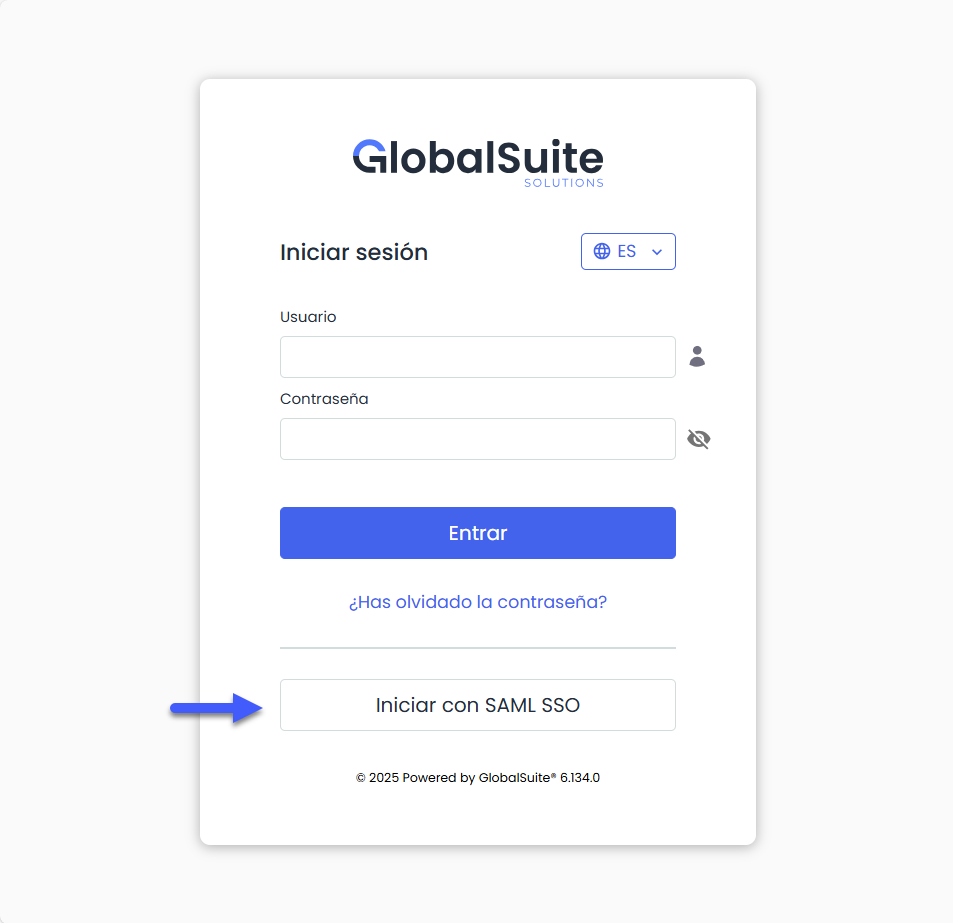
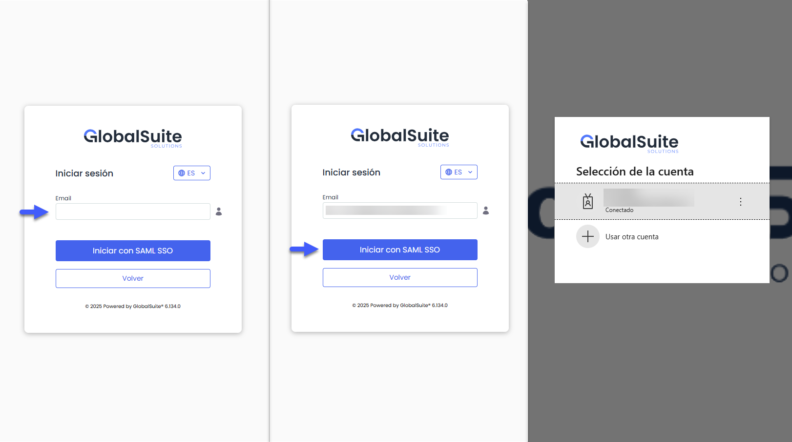
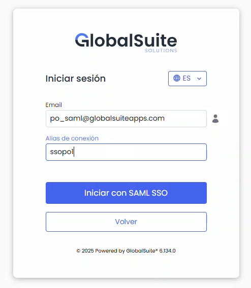
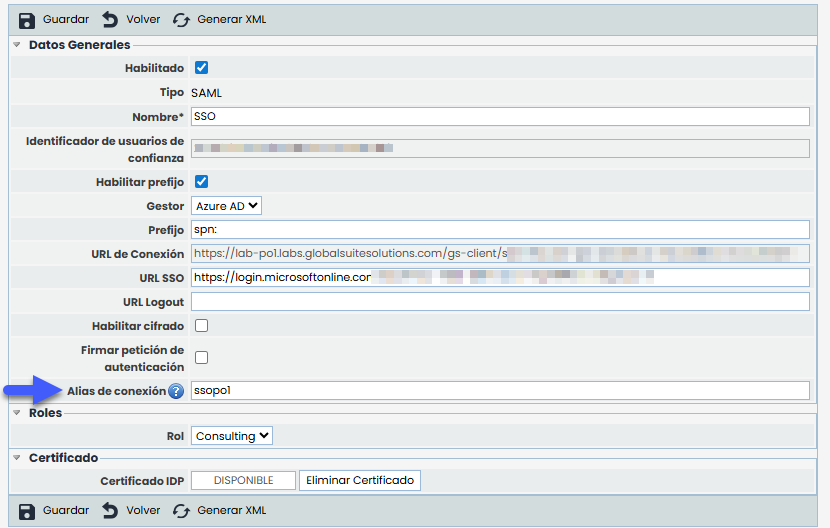
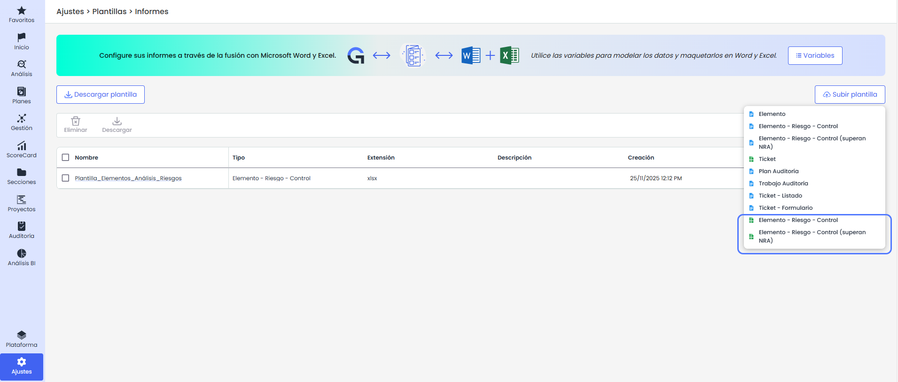
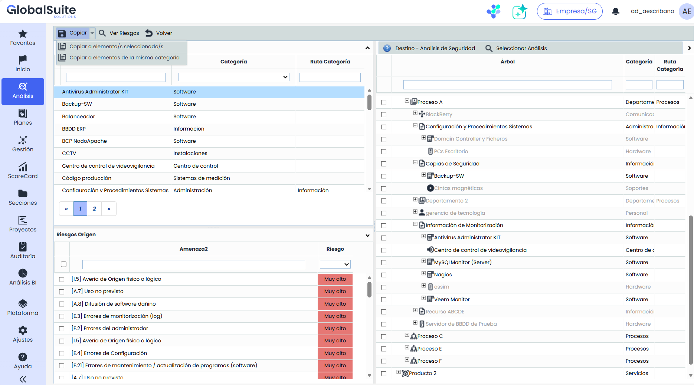

# v6.134 (Noviembre 2025)

### Nuevas funcionalidades y mejoras – Inicio de sesión mediante **Single Sign-On (SSO)**


Se amplía la funcionalidad de \*\*inicio de sesión mediante Single Sign-On (SSO) con autenticación SAML\*\*, permitiendo ahora acceder directamente desde la pantalla estándar de login de GlobalSuite® introduciendo únicamente el correo electrónico.
\*\*Las URLs existentes continuarán funcionando sin cambios\*\*. Esta mejora añade una nueva forma de acceso utilizando la URL estándar del entorno y el botón “Iniciar con SAML SSO”.


Como mejora, todas las conexiones configuradas con autenticación SAML pueden acceder directamente desde la **pantalla de login estándar de GlobalSuite®**, utilizando el botón **“Iniciar con SAML SSO”**.

Al seleccionar esta opción, se mostrará un campo para introducir el correo electrónico del usuario.  
El sistema identificará automáticamente la conexión correspondiente, autenticará contra el servidor de la organización y permitirá el acceso **sin necesidad de utilizar URLs externas ni parámetros adicionales**.

#### Usuarios con varias cuentas asociadas al mismo correo

En los casos en los que un mismo correo electrónico tenga **varios usuarios asociados** dentro del SG, GlobalSuite® iniciará sesión utilizando el **usuario principal** (el que agrupa al resto de usuarios vinculados).

Una vez autenticado, se mostrará la pantalla habitual para que el usuario **seleccione con qué usuario asociado desea trabajar**, manteniendo el comportamiento actual del sistema.

#### Usuarios nuevos

En el caso de los usuarios que acceden por primera vez —es decir, aquellos que nunca han iniciado sesión y aún no tienen un usuario creado en el sistema— se solicitará un dato adicional denominado **“Alias de Conexión”**.

Este alias permite identificar en qué SG debe registrarse el usuario y se define durante la configuración de la conexión.

### Nuevos Informes Dinámicos en Excel

#### Mejora en los informes dinámicos de Elementos, Riesgos y Controles


Se amplían las capacidades de los \*\*informes dinámicos de Elementos, riesgos y controles\*\*, que hasta ahora permitían su [generación en \*\*Word\*\*](https://help.globalsuitesolutions.com/es/globalsuite/v1/personaliza-plantillas-informes-riesgos), incorporando ahora la posibilidad de crear \*\*informes en Excel\*\* para extraer la información de un elemento con los riesgos y controles aplicados en un formato estructurado\*\*.\*\*
Además, se amplía el conjunto de \*\*variables disponibles\*\*, ofreciendo más información sobre la gestión, el seguimiento y los elementos asociados a los tickets, y aumentando la flexibilidad en la creación y personalización de plantillas.


**Características principales:**

* **Plantillas dinámicas**: Será posible crear documentos en Excel con información agregada de un elemento y sus distintos análisis de riesgos que permiten la automatización del contenido.

* **Integración con GlobalSuite®**: Se podrá utilizar datos configurados previamente en la plataforma para generar informes sin necesidad de edición manual.
* **Flexibilidad en la personalización**: Será posible adaptar el diseño y la estructura de los informes según las necesidades.
* **Listados de variables**: Se podrá acceder a un catálogo completo de variables para elementos, riesgos y controles, cruzando información para la extracción masiva de datos.


\*\*Más Información\*\*
Para tener más detalle sobre qué datos pueden exportarse en las plantillas de Elementos, Riesgos y Controles, puedes consultar el detalle del manual [aquí](https://help.globalsuitesolutions.com/es/globalsuite/v1/plantillas-informes-word#PlantillasinformesWord-Variables).


## Nuevas mejoras GlobalSuite® GRC

#### Mejora en la Copia de Riesgos por Categoría


Se amplían las capacidades de la \*\*Copia de Riesgos\*\* en el módulo de Análisis de Riesgos de GlobalSuite® para poder aplicar directamente a otros elementos de la misma categoría.


El botón *Copiar* pasa a convertirse en un menú desplegable con dos alternativas: **Copiar a elemento(s) seleccionado(s)** y **Copiar a elementos de la misma categoría**.

* **Copiar a elemento(s) seleccionado(s)** mantiene el funcionamiento actual: se deben seleccionar el elemento origen, los riesgos y los elementos destino en el árbol.
* **Copiar a elementos de la misma categoría** permite copiar los riesgos del elemento origen a **todos los elementos del análisis que compartan su categoría**, sin necesidad de seleccionar destinos manualmente.

Esta nueva mejora está disponible tanto si se quieren copiar riesgos en el mismo análisis o a todos los elementos de esa categoría de un análisis de riesgos distinto.
