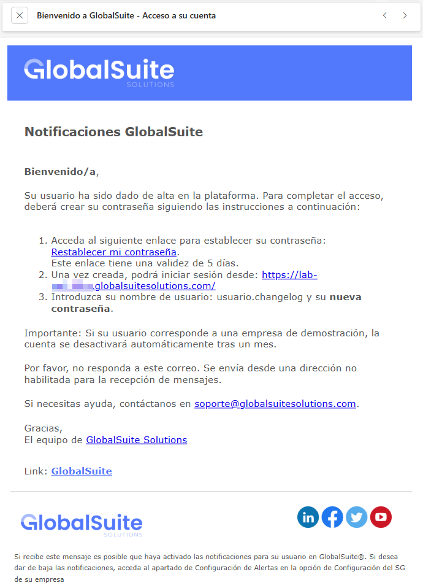
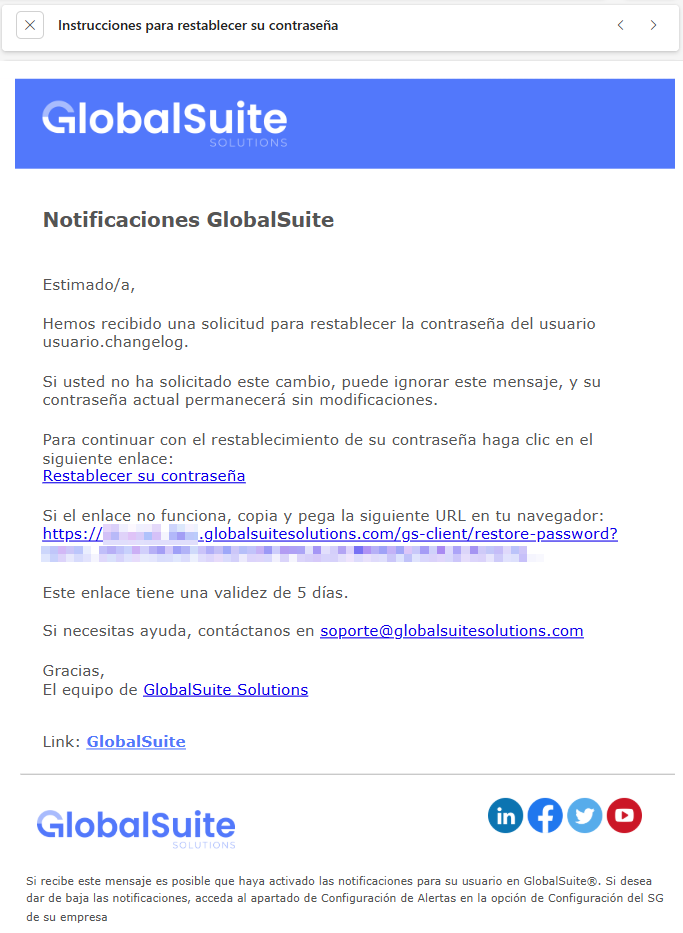
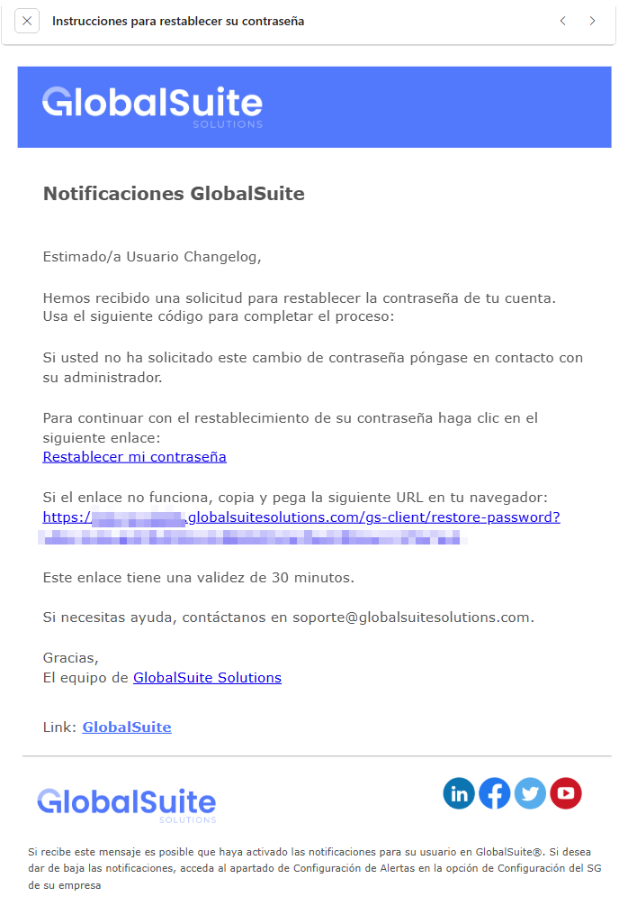
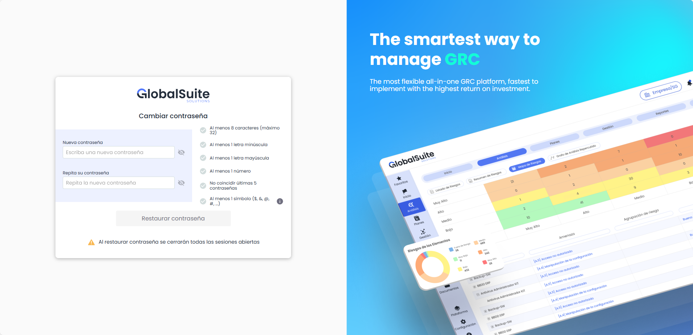
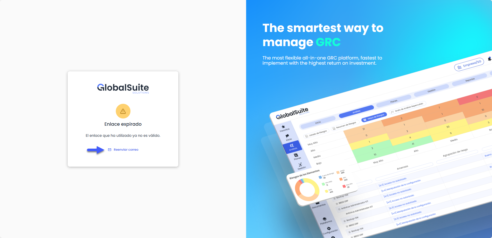

# v6.135 (Diciembre 2025)

## Nuevas funcionalidades y mejoras – Recuperación y creación de contraseñas


Hemos renovado por completo el proceso de alta de usuarios y recuperación de contraseñas, \*\*eliminando el envío de contraseñas por correo electrónico\*\*. Este cambio responde a solicitudes de clientes y a buenas prácticas de seguridad, evitando el uso de claves en texto plano y reforzando la protección de las cuentas.


El alta de usuarios y la restauración de contraseñas realizadas por administradores desde **Ajustes** envían ahora un correo con un enlace seguro, válido durante **5 días**, para que el usuario pueda definir su contraseña.



De la misma forma, la opción **“He olvidado mi contraseña”** envía un correo con un enlace seguro y con una validez de **30 minutos**, permitiendo completar el proceso de recuperación de forma autónoma.



Todos los enlaces generados para el restablecimiento de contraseñas son **únicos, firmados y de un solo uso**, invalidándose automáticamente tras su primera utilización. Además, se incorpora una **nueva pantalla de cambio de contraseña**, desde la cual el usuario puede definir su nueva clave una vez validado el enlace recibido.



Tras un cambio de contraseña exitoso, el sistema cierra las sesiones activas previas, registra la auditoría del evento y envía una **notificación de confirmación** al usuario.

En caso de que el enlace haya vencido, al acceder a él el sistema mostrará un mensaje informativo y ofrecerá la posibilidad de **reenviar el correo**, permitiendo generar un nuevo enlace de restablecimiento directamente desde la pantalla.



Estas mejoras aplican a los **usuarios con autenticación local de GlobalSuite**. Los usuarios que acceden mediante **AD, LDAP, ADFS o Single Sign-On con SAML** continuarán operando como hasta ahora.

## GlobalSuite API: Actualización de seguridad en la autenticación


Para elevar los estándares de seguridad y garantizar la integridad de las comunicaciones con \*\*GlobalSuite\*\*, vamos a ajustar los mecanismos permitidos para el envío de la \*\*API-Key\*\*.
A partir de la próxima versión, el uso de la API-Key como parámetro en la URL (GET) quedará \*\*depreciado y dejará de ser funcional\*\*. La única vía válida para autenticar las peticiones será a través de las \*\*cabeceras (headers) de HTTP\*\*.


#### ¿Por qué realizamos este cambio?

El envío de credenciales a través de la URL (*query strings*) representa un riesgo de seguridad, ya que las claves pueden quedar registradas en:

* Historiales de navegación del navegador.
* Logs del servidor y proxies intermedios.
* Referrer headers al navegar a otros sitios.

Al restringir el uso al **Header**, nos alineamos con las mejores prácticas de la industria (OWASP), asegurando que la conexión sea más robusta y privada.

#### Detalles técnicos

##### Así funciona actualmente (Soportado hasta la versión actual):

Se permite el envío de la clave tanto en la URL como en la cabecera: `https://demo-eu.globalsuitesolutions.com/v1/categories?api_key=API-KEY`

##### Así deberá funcionar (Único método disponible en la próxima versión):

La clave deberá enviarse exclusivamente en el header de la petición:


```
HTTP
```



```
GET /v1/globalsuite/data HTTP/1.1
Host: demo-eu.globalsuitesolutions.com
X-API-KEY: TU\_CLAVE\_AQUI
Content-Type: application/json
```


#### Acción requerida

Si actualmente realizas integraciones con GlobalSuite® utilizando la API-Key como parámetro en la URL, **se debe actualizar la conexión antes del 18 de enero** para evitar la interrupción del servicio.

1. Localiza las llamadas a la API de GlobalSuite en tu código.
2. Elimina el parámetro `api_key` de la cadena de la URL.
3. Añade la clave en el header de la petición HTTP bajo el nombre `apikey`.


\*\*Más info\*\*
Puedes consultar más información sobre el API de GlobalSuite en este enlace:
<https://help.globalsuitesolutions.com/es/globalsuite/v1/globalsuite-api>

