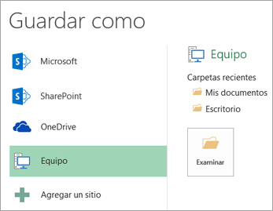

# v6.19 (Julio 2021)

### Nuevas funcionalidades y mejoras generales de GlobalSUITE® GRC

**- Módulo Ticketing:** Optimización de la asociación de roles/empleados de un ticket, a partir del Workflow utilizado.

* Mejora de rendimiento ante un volumen elevado de empleados en la organización.
* Mayor usabilidad, se desglosa en dos columnas pudiendo realizar búsquedas por rol y por empleado simultáneamente.
* Reducción de tiempo de carga de la ficha del ticket.

- **Descarga CSV**: Optimización de la generación del informe de Evaluación de Riesgos > Mapa de Riesgos.

* El informe con la información de Elementos, Riesgos y Controles evaluados en el análisis de riesgos, pasa a generarse en formato csv en vez de en formato .xlsx
* En caso de que el análisis de riesgos sea muy extenso, se incluirán todos los registros en un único archivo, en lugar de dividido en varios archivos Excel separados, lo que facilita su consulta posterior.

Este formato CSV es un estándar que permite la explotación y volcado de la información de riesgos en otros sistemas, facilitando la interconexión y explotación de las mismas.

En próximas versiones se incorporarán nuevos informes en este formato estándar CSV

Si se quiere convertir el informe descargado en formato Excel, se puede realizar siguiendo estos pasos:

1. Abra el archivo .csv descargado de GlobalSUITE® que desee convertir.
2. Haga clic en **Archivo** > **Guardar como**.

   
3. En **Sitios**, seleccione el lugar donde desea guardar el archivo.

   
4. En el cuadro de diálogo **Guardar como**, vaya a la ubicación deseada.

   
5. En la lista **Guardar como tipo**, haga clic en el formato de archivo "*Libro de Excel (\*.xlsx)*". Haga clic en las flechas para desplazarse a los formatos de archivo que no se vean en la lista.

   

**Más información:** <https://support.microsoft.com/es-es/office/guardar-un-libro-con-otro-formato-de-archivo-6a16c862-4a36-48f9-a300-c2ca0065286e>
