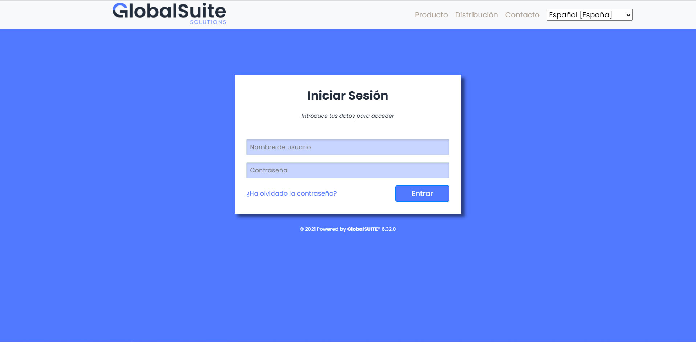
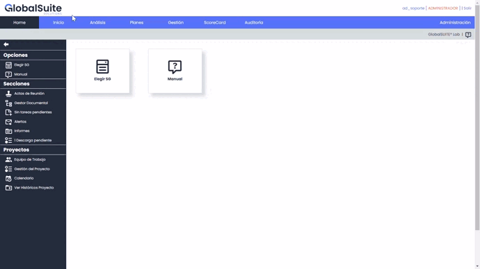
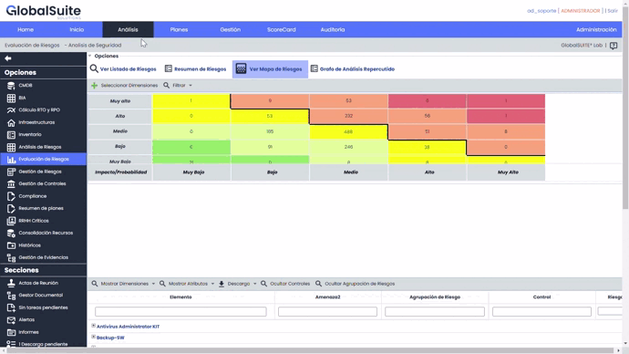

# v6.32 (Diciembre 2021)

## Nuevo Rebranding de GlobalSuite®

Como parte del cambio de imagen y marca que hemos lanzado en GlobalSuite Solutions, hemos adaptado la nueva imagen corporativa de nuestra solución (si quieres conocer en detalle, puedes ver la entrada de [nuestro blog](https://www.globalsuitesolutions.com/es/globalsuite-solutions-nueva-imagen/))

El cambio que hemos realizado sobre el software es principalmente visual, modernizando la interfaz con unos cambios que representan nuestros valores de **innovación** y **profesionalidad**.

Además de ello, hemos incluido algunas mejoras de usabilidad, que creemos que facilitarán el manejo y la utilización de GlobalSuite®. Os indicamos las más importantes:

#### Menú principal de navegación

Hemos añadido dentro de cada pestaña o sección un módulo visual de navegación con las opciones y apartados disponibles. Esto permitirá un acceso rápido a las mismas, y facilitará la navegación de la herramienta.

#### Mejora de menús superiores

También hemos incorporado mejoras en la navegación de subapartados, permitiendo identificar en cuál de ellas estamos actualmente.

Esta actualización es el punto de partida de un proyecto transversal que se desarrollará durante 2022. Este proyecto se centra en modernizar GlobalSuite® desde el punto de vista técnico y funcional, poniendo el foco en el usuario. Queremos ser un referente tecnológico internacional en Software y soluciones de GRC a la medida de cada negocio.

**Resumen de nuevas funcionalidades versiones v6.31 a v6.32**

En el siguiente vídeo podrá ver una explicación de las novedades incorporadas en las últimas versiones de GlobalSuite®.

### Vídeos


Changelog GlobalSuite v6.31 y v6.32.mp4

