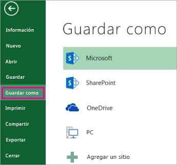

# v6.35 (Enero 2022)

### Nuevas funcionalidades y mejoras generales de GlobalSuite® GRC

- Mejoras en la funcionalidad de **Gestión de Controles**: Se han realizado modificaciones en el apartado de Análisis > [Gestión de Controles](https://help.globalsuite.es/pages/viewpage.action?pageId=36178050), entre las que se encuentran:

* Mejora de rendimiento ante un gran volumen de datos. En caso de tener un número de controles y acciones elevado, la herramienta tardará mucho menos en cargarse.

* Posibilidad de modificar la información de las acciones desde la tabla principal, sin necesidad de acceder al detalle del control.

* Se ha incorporado la información de Fecha de Fin y Estado de las acciones a la vista principal

* Optimización de la descarga de informe de controles y acciones:

* * La descarga ha pasado a generarse en segundo plano para evitar esperas del usuario. Una vez generado, podrá obtenerlo en el apartado [Descargas Pendientes](https://help.globalsuite.es/display/GlobalSUITEes/Descargas+Pendientes)

* * La estructura de la información se ha optimizado, mostrando la información de las acciones en columnas adicionales a las de los controles.

* * El archivo generado ha pasado de formato Excel a formato CSV para facilitar su explotación posterior.

Este formato CSV es un estándar que permite la explotación y volcado de la información de riesgos en otros sistemas, facilitando la interconexión y explotación de las mismas.

Si se quiere convertir el informe descargado en formato Excel, se puede realizar siguiendo estos pasos:

1. Abra el archivo .csv descargado de GlobalSUITE® que desee convertir.
2. Haga clic en **Archivo** > **Guardar como**.

   
3. En **Sitios**, seleccione el lugar donde desea guardar el archivo.

   
4. En el cuadro de diálogo **Guardar como**, vaya a la ubicación deseada.

   
5. En la lista **Guardar como tipo**, haga clic en el formato de archivo "*Libro de Excel (\*.xlsx)*". Haga clic en las flechas para desplazarse a los formatos de archivo que no se vean en la lista.  
   

**Más información:** <https://support.microsoft.com/es-es/office/guardar-un-libro-con-otro-formato-de-archivo-6a16c862-4a36-48f9-a300-c2ca0065286e>
