# v6.63 (Marzo 2023)

## Nuevas funcionalidades y mejoras generales de GlobalSuite® Security

### Esquema Nacional de Seguridad. Adaptación RD 311/2022

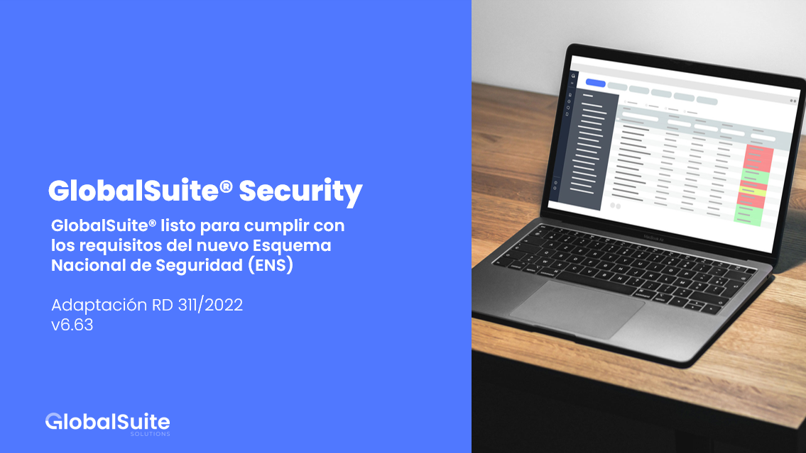

##### GlobalSuite® listo para cumplir con los requisitos del nuevo ENS

La nueva versión de GlobalSuite® ya dispone todo lo necesario para adaptar a tu empresa al nuevo ENS

Completamente adecuada al Real Decreto 311/2022, de 3 de mayo, por el que se regula el Esquema Nacional de Seguridad

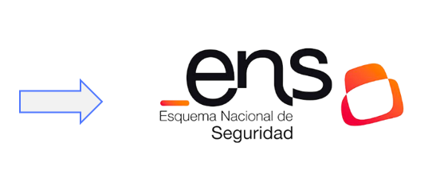

#### Medidas de Seguridad

**Adaptación a la nueva Versión 2022**: sustituye a la anterior (Real Decreto 311/2022, de 3 de mayo, por el que se regula el Esquema Nacional de Seguridad)

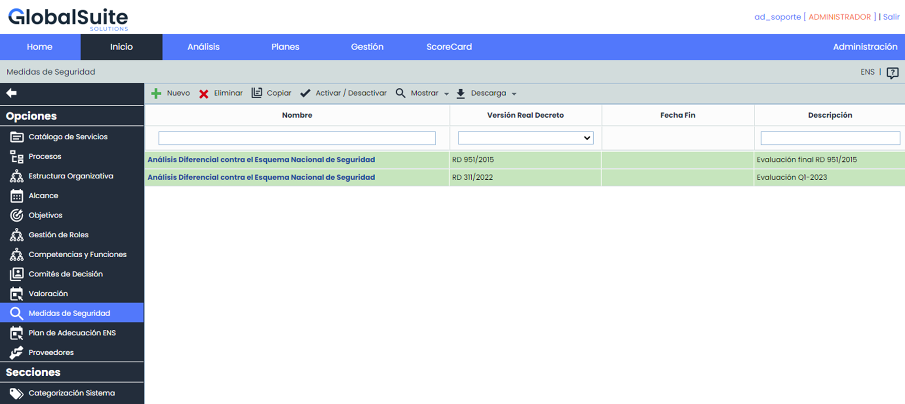

* **Múltiples Evaluaciones**: Ahora será posible gestionar más de una evaluación de las Medidas de Seguridad indicadas en el ENS de las versiones:

  * RD 951/2015
  * RD 311/2022
* **Copia de Evaluaciones:** Se incorpora la funcionalidad de duplicar los registros que incluyen toda la información de las evaluaciones.

**En esta nueva versión, los clientes dispondrán de un registro con la evaluación de medidas de seguridad que tenían.**

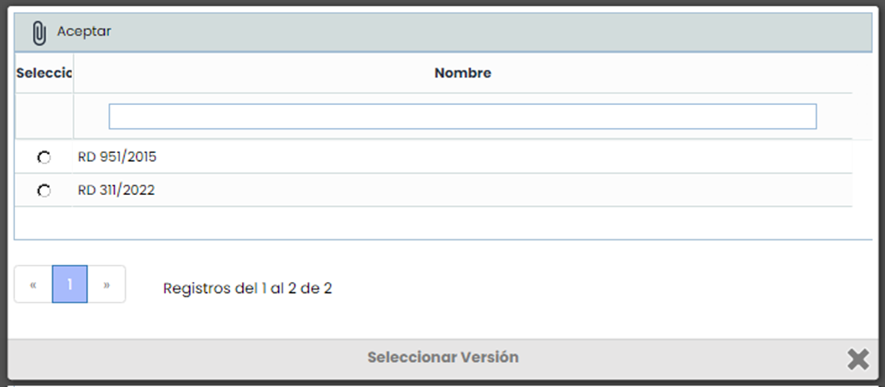

* **Históricos**: Será posible crear históricos de las evaluaciones, los cuales almacenarán los niveles de seguridad y aplicabilidad de los requisitos en el momento en que se realicen.

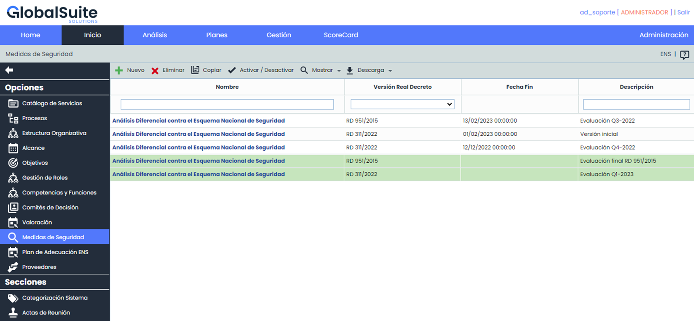

* **Filtrado de evaluaciones:** Por defecto, GlobalSuite® mostrará las evaluaciones activas (en verde), pero se podrán mostrar todas en el listado principal.
* **Nivel de Seguridad:** Aunque la Categorización del Sistema se modifique, estas versiones históricas mantendrán el grado de aplicabilidad original.

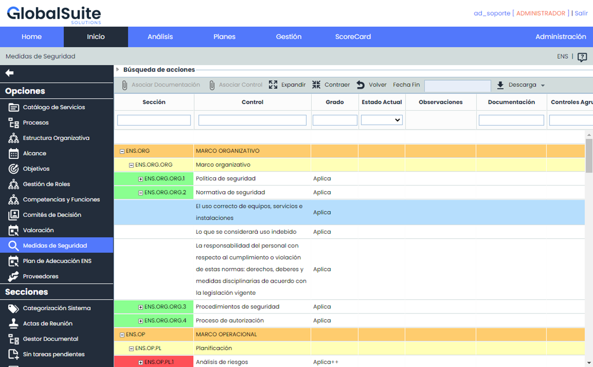

* **Filtros Avanzados**: Se ha incorporado la posibilidad filtrar por acciones de forma independiente en el apartado "Búsqueda de acciones".

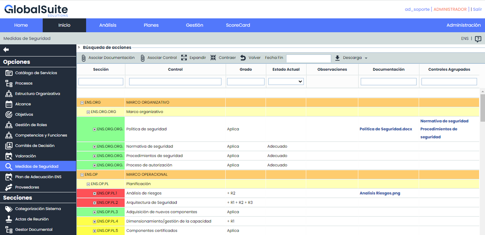

* **Trazabilidad documental**: Se incluye la funcionalidad de asociar a medidas o requisitos, documentos del [Gestor Documental](https://help.globalsuite.es/display/GlobalSUITEes/.Gestor+Documental+vv6.53), así como controles registrados en [Gestión de Controles.](https://help.globalsuite.es/pages/viewpage.action?pageId=78808228)

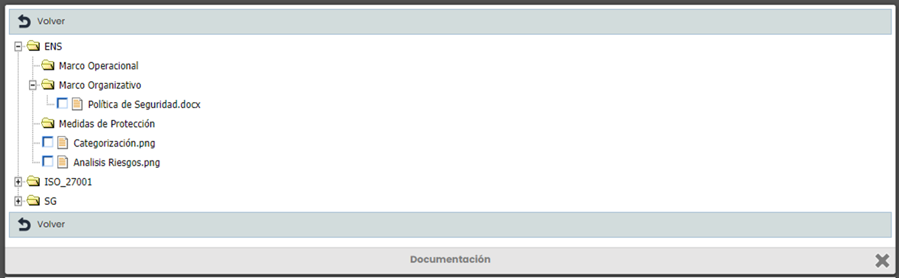

* **Descarga de Informes**: Será posible generar Informes en formato Docx tanto para registros activos como históricos, los cuales contendrán toda la información de los mismos.

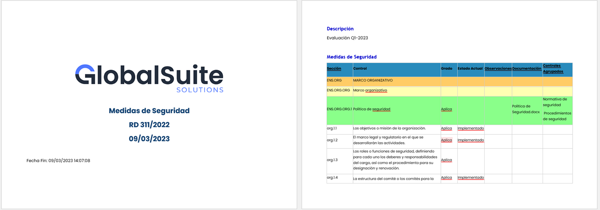

* **Verificación de Adecuación**: Se incorpora la posibilidad de identificar las medidas de seguridad que se encuentras adecuadas, en caso de que los controles se encuentren implantados.

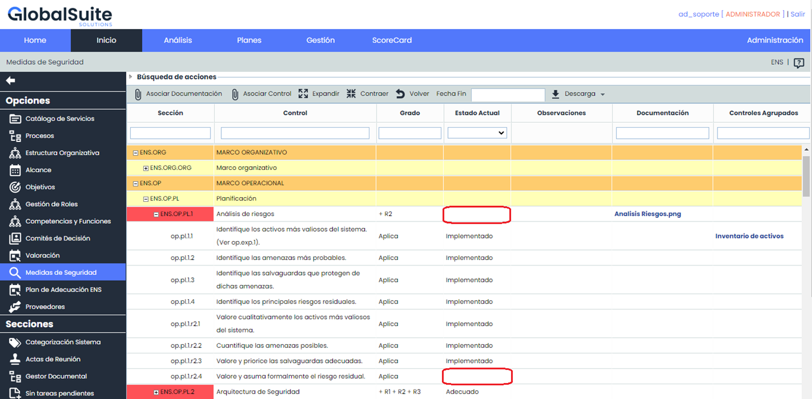

* **Exclusión de controles**: En caso de que algún requisito del ENS no sea de aplicación se podrá indicar, en cuyo caso no se contabilizará para marcar como adecuada una medida de seguridad.

#### Plan de Adecuación

* **Múltiples Planes**: A partir de ahora será posible crear varios planes de Adecuación a partir de las evaluaciones de [Medidas de Seguridad](https://help.globalsuite.es/display/GlobalSUITEes/.Medidas+de+Seguridad+vv6.63) del ENS para ambas versiones soportadas:

  * RD 951/2015
  * RD 311/2022

**En esta nueva versión, los clientes dispondrán de un registro con el Plan de Adecuación activo si lo tuvieran. En caso contrario, el listado aparecerá vacío**

* **Creación Automática**: Los planes de adecuación se podrán crear con todas las medidas de seguridad que aplican y que tienen algún control que no está implementado al 100%. Además, se podrá realizar un seguimiento detallado de cada uno de los controles y ver su progreso en tiempo real.

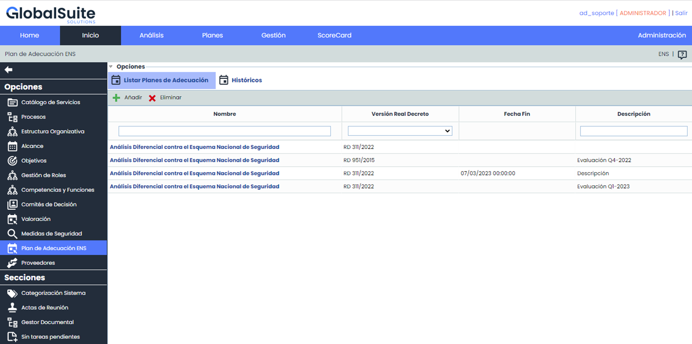

* **Históricos**: Será posible crear históricos para almacenar el estado de un plan de adecuación y poder revisar su evolución.
* **Filtros Avanzados:** Será posible filtrar por controles y por acciones de forma independiente.

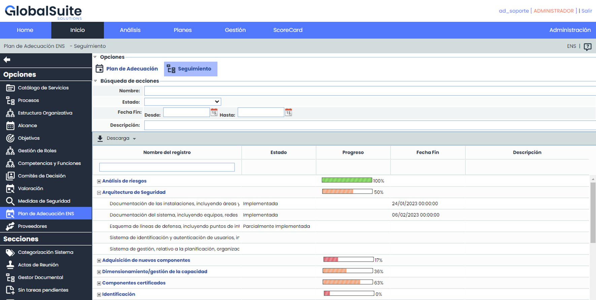

* **Descarga de Informes**: Será posible generar un Informe CSV de los controles y acciones a implementar para permitir una mejor revisión y análisis de los datos.

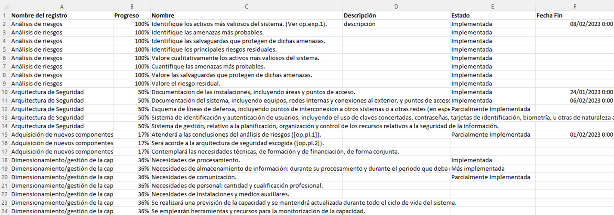
