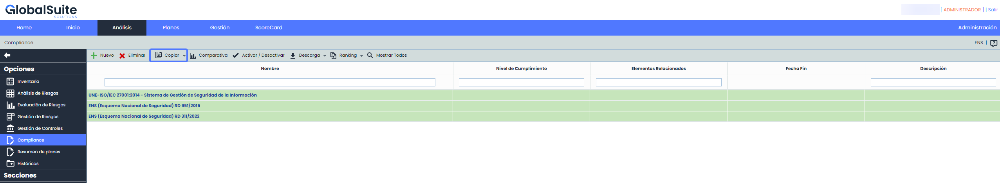
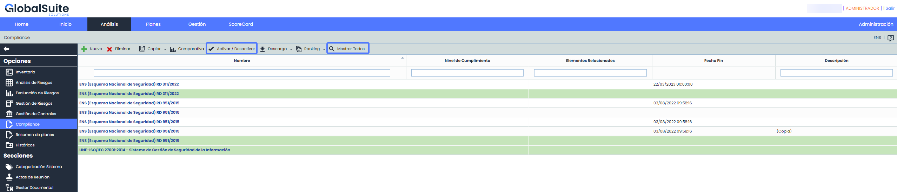
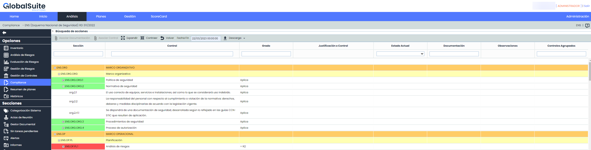
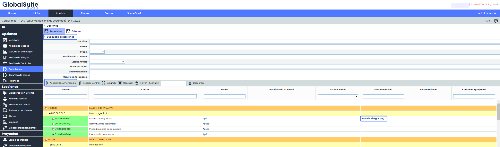
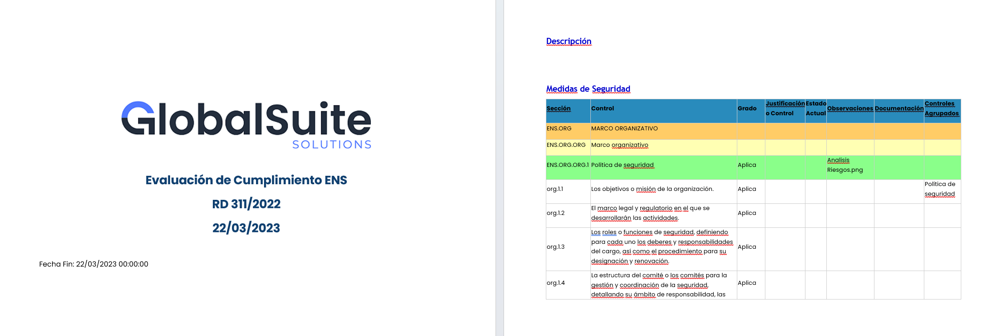
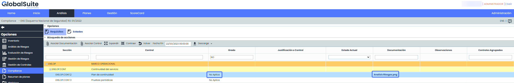

# v6.64 (Abril 2023)

### Nuevas funcionalidades y mejoras generales de GlobalSuite® Security

* **Esquema Nacional de Seguridad. Adaptación RD 311/2022**

**Compliance**

* **Adaptación a la nueva Versión 2022**: sustituye a la anterior (Real Decreto 311/2022, de 3 de mayo, por el que se regula el Esquema Nacional de Seguridad)

* **Múltiples Evaluaciones**: Ahora será posible gestionar más de una evaluación de las Medidas de Seguridad indicadas en el ENS de las versiones:

  * RD 951/2015
  * RD 311/2022

* **Copia de Evaluaciones:** Se incorpora la funcionalidad de duplicar los registros que incluyen toda la información de las evaluaciones.

**En esta nueva versión, los clientes dispondrán de un registro con la evaluación ENS que tenían.**

* **Históricos**: Será posible crear históricos de las evaluaciones, los cuales almacenarán los niveles de seguridad y aplicabilidad de los requisitos en el momento en que se realicen.

* **Filtrado de evaluaciones:**Por defecto, GlobalSuite® mostrará las evaluaciones activas (en verde), pero se podrán mostrar todas en el listado principal.

* **Nivel de Seguridad:**Aunque la Categorización del Sistema se modifique, estas versiones históricas mantendrán el grado de aplicabilidad original.

* **Filtros Avanzados**: Se ha incorporado la posibilidad filtrar por acciones de forma independiente en el apartado "Búsqueda de acciones".

* **Trazabilidad documental**: Se incluye la funcionalidad de asociar a medidas o requisitos, documentos del [Gestor Documental](https://help.globalsuite.es/display/GlobalSUITEes/.Gestor+Documental+vv6.53), así como controles registrados en [Gestión de Controles.](https://help.globalsuite.es/pages/viewpage.action?pageId=78808228)

* **Descarga de Informes**: Será posible generar Informes en formato Docx tanto para registros activos como históricos, los cuales contendrán toda la información de los mismos.

* **Exclusión de controles**: En caso de que algún requisito del ENS no sea de aplicación se podrá indicar, en cuyo caso no se contabilizará para marcar como adecuada una medida de seguridad.

**Resumen de nuevas funcionalidades del módulo ENS de las versiones v6.63 y v6.64**

En el siguiente vídeo podrá ver una explicación de las novedades incorporadas en el módulo de Esquema Nacional de Seguridad de GlobalSuite®.

## Vídeos


Changelog v6.63 - v6.64 ENS.mp4

