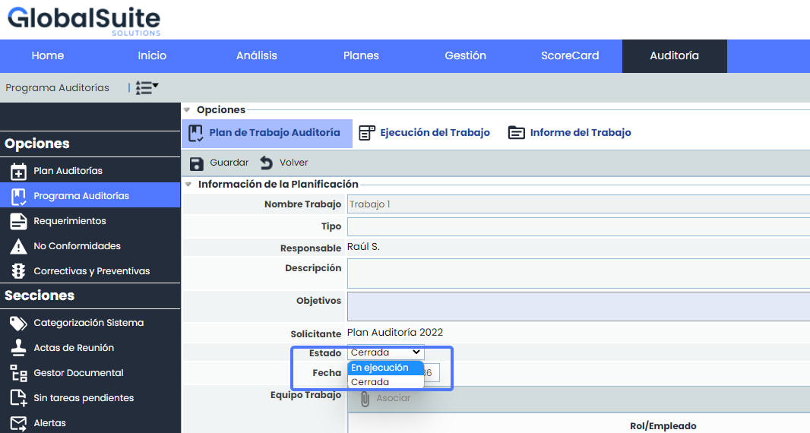

# v6.69 (Junio 2023)

### GlobalSUITE® Audit Management

**Programa Auditorías**

* Reabrir trabajos:  Se ha añadido la posibilidad de reabrir trabajos de Auditoría que se encuentren en estado "Cerrado" y pasarlos al estado "En ejecución".

Esta mejora brindará la posibilidad de volver a editar, realizar cambios y agregar información adicional en los Trabajos de Auditoría previamente cerrados.

### Nuevas funcionalidades y mejoras generales de GlobalSUITE® GRC

**Descarga CSV**: Optimización de la generación de los Informes de Tickets

* A partir de ahora los  informes de todos los tipos de Tickets pasa a generarse en formato csv en vez de en formato .xlsx
* En caso de que el volumen de datos sea muy extenso, se incluirán todos los registros en un único archivo, en lugar de dividido en varios archivos Excel separados, lo que facilita su consulta posterior.

Este formato CSV es un estándar que permite la explotación y volcado de la información de riesgos en otros sistemas, facilitando la interconexión y explotación de las mismas.

El informe generado estará disponible en el apartado [Descargas Pendientes](https://help.globalsuite.es/display/GlobalSUITEes/.Descargas+Pendientes+vv6.53).
