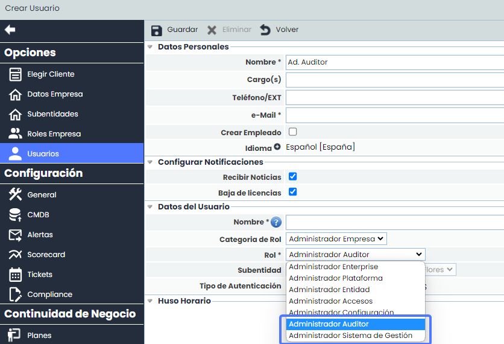
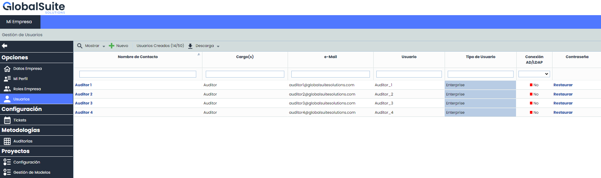
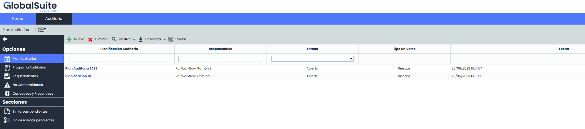
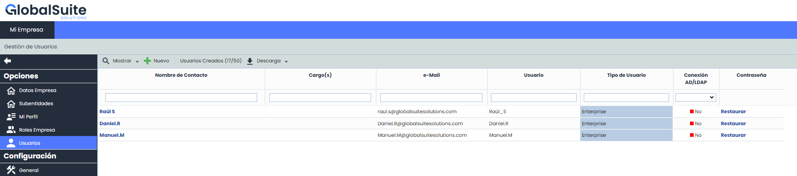

# v6.71 (Julio 2023)

### GlobalSuite® Audit Management

* Se incorporan mejoras en el acceso a las funcionalidades de GlobalSuite para el módulo de Audit, las cuales brindan la capacidad de segregar dicho acceso de manera más específica.

Esta funcionalidad implica permitir un nivel de control y restricción más granular, incluso a nivel de administración, la cual incluye la introducción de dos nuevos Roles de usuarios Administradores, para garantizar que el área de Audit pueda operar de manera aislada e independiente del resto, al mismo tiempo que se integra con otras áreas como la de Riesgos.

* **Nuevos Roles**

A partir de ahora se podrán crear desde Administración. usuarios con dos nuevos Roles: Ad. Auditor y Ad. Sistema de Gestión.

* * **Ad. Auditor**: tiene privilegios y acceso exclusivo a las funcionalidades relacionadas con la auditoría y podrá crear usuarios empresa con acceso únicamente a dichas funcionalidades.

    * Sólo podrá crear y gestionar usuarios con acceso únicamente a Auditoría.
    * No podrá visualizar los usuarios con acceso al resto de opciones.

* * * Solo tendrá acceso a las funcionalidades del módulo de Audit.
    * No puede acceder ni administrar funcionalidades fuera del ámbito de Auditoría.

* * **Ad. Sistema de Gestión**: se encarga de administrar las funcionalidades generales del sistema de gestión, pero no tendrá acceso directo a las funcionalidades específicas de la auditoría.

    * Podrá crear y gestionar usuarios con acceso a todas las opciones, excepto a las que correspondan a Auditoría.
    * No podrá visualizar los usuarios con acceso a Auditoría.
    * No puede acceder ni administrar funcionalidades dentro del ámbito de Auditoría.

* ***Actualización de plataformas: Cambio a VMware como estándar para nuevas instalaciones on-premises***

*Te informamos que, con la liberación de las versiones X.Y.Z de GlobalSuite y A.B.C del Canal de Comunicaciones, discontinuamos el soporte y asistencia técnica al despliegue de nueva infraestructura on-premises basada en entornos de virtualización Microsoft Hyper-V.*

*Tomamos esta decisión ya que los appliances de virtualización abierta que contienen las nuevas versiones de nuestros productos, no son compatibles con la tecnología de despliegue del software hipervisor de Microsoft.*

*En su lugar, VMware se convierte en la única plataforma y estándar de operación soportados para nuevas instalaciones on-prem.*

* Mejoras internas y resolución de errores.
