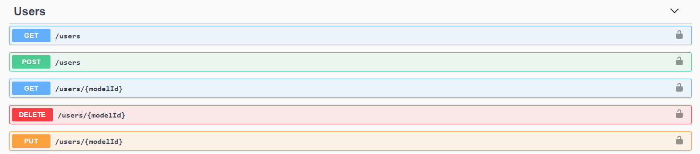
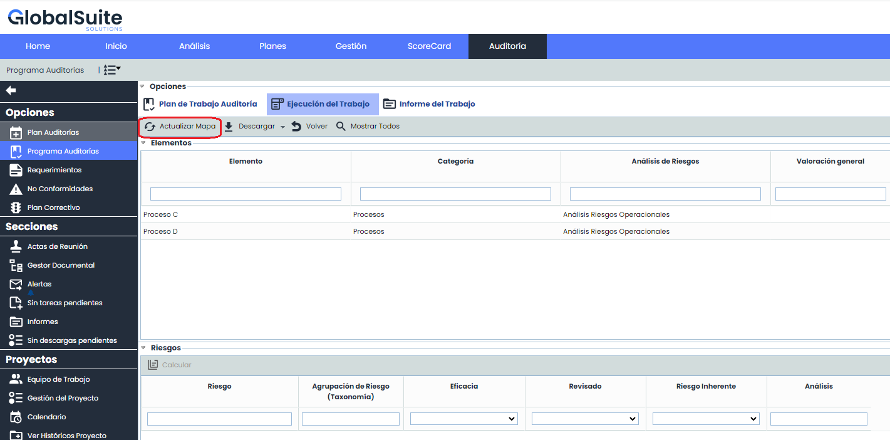

# v6.72 (Julio 2023)

### Nuevas funcionalidades y mejoras generales de GlobalSuite® GRC

- **API de Integración con Usuarios**: En esta versión del producto hemos incorporado capacidades para interactuar con los [Usuarios](https://help.globalsuite.es/display/GlobalSUITEes/Usuarios), que permite automatizar la gestión de los mismos.

* Está disponible la consulta y obtención de usuarios y roles asignados para auditar el control de acceso a la aplicación.
* Es posible crear, modificar y eliminar usuarios, permitiendo actualizar datos personales, activar o desactivar el acceso, o asignar distintos perfiles y privilegios de uso de GlobalSuite®.

Mediante el uso de las APIs, puede integrar GlobalSuite® con el resto de aplicaciones, herramientas o sistemas de su ecosistema corporativo. Por ejemplo:

* Puede automatizar la creación de registros desde otras herramientas.
* Sincronizar información para exportarlos en otra herramienta para su tratamiento.
* Exportar registros para almacenarlos en un repositorio, o lago de datos (EDL).

Puede consultar la API de GlobalSuite® mediante el repositorio de documentación [API GlobalSuite®](https://docs.globalsuitesolutions.com/docs/).

Si quiere comenzar a probar o a utilizar las APIs de GlobalSuite® póngase en contacto con su proveedor.

En próximas versiones iremos incorporando capacidades adicionales para la interacción automática del producto. Si quiere más información sobre las APIs, puede consultarla [aquí](https://help.globalsuite.es/pages/viewpage.action?pageId=52530289).

### GlobalSuite® Audit Management

* **Actualizar Mapa:**

  * En esta versión, para los trabajos de auditoría en ejecución, al pulsar el botón Actualizar Mapa, no solamente incorporará los nuevos elementos, sino que actualizará la información (nombre, categoría) de los elementos previos, en caso de que hayan sido modificados en el Inventario.  
    Esto se suma a la actualización de dimensiones que ya venía realizando la funcionalidad.
  * Si no se pulsa el botón, la información del [Trabajo de Auditoría](https://help.globalsuite.es/pages/viewpage.action?pageId=36177802) en ejecución mantendrá la información original, para conservar los datos auditados en su momento.

**Resumen de nuevas funcionalidades versiones v6.69 a v6.72**

En el siguiente vídeo podrá ver una explicación de las novedades incorporadas en las últimas versiones de GlobalSuite® Audit Management.

- Mejoras internas y resolución de errores.

## Vídeos


Nuevas funcionalidades y mejoras del módulo GlobalSuite® Audit Management..mp4

