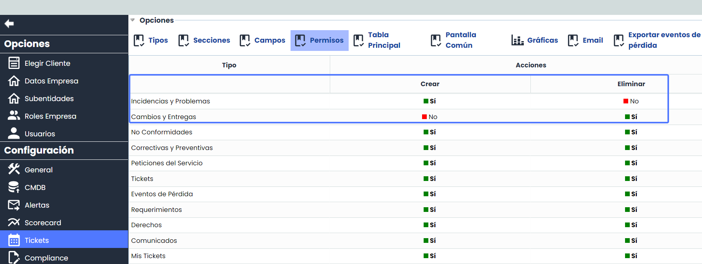
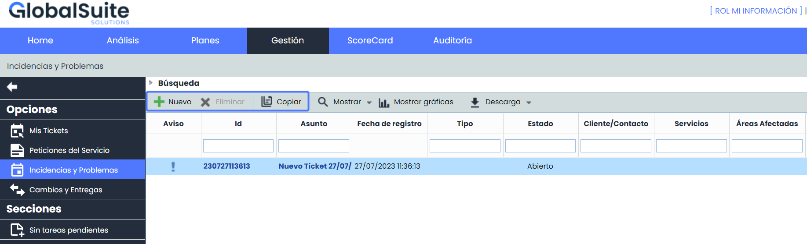
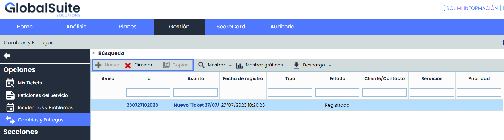

# v6.73 (Julio 2023)

### Nuevas funcionalidades y mejoras generales de GlobalSuite® GRC

* **Módulo de Ticketing**

Gestión de permisos de Tickets: Administración > Configuración > Tickets > nueva opción "Permisos".

Esta funcionalidad mejora la seguridad y la eficiencia del sistema de Ticketing, ya que se podrán gestionar los privilegios de los usuarios con acceso a Mi Información, evitando posibles errores o cambios no deseados los distintos tipos de tickets. Esto brinda un mayor control sobre quiénes pueden crear o eliminar tickets y qué tipo de tickets pueden manipular.

También permite una mayor personalización y adaptación del sistema a las necesidades específicas de cada equipo o empresa, asegurando un flujo de trabajo más fluido y organizado en la gestión de tickets.

* * A partir de ahora será posible configurar y personalizar los permisos de creación y eliminación de Tickets para usuarios con acceso a Mi Información.
  * Estos permisos también tendrán efecto en la creación de los tickets en las tablas de entrada y salida de la herramienta.
  * Esta configuración, podrá realizarse por tipo de Ticket.
  * Los permisos de creación y eliminación serán independientes entre sí.

**Configuración**

**Vista usuario acceso Mi Información**

* **Mejoras internas y resolución de errores.**
